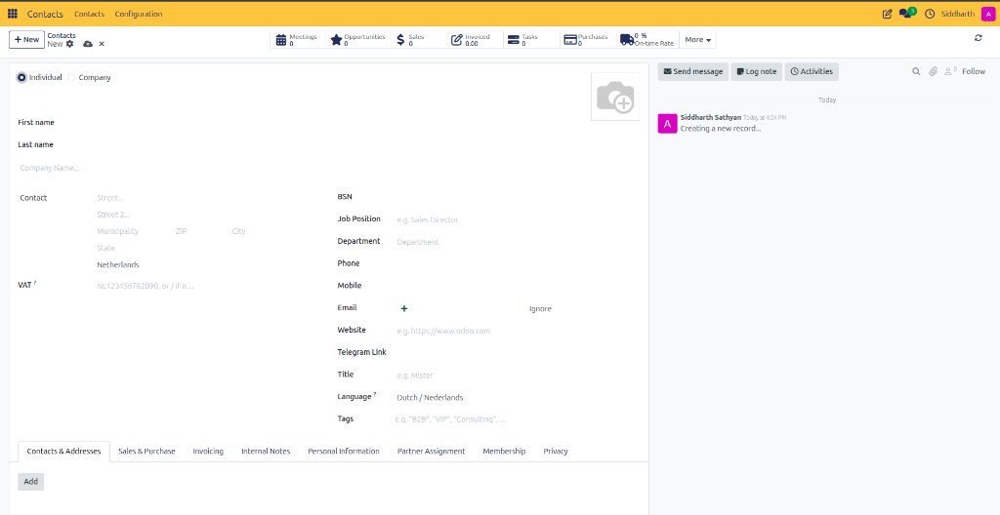
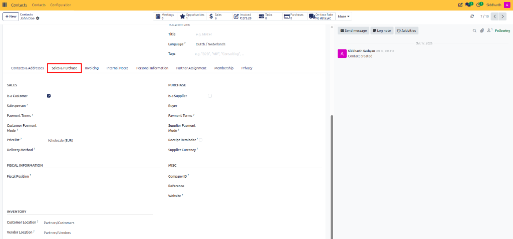
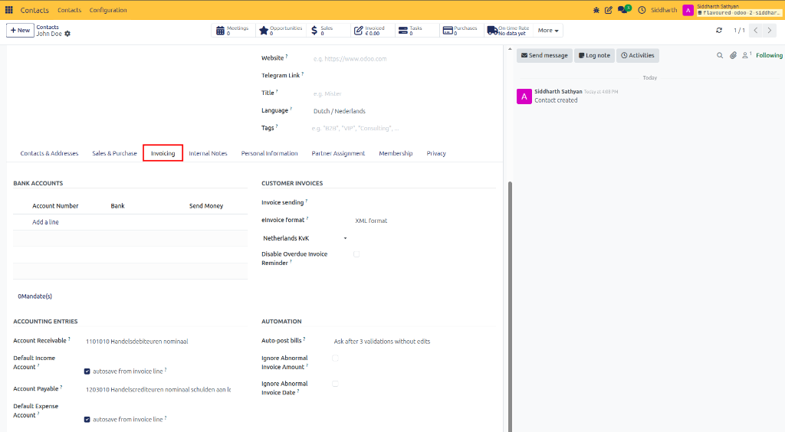
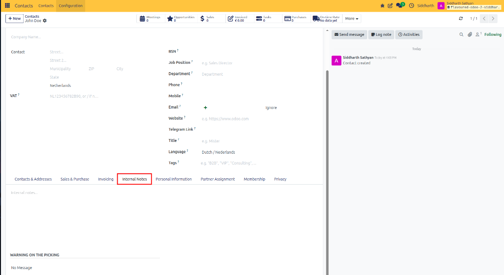
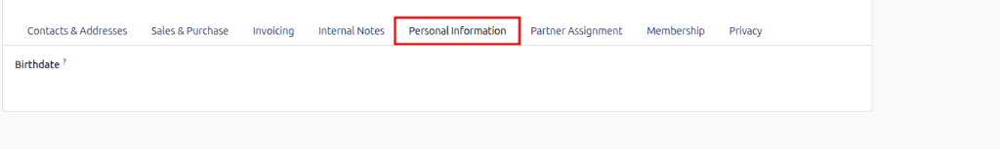
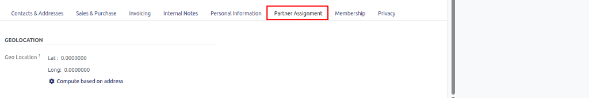
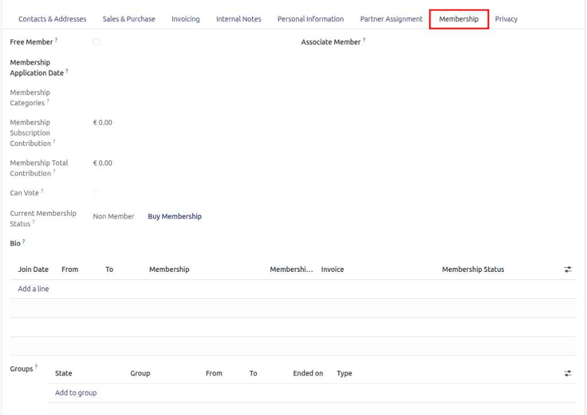
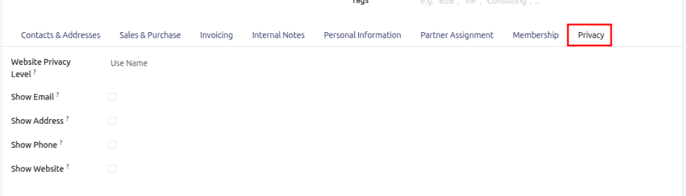

# How-To: Create and Manage Contacts

Create corporate or individual partner profiles, link employees to parent companies, configure dedicated delivery and invoice addresses, and set commercial credit terms and sales order alerts.

---

### Task 1: Create a Company or Individual Contact

1. Navigate to the **Contacts** app from your main dashboard.
2. In the top-left corner, click **New**.

   

3. Choose the contact type:
   * **Individual**: Select for private customers, independent contractors, or specific employees.

     

   * **Company**: Select for corporate organizations, vendors, or institutions.

     

4. Enter the primary details:
   * **Name**: Enter the personal name or legal company name.
   * **Company Name** *(Individual only)*: If the person works for an existing organization, select or type the parent company name. If they are independent, leave this field blank.
   * **Address**: Enter street, city, state, postal code, and country.
   * **Contact Information**: Enter **Phone**, **Mobile**, and **Email**.
   * **Tax ID**: Enter the business VAT, GSTIN, or national tax registration number.

> [!NOTE]
> For descriptions, formats, and allowed values of every field on this form, see [Reference: Header and Identity Fields](../settings-and-fields/01-contact-form-field-definitions.md#header-and-identity-fields).

5. Click the cloud icon at the top of the form (or navigate away) to save.

---

### Task 2: Add Separate Delivery, Invoice, and Sub-Contact Addresses

Large clients and vendors often operate across multiple locations. To ensure invoices and shipments are routed to the correct locations automatically:

1. Open the target company contact record.
2. Select the **Contacts & Addresses** tab and click **Add**.

   

3. In the modal dialog, select the address type:
   * **Contact**: Adds a named employee or representative working at this business.
   * **Invoice Address**: Sets the billing destination for accounting invoices and credit notes.
   * **Delivery Address**: Sets the shipping destination for delivery slips and physical goods.
   * **Other Address**: Adds a subsidiary office, factory site, or secondary location.
4. Enter the location name, direct contact phone, email, and street address.
5. Click **Save & Close** (or **Save & New** to add another location immediately).

> [!NOTE]
> For technical definitions of each address type and EDI GLN rules, see [Reference: Contacts and Addresses Tab](../settings-and-fields/01-contact-form-field-definitions.md#contacts-and-addresses-tab).

> [!TIP]
> When creating a Sales Order or Vendor Bill for this company, CURQ automatically defaults the **Delivery Address** and **Invoice Address** to the destinations configured here.

---

### Task 3: Configure Commercial, Accounting, and Invoicing Settings

#### Assign Sales and Purchase Terms
1. Open the contact record and select the **Sales & Purchase** tab.

   

2. Under the **Sales** column:
   * Verify **Is a Customer** is checked if they purchase goods or services.
   * Select a dedicated internal **Salesperson**.
   * Choose customer **Payment Terms** (such as `Immediate Payment`, `15 Days`, or `30 Days`).
   * Select a **Customer Payment Mode** and default **Pricelist**.
3. Under the **Purchase** column:
   * Select **Is a Supplier** if you procure goods or services from this partner, and assign a responsible **Buyer**.
   * Set supplier **Payment Terms** and **Supplier Payment Mode**.

> [!NOTE]
> For detailed definitions of sales pricelists, fiscal positions, and commercial register IDs, see [Reference: Sales and Purchase Tab](../settings-and-fields/01-contact-form-field-definitions.md#sales-and-purchase-tab).

#### Configure Invoicing and Auto-Post Bill Rules
1. Select the **Invoicing** tab on the contact form.

   

2. Under **Accounting Entries**:
   * Verify the **Account Receivable** and **Account Payable** default general ledger accounts.
   * Select a specialized **Fiscal Position** if international tax mapping or domestic tax exemption applies.
3. Under **Automated Processing**:
   * Set **Auto-post bills** to govern how incoming vendor bills from this partner are handled:
     * **Always**: Automatically validates and posts bills as soon as they are registered.
     * **Ask after 3 validations without edits**: Prompts to automate bill posting after three consecutive bills without manual modifications.
     * **Never**: Mandates manual confirmation for every bill received from this supplier.

#### Configure Internal Notes and Operational Alerts
To alert your sales team about special handling or block bad debtors:
1. Select the **Internal Notes** tab.

   

2. In the notes area, enter internal reminders or background information.
3. Under the **Warning on the Sales Order** or **Warning on the Picking** dropdown, select an action:
   * **No Message**: Standard operation without alerts.
   * **Warning**: Displays an informational popup reminder to the operator when this partner is selected, but permits them to proceed.
   * **Blocking Message**: Displays an error popup and completely halts transaction creation for this partner.
4. In the text area below, type the exact message the user should see.
5. Save the contact.

> [!NOTE]
> For behavioral rules and popup dialog specifications of alert levels, see [Reference: Internal Notes and Warnings Tab](../settings-and-fields/01-contact-form-field-definitions.md#internal-notes-and-warnings-tab).

#### Configure Personal Information, Geolocation, Membership, and Privacy (Optional)
Depending on your operational requirements, configure secondary partner profile tabs:

1. **Personal Information** *(Individual contacts)*:
   * Select the **Personal Information** tab to record private demographic details such as **Birthdate**.

   

2. **Partner Assignment & Geolocation**:
   * Select the **Partner Assignment** tab.
   * Click **Compute based on address** to calculate precise GPS latitude and longitude coordinates for delivery dispatch and map routing.

   

3. **Membership Subscriptions**:
   * For organizations, associations, or clubs, select the **Membership** tab to track member status, record join dates, and manage subscription contributions or free member voting privileges.

   

4. **Website Privacy Settings**:
   * Select the **Privacy** tab to govern how contact information is exposed on public websites or community portals (e.g., selecting **Website Privacy Level** and toggling public disclosure for email, address, phone, or website).

   

---

### Edge Cases & Recovery Steps

* **Contact Linked to the Wrong Company**: Open the individual's record, click the **Company Name** field, click the **X** to remove the link, and select or type the correct company.
* **Employee Address Differs from Company**: By default, linked contacts inherit their parent company's address. To set a private home or branch address, open the employee record, edit the address fields directly, and save.
* **Deleted Address Recovery**: If an address line was accidentally removed, check the chatter audit log at the bottom right of the record or restore from the **Archived** filter if deactivated.

---

## Related Documentation

* [Getting Started: Overview & Create Your First Contact](../getting-started/01-create-your-first-contact.md)
* [How-To: Search, Filter, and Group Contacts](./02-search-filter-and-group-contacts.md)
* [How-To: Register and Authorize Partner Bank Accounts](./08-manage-partner-bank-accounts.md)
* [Reference: Contact Form Field Definitions](../settings-and-fields/01-contact-form-field-definitions.md)
