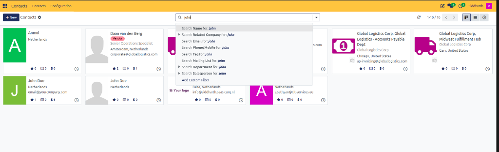
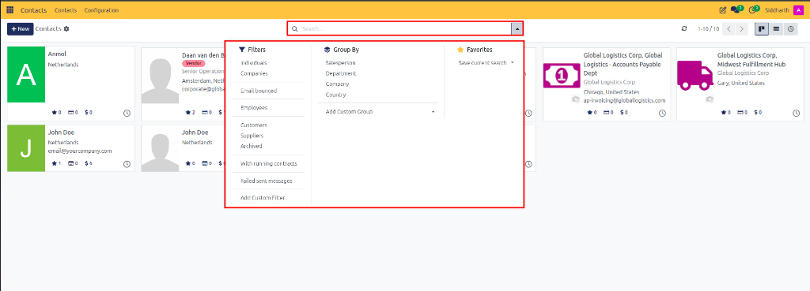
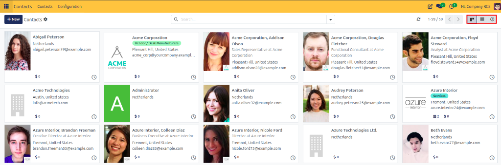

# Task Guide: Search, Filter, and Group Contacts

Search across partner details, apply built-in and custom multi-criteria filters, group contacts hierarchically, and save custom search views for quick access.

---

### Task 1: Search Across Contact Records

1. Open the **Contacts** app.
2. Click into the search bar at the top center of the screen.
3. Type your query. CURQ dynamically searches across:
   * **Name**: Individual personal names and business titles.
   * **Related Company**: Associated parent organizations.
   * **Email**: Contact email addresses.
   * **Phone / Mobile**: Direct telephone numbers.
   * **Tag**: Assigned classification badges.
   * **Mailing List**: Associated marketing mailing lists.
   * **Department**: Internal or partner business unit.
   * **Salesperson**: The internal user managing the account.
4. Select the specific field match from the search dropdown (for example, `Search Name for: john`), or press **Enter** to search globally across names.

   

---

### Task 2: Apply Filters and Custom Rules

1. Click inside the search bar to reveal the filter dropdown options.
2. Under the **Filters** section, click one or more preset filters:
   * **Individuals**: Shows only personal contacts and linked people.
   * **Companies**: Shows only legal organizations and corporate entities.
   * **Email bounced**: Highlights contacts with delivery failures.
   * **Employees**: Shows internal team members and staff.
   * **Customers**: Filters for client partner records.
   * **Suppliers**: Filters for vendor and supplier records.
   * **Archived**: Displays deactivated records hidden from standard views.
   * **With running contracts**: Shows partners with active contractual engagements.
   * **Failed sent messages**: Identifies partners with outgoing message delivery issues.

   

3. **Add a Custom Filter**:
   * Click **Add Custom Filter** at the bottom of the dropdown.
   * Set your rule (for example, `Country` is equal to `United States` or `City` contains `Austin`).
   * Click **Apply**.

---

### Task 3: Group Contacts Multi-Level

1. In the search dropdown, locate the **Group By** section.
2. Select a primary grouping criterion:
   * **Salesperson**: Organizes records by internal account manager.
   * **Department**: Groups contacts by business unit.
   * **Company**: Groups all employees and branch addresses beneath their parent company.
   * **Country**: Clusters partners by geographic territory.
3. **Add a Custom Grouping**: Click **Add Custom Group** to cluster by any field, such as `Industry` or `Payment Terms`.
4. To apply multi-level grouping, click a second group criterion (for example, Group by **Country**, then by **Company**).

---

### Task 4: Switch Views and Save Search Favorites

#### Switch Directory Views
At the top right of the screen, click the view switcher icons:

* **Kanban Card View**: Displays visual cards with contact photos, badges, and quick smart-button metrics.
* **List View**: Displays records in a dense tabular format for bulk operations and comparison.
* **Activity View**: Displays an agenda grid of scheduled phone calls, meetings, and upcoming follow-ups.

#### Save a Search View as a Favorite
1. Once your desired combination of search keywords, filters, and groupings is active:
2. Click into the search bar dropdown.
3. Under the **Favorites** section, click **Save current search**.
4. Enter a memorable title (such as `US Enterprise Customers`).
5. (Optional) Check **Use by default** to load this view automatically when opening Contacts, or **Share with all users** to make it accessible to your team.
6. Click **Save**.

---

### Edge Cases & Recovery Steps

* **Contact Missing from Directory**: If you cannot locate an existing contact, click the search bar, remove any lingering filter chips, and select **Filters > Archived** to check if the record was deactivated.
* **Too Many Search Results**: Combine multiple filters simultaneously (for example, `Companies` + `Customers` + `Country: Germany`) to narrow down large directories.

---

## Related Documentation

* [Task Guide: Create and Manage Contacts](./01-create-and-manage-contacts.md)
* [Task Guide: Perform Bulk Actions on Contacts](./04-perform-bulk-actions.md)
* [Task Guide: Merge Duplicate Contacts](./03-merge-duplicate-contacts.md)
* [Task Guide: Configure and Assign Contact Tags](./05-configure-contact-tags.md)
