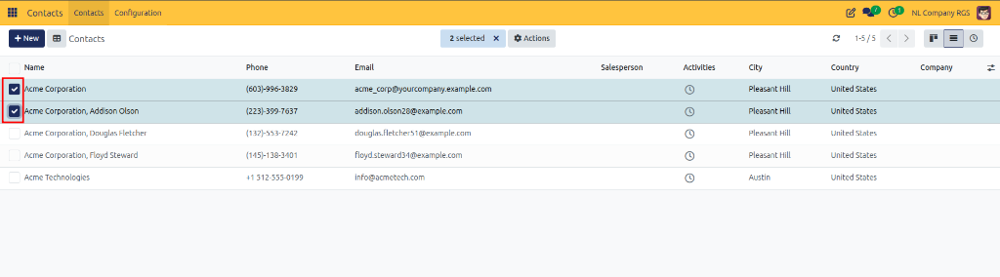
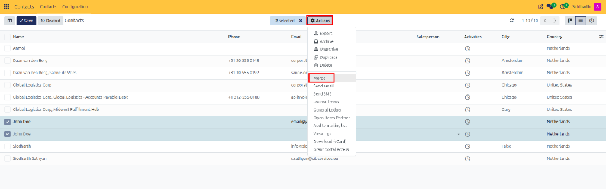
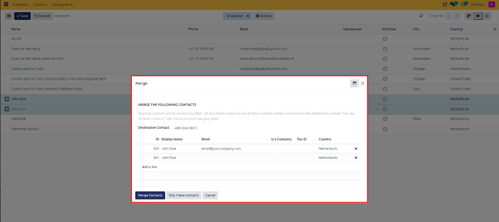

# Task Guide: Merge Duplicate Contacts

Identify and consolidate duplicate contact records into a single master profile, automatically reassigning all sales orders, invoices, stock moves, and communication logs.

---

### Prerequisites
* You must have permissions to modify and delete contact records.
* The records to be merged should represent the same legal entity or individual person.

---

### Step-by-Step Instructions

#### 1. Locate Duplicates in List View
1. Open the **Contacts** app.
2. In the top-right corner, switch to the **List View** icon.
3. In the search bar, search for the contact name, email, or company name to view potential duplicates side by side.
4. Select the checkbox next to each duplicate record you wish to combine.

   

#### 2. Open the Merge Dialog
1. Click the **Actions** dropdown menu (gear icon) located at the top center of the list.
2. Select **Merge**.

   

#### 3. Choose the Destination Master Contact
The **Merge** window displays the selected records and lets you define the surviving profile:

1. In the **Destination Contact** field, select which record will remain as the permanent master profile.
2. Review the list of contacts being merged in the sub-table (verifying `ID`, `Display Name`, `Email`, `Is a Company`, `Tax ID`, and `Country`):
   * To exclude a record selected by mistake, click the **X** (remove) icon on that row.
   * To add another duplicate record, click **Add a line** and search for the contact.
3. Click **Merge Contacts** (or **Cancel** / **Skip these contacts** to abort without altering records).

---

### What Happens During the Merge

When CURQ executes the consolidation:
* All past **Sales Orders**, **Vendor Bills**, **Invoices**, and **Delivery Orders** are reassigned to the Destination Contact.
* All **Chatter messages**, notes, and activities are unified onto the surviving record's timeline.
* Secondary email addresses and phone numbers are preserved on the master profile.
* The redundant duplicate contact cards are permanently removed.

---

### Edge Cases & Recovery Steps

* **Accidentally Merged Wrong Contacts**: Merges are permanent database redirections and cannot be automatically "unmerged" with a single click. If an unintended merge occurs, you must manually create a new contact card and reassign specific transactions or employees from the chatter history. Always verify the Destination Contact carefully before clicking **Merge Contacts**.
* **Merging an Individual with a Company**: Ensure you choose the **Company** as the Destination Contact if the goal is to keep the business entity, or convert the individual into an employee contact beforehand.

---

## Related Documentation

* [Task Guide: Search, Filter, and Group Contacts](./02-search-filter-and-group-contacts.md)
* [Task Guide: Perform Bulk Actions on Contacts](./04-perform-bulk-actions.md)
* [Task Guide: Create and Manage Contacts](./01-create-and-manage-contacts.md)
* [Core Concepts: Understanding Contact Deduplication and Data Integrity](../core-concepts/02-understanding-contact-deduplication-and-data-integrity.md)
