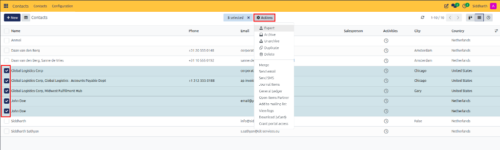

# Perform Bulk Actions on Contacts

Execute batch operations across multiple contacts simultaneously, including data export, archiving, reinstating records, bulk email and SMS messaging, and customer portal invitations.

---

### Accessing the Bulk Actions Menu

1. Open the **Contacts** app.
2. In the top right, switch to the **List View**.
3. Select the checkboxes on the rows of the contacts you want to process (or select the checkbox in the table header to select all visible records).
4. Click the **Actions** gear icon at the top of the table.

---

### Common Bulk Tasks

#### 1. Batch Export to Excel or CSV
1. Select your target contacts.
2. Click **Actions > Export**.
3. Choose the export format (**XLSX** or **CSV**).
4. Select the fields you wish to include, or use a saved export template.
5. Click **Export**.

#### 2. Archive or Unarchive Contacts in Bulk
To clean up inactive leads or expired vendors without deleting past transactions:
* **To Archive**: Select the contacts, click **Actions > Archive**, and confirm. The contacts will disappear from default views.
* **To Unarchive**:
  1. Click into the search bar and select **Filters > Archived**.
  2. Select the records you want to reinstate.
  3. Click **Actions > Unarchive**.

#### 3. Send Bulk Emails or SMS
1. Select the recipients from the list.
2. Click **Actions > Send email** (or **Send SMS**).
3. Select an email template or write a custom message.
4. Click **Send**. Individual messages are queued and sent to each contact's primary address.

#### 4. Grant Customer Portal Access
To allow multiple customers to view their invoices, deliveries, and quotes online:
1. Select the desired customer records.
2. Click **Actions > Grant portal access**.
3. Verify the email addresses in the dialog box.
4. Select the **In Portal** checkbox for each customer and click **Apply**. An email invitation with account setup instructions is dispatched to each contact.

#### 5. Export vCards for Mobile & Outlook
1. Select the contacts.
2. Click **Actions > Download (vCard)**.
3. CURQ downloads standardized `.vcf` files that can be imported directly into mobile address books or email clients.

---

### Edge Cases & Recovery Steps

* **"Cannot delete contact" Error**: If you select **Actions > Delete** and receive a validation error, one or more selected contacts are linked to posted financial transactions (such as validated invoices or journal entries). CURQ blocks deletion to preserve statutory accounting integrity.
  * **Solution**: Use **Actions > Archive** instead. This hides the partner from new lookups while maintaining legal accounting records.
* **Accidental Bulk Archiving**: If you archived contacts by mistake, filter by **Archived**, select the affected records, and click **Actions > Unarchive**.

---

## Related Documentation

* [Search, Filter, and Group Contacts](./02-search-filter-and-group-contacts.md)
* [Configure and Assign Contact Tags](./05-configure-contact-tags.md)
* [Merge Duplicate Contacts](./03-merge-duplicate-contacts.md)
* [Understanding Contact Deduplication and Data Integrity](../core-concepts/02-understanding-contact-deduplication-and-data-integrity.md)
