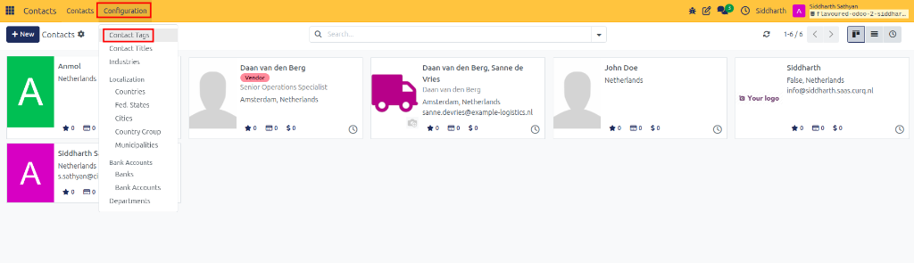
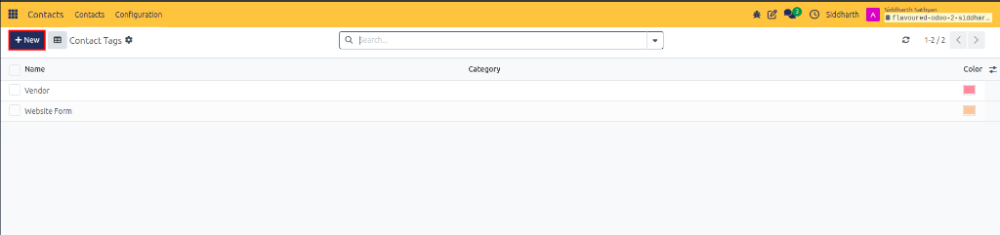
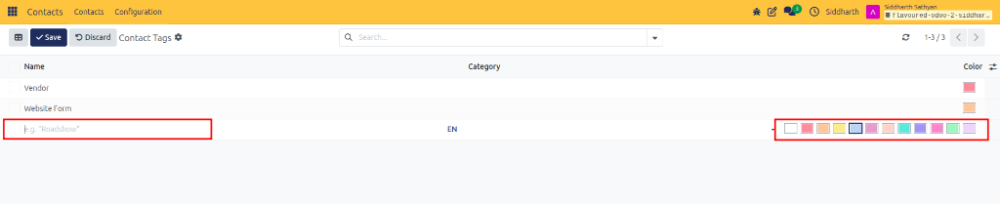
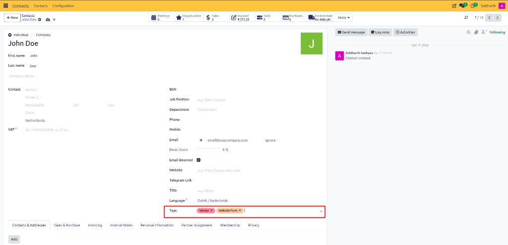

# Configure and Assign Contact Tags

Create color-coded labels, establish nested tag categories, assign badges to partner profiles, and filter contacts by tag across your directory.

> **Prerequisites**
> * Active user account with **Contacts / Administrator** rights.
> * Partner master directory active in the **Contacts** application.
>
> **Warning (Configuration Advisory):** Modifying contact tags requires administrative privileges. Because misconfiguration can lead to operational disruptions or workflow errors, configuration by a user administrator with the assistance of an authorized CURQ advisor or consultant is advised.

---

## 1. Create and Assign Contact Tags

### 1.1 Create a Contact Tag from Configuration

1. Open the **Contacts** app.
2. In the top navigation menu, click **Configuration > Contact Tags**.

   

3. Click **+ New** at the top left of the list (or click into an empty row at the bottom of the table).

   

4. Enter the tag details:
   * **Tag Name**: Type a descriptive label (such as `VIP`, `Wholesale Distributor`, or `Roadshow`).
   * **Category**: (Optional) Select a parent category to create a nested hierarchy (for example, choose `Vendor` to create `Vendor / Office Supplies`).
   * **Color**: Select one of the color swatches from the palette on the right to set the badge color.

   

5. Click **Save** at the top left (or click outside the row) to commit the new tag.

> For complete field definitions and header attributes, see [**Header and Identity Fields**](../settings-and-fields/01-contact-form-field-definitions.md#1-header-and-identity-fields).

---

### 1.2 Create a Tag on the Fly

You can create new tags directly while editing a contact form without navigating away:

1. Open any contact record in **Contacts**.
2. Locate the **Tags** field on the right side of the form.
3. Type the tag name into the field (for example, `Trade Show 2026`).
4. **Search before creating**: When you type into the Tags field, the **Create "[Tag Name]"** option appears quickly in the dropdown. Always scroll to the bottom of the list and select **Search more...** to verify whether an existing tag fits your need before creating a new one. Select **Create** only when you genuinely need a new tag to avoid creating unnecessary or duplicate tags.
5. **Ensure name accuracy**: Enter tag names accurately, as spelling errors or discrepancies will directly affect directory search results and marketing segment filters.
6. **Avoid leading spaces**: Be careful not to enter leading spaces (for example, `" VIP"` instead of `"VIP"`). Even a single extra space before a tag name causes search problems, as CURQ registers it as a distinct tag.
7. Click **Create "[Tag Name]"** once you have verified that the tag is truly new and correctly spelled.
8. Click on the newly created badge to pick a color swatch.

---

### 1.3 Assign Tags to Contacts

1. Open the target contact card.
2. Click into the **Tags** field.

   

3. Select one or more tags from the dropdown list (such as `Vendor` or `Website Form`). If you have many tags, select **Search more...** to locate the exact tag needed.
4. Click the cloud icon at the top left (or navigate away) to save.

> For **Tags** field behavior and data quality guidelines, see [**Communication & Contact Channels**](../settings-and-fields/01-contact-form-field-definitions.md#13-communication--contact-channels).

---

## 2. Filter the Directory by Tag

1. In the main **Contacts** directory, click the search bar.
2. Type the tag name (for example, `VIP`).
3. Select **Search Tag: VIP** from the autocomplete dropdown.
4. Only contacts carrying that badge will be displayed.

> **Warning (Search Accuracy & Tag Duplication):** If contacts carrying a tag do not appear in your search results, verify the tag's exact spelling and formatting on the contact record. An accidental leading space *(e.g., `" VIP"` instead of `"VIP"`)* creates an orphaned, duplicate tag that will not match standard directory queries.

---

## 3. Edge Cases & Recovery Steps

* **Deactivating Outdated Tags**: To prevent employees from selecting retired tags without deleting them from historical records, navigate to **Configuration > Contact Tags**, click into the tag, and switch off the **Active** toggle.
* **Removing a Tag from a Contact**: Click the small **x** on the tag badge directly within the **Tags** field on the contact form, then save.

---

> **Tip (Advised Settings):** Limit global contact tags to high-level commercial categories (e.g., VIP, Prospect, Vendor) and use distinct colors for visual clarity across Kanban views.

---

## Related Documentation

* [Create and Manage Contacts](./01-create-and-manage-contacts.md)
* [Configure and Assign Contact Titles](./06-configure-contact-titles.md)
* [Configure and Assign Industries](./07-configure-industries.md)
* [Search, Filter, and Group Contacts](./02-search-filter-and-group-contacts.md)
* [Contact Form Field Definitions](../settings-and-fields/01-contact-form-field-definitions.md)
