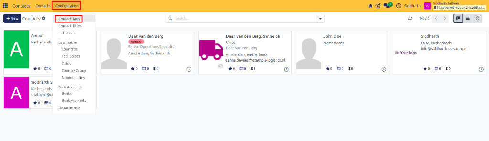
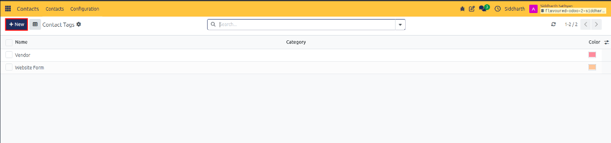
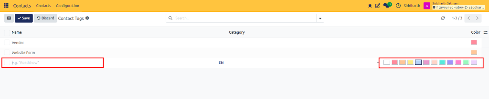
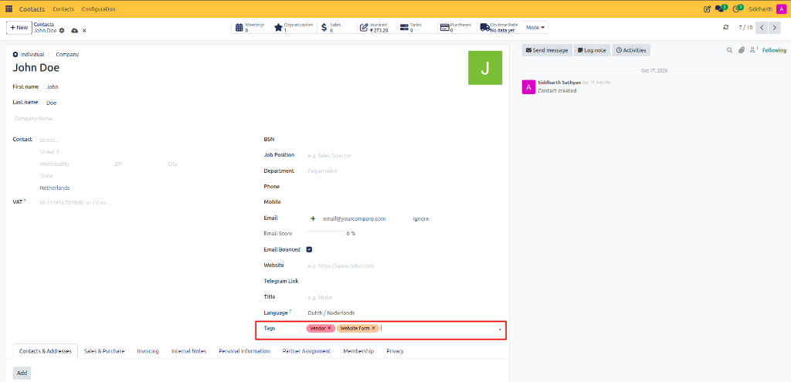

# How-To: Configure and Assign Contact Tags

Create color-coded labels, establish nested tag categories, assign badges to partner profiles, and filter contacts by tag across your directory.

---

### Task 1: Create a Contact Tag from Configuration

1. Open the **Contacts** app.
2. In the top navigation menu, click **Configuration > Contact Tags**.

   

3. Click **+ New** at the top left of the list (or click into an empty row at the bottom of the table).

   

4. Enter the tag details:
   * **Tag Name**: Type a descriptive label (such as `VIP`, `Wholesale Distributor`, or `Roadshow`).
   * **Category**: (Optional) Select a parent category to create a nested hierarchy (for example, choose `Vendor` to create `Vendor / Office Supplies`).
   * **Color**: Select one of the color swatches from the palette on the right to set the badge color.

   

5. Click **Save** at the top left (or click outside the row) to commit the new tag.

---

### Task 2: Create a Tag on the Fly

You can create new tags directly while editing a contact form without navigating away:

1. Open any contact record in **Contacts**.
2. Locate the **Tags** field on the right side of the form.
3. Type the new tag name (for example, `Trade Show 2026`).
4. Click **Create "[Tag Name]"** in the dropdown.
5. Click on the newly created badge to pick a color swatch.

---

### Task 3: Assign Tags to Contacts

1. Open the target contact card.
2. Click into the **Tags** field.

   

3. Select one or more tags from the dropdown list (such as `Vendor` or `Website Form`).
4. Click the cloud icon at the top left (or navigate away) to save.

---

### Task 4: Filter the Directory by Tag

1. In the main **Contacts** directory, click the search bar.
2. Type the tag name (for example, `VIP`).
3. Select **Search Tag: VIP** from the autocomplete dropdown.
4. Only contacts carrying that badge will be displayed.

---

### Edge Cases & Recovery Steps

* **Deactivating Outdated Tags**: To prevent employees from selecting retired tags without deleting them from historical records, navigate to **Configuration > Contact Tags**, click into the tag, and switch off the **Active** toggle.
* **Removing a Tag from a Contact**: Click the small **x** on the tag badge directly within the **Tags** field on the contact form, then save.

---

## Related Documentation

* [How-To: Create and Manage Contacts](./01-create-and-manage-contacts.md)
* [How-To: Configure and Assign Contact Titles](./06-configure-contact-titles.md)
* [How-To: Configure and Assign Industries](./07-configure-industries.md)
* [How-To: Search, Filter, and Group Contacts](./02-search-filter-and-group-contacts.md)
