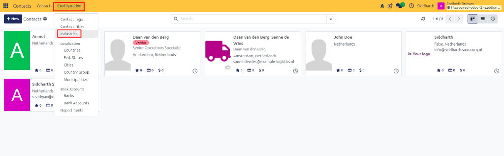
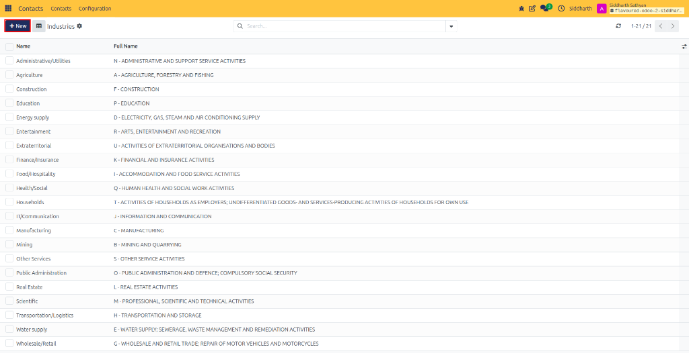
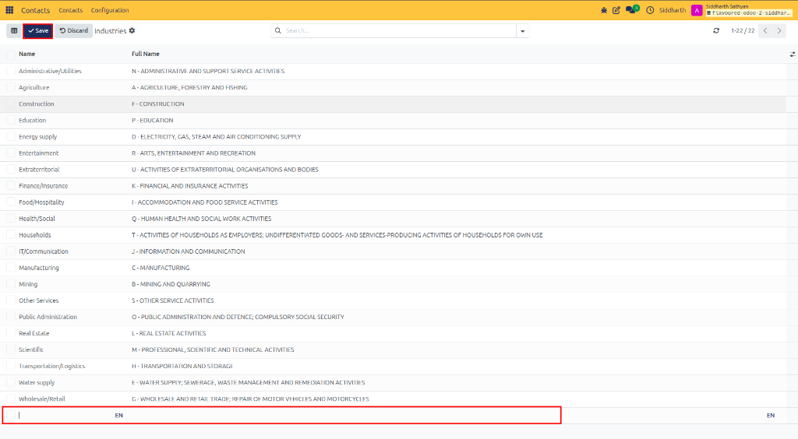
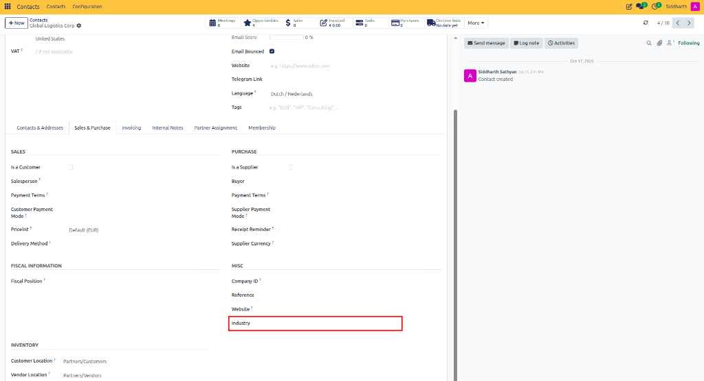

# How-To: Configure and Assign Industries

Configure economic sectors (such as Manufacturing, Retail, or IT/Communication), assign industry classifications to company profiles, and segment partners by sector.

---

### Task 1: Create a Custom Industry Classification

1. Open the **Contacts** app.
2. In the top navigation bar, click **Configuration > Industries**.

   

3. Review the existing classifications (CURQ includes standard NACE/ISIC sectors such as *Manufacturing*, *Construction*, *Agriculture*, *Finance/Insurance*, and *IT/Communication*).
4. Click **+ New** at the top left of the list (or click into an empty row at the bottom).

   

5. Enter the industry details:
   * **Name**: Short industry identifier (for example, `CleanTech` or `Biotech`).
   * **Full Name**: Full sector description (for example, `Clean Energy and Environmental Technologies`).

   

6. Click **Save** at the top left (or click outside the line).

---

### Task 2: Assign an Industry to a Company Profile

1. Open a business contact card in the **Contacts** app (ensure the record type is **Company**).
2. Open the **Sales & Purchase** tab.
3. In the **Misc** section on the right, locate the **Industry** field.

   

4. Select the sector from the dropdown list (for example, `Manufacturing` or `IT/Communication`).
5. Click the cloud icon to save.

---

### Task 3: Filter Companies by Industry

1. In the **Contacts** directory, click the search bar.
2. Click the search dropdown and select **Add Custom Filter**.
3. Configure the rule:
   * Field: **Industry**
   * Operator: **is equal to**
   * Value: Select the sector (for example, `Manufacturing`).
4. Click **Apply**.

---

### Edge Cases & Recovery Steps

* **Industry Field Missing**: The **Industry** field only appears on **Company** records. It is hidden on **Individual** contact cards. To classify an organization, open the parent company record rather than an employee's card.
* **Retiring an Industry Sector**: To stop staff from assigning an outdated sector without breaking historical data, open **Configuration > Industries**, click into the industry form, and toggle off **Active**.

---

## Related Documentation

* [How-To: Configure and Assign Contact Titles](./06-configure-contact-titles.md)
* [How-To: Register and Authorize Partner Bank Accounts](./08-manage-partner-bank-accounts.md)
* [How-To: Configure and Assign Contact Tags](./05-configure-contact-tags.md)
* [How-To: Search, Filter, and Group Contacts](./02-search-filter-and-group-contacts.md)
