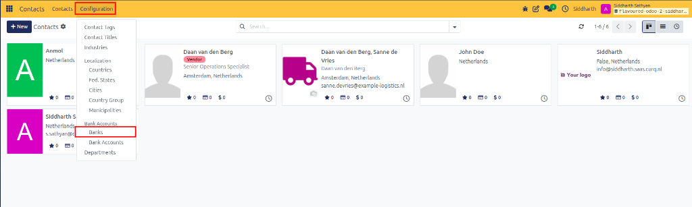
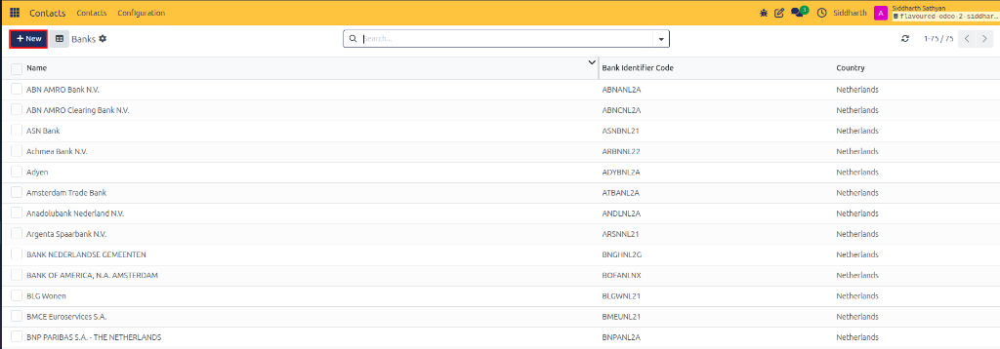
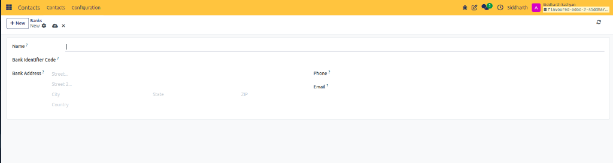
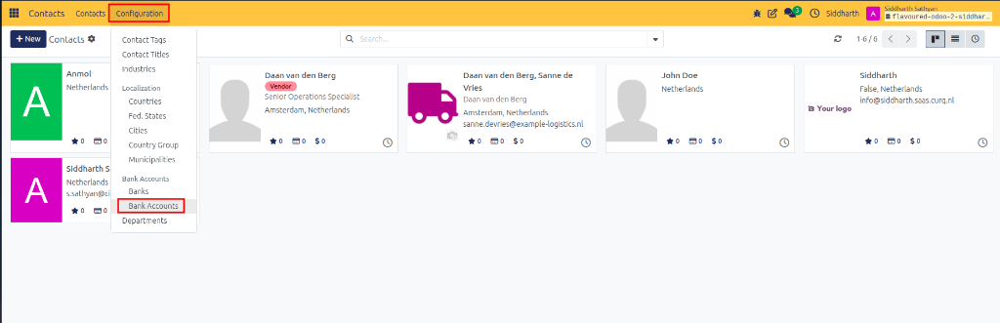
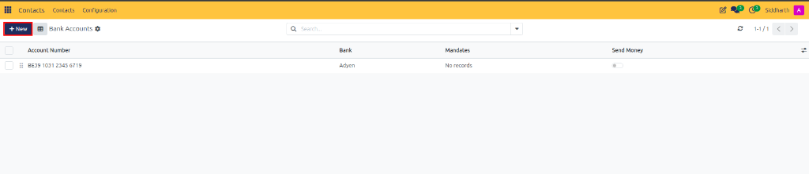
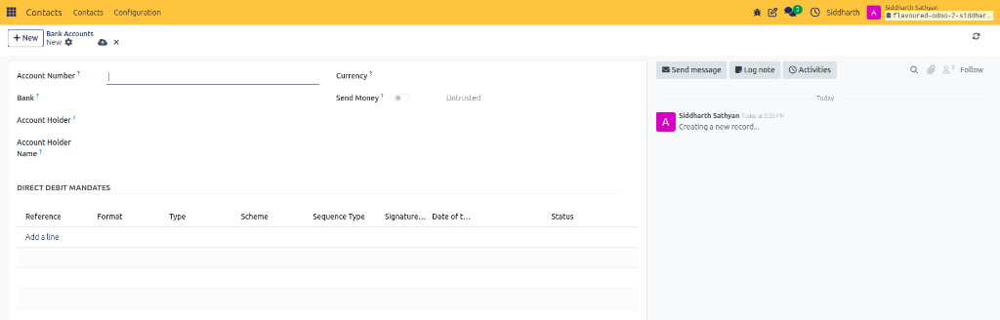

# Register and Authorize Partner Bank Accounts

Register banking institutions, link account numbers to vendor and customer cards, authorize accounts for outgoing electronic payments, and resolve security risk warnings.

---

### Task 1: Register a Bank Institution

Before adding partner accounts, register the banking institution with its official identifier:

1. Open the **Contacts** app.
2. In the top navigation bar, click **Configuration > Banks** (under the **Bank Accounts** heading).

   

3. Review the existing registry.

   

4. Click **+ New** at the top left.
5. Fill in the bank details:

   

   * **Name**: Legal bank name (such as `JPMorgan Chase` or `ABN AMRO Bank N.V.`).
   * **Bank Identifier Code**: BIC / SWIFT code (such as `CHASUS33` or `ABNANL2A`).
   * **Bank Address**: Physical branch address (`Street`, `City`, `State`, `ZIP`, `Country`).
   * **Phone** & **Email**: Branch communication contacts.
6. Click the cloud icon to save.

> [!NOTE]
> For specifications and validation rules of institutional fields, see [Bank Directory Fields](../settings-and-fields/02-bank-account-security-and-fields.md#bank-directory-fields).

---

### Task 2: Add a Bank Account to a Partner Contact

You can attach a bank account directly from the partner's contact form or manage accounts from the centralized registry:

#### Option A: Directly on the Contact Form
1. In **Contacts**, open the vendor or customer card.
2. Select the **Invoicing** tab.
3. In the **Bank Accounts** table, click **Add a line**.
4. Enter the **Account Number** (or IBAN) and select the **Bank** from the registry.
5. Click **Save**.

#### Option B: Centralized Bank Accounts Registry
1. In the top navigation bar, click **Configuration > Bank Accounts**.

   

2. Review the list of all configured partner accounts across the organization.

   

3. Click **+ New** to register an account directly, or click into an existing account to manage its verification status and **Send Money** toggle.

   

> [!NOTE]
> For parameter definitions of routing numbers and account holder reconciliation, see [Partner Bank Account Fields](../settings-and-fields/02-bank-account-security-and-fields.md#partner-bank-account-fields).

---

### Task 3: Authorize and Trust an Account for Outgoing Payments

To prevent payment fraud, all newly added bank accounts start with an **Untrusted** status. Outgoing batch payments (vendor payouts and customer refunds) are blocked until verified:

1. An authorized financial controller contacts the vendor or verifies the official bank confirmation letter.
2. Open the partner's contact form and go to the **Invoicing** tab (or open **Configuration > Bank Accounts**).
3. Click on the bank account record.
4. Turn on the **Send Money** toggle.
5. The status badge updates from **Untrusted** to **Trusted**.
6. Save the record. CURQ now allows outgoing automated wire payments to this account.

> [!NOTE]
> For system trigger conditions and behavior matrices of trust badges and alert banners, see [Security Badges and Risk Levels](../settings-and-fields/02-bank-account-security-and-fields.md#security-badges-and-risk-levels).

---

### Edge Cases & Security Warnings

* **High Risk Warning (Payment Service Provider)**: If CURQ detects that an account number belongs to a money transfer intermediary or virtual wallet rather than an established commercial bank, a **High Risk** banner appears. Perform a phone verification using known company numbers before authorizing the account.
* **Medium Risk Warning (Country Mismatch)**: If a vendor's primary business address is in one country (e.g., France) but the IBAN country code is from another (e.g., Cyprus), CURQ flags a **Country Mismatch** alert. Confirm cross-border invoicing validity with the vendor's finance team.
* **Modifying an Existing Account**: If a vendor requests to change their bank account details via email, treat this as a high-risk event. Create a new bank line and verify via a second channel before enabling **Send Money**.

---

## Related Documentation

* [Create and Manage Contacts](./01-create-and-manage-contacts.md)
* [Configure Geographic Data and Country Groups](./09-configure-geographic-localization.md)
* [Perform Bulk Actions on Contacts](./04-perform-bulk-actions.md)
* [Bank Account Fields and Security Badges](../settings-and-fields/02-bank-account-security-and-fields.md)
