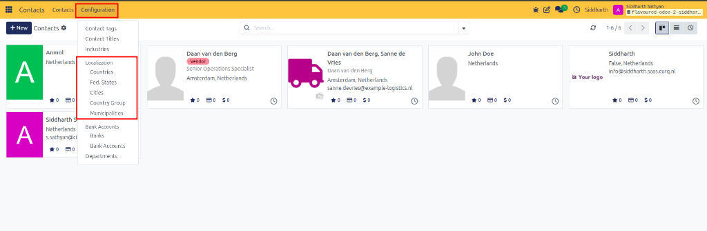
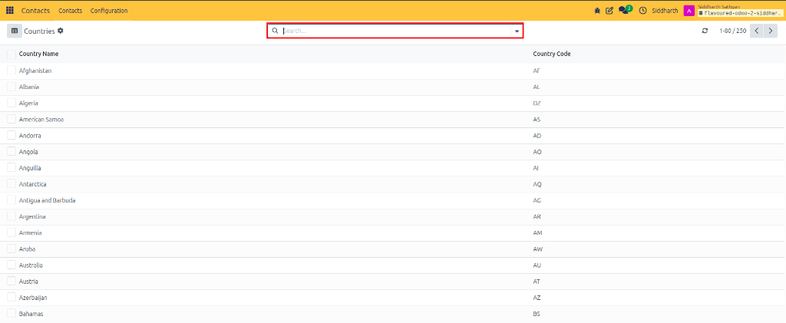
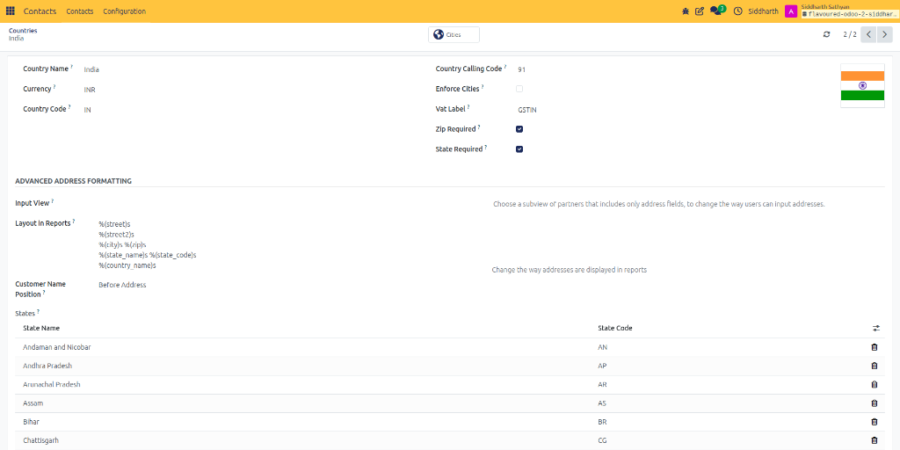
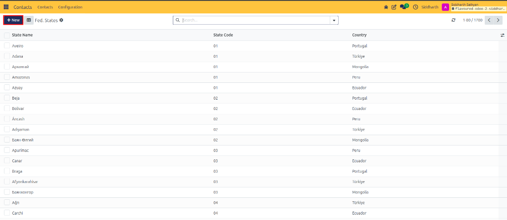
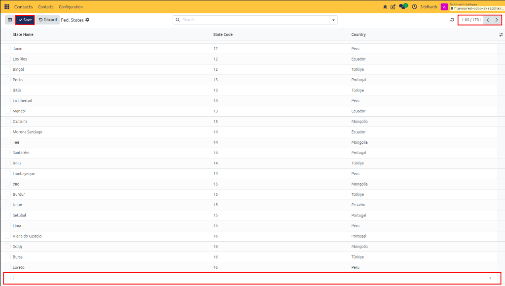
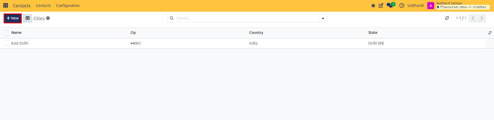
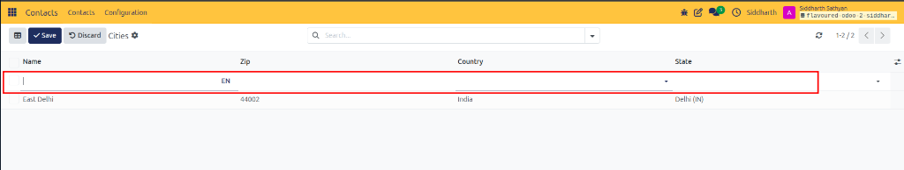
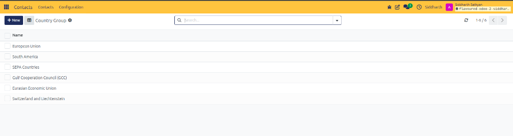
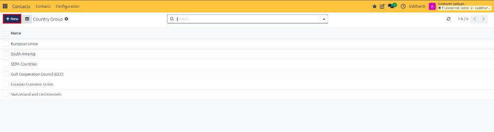
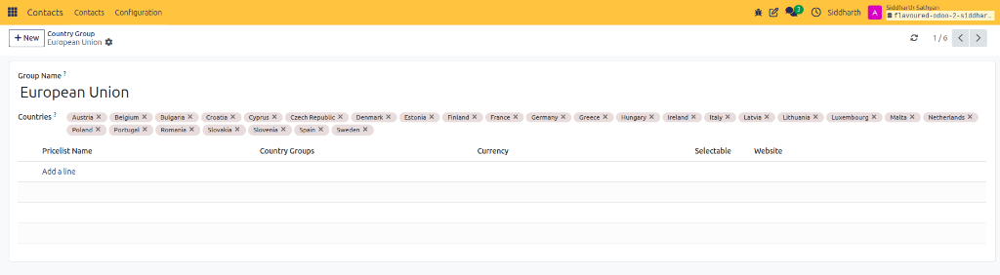

# Task Guide: Configure Geographic Data and Country Groups

Configure country address formatting, add federal states, register cities for automated postal code completion, and build regional country groups for pricelists and tax positions.

---

### Accessing Localization Settings

1. Open the **Contacts** app.
2. In the top navigation bar, click **Configuration**.
3. Under the **Localization** section, select from the directories:
   * **Countries**
   * **Fed. States**
   * **Cities**
   * **Country Group**
   * **Municipalities**

---

### Task 1: Manage Country Formatting and Validation Rules

1. Navigate to **Configuration > Countries**.

   

2. Click on the country you want to modify (such as `India` or `United States`).

   

3. Configure validation and address formatting:
   * **Enforce Cities**: Turn on to require users to pick from verified cities rather than typing free-text.
   * **Zip Required**: Turn on to block saving addresses without postal codes.
   * **State Required**: Turn on to mandate state/province selection.
   * **Vat Label**: Customize the tax identification label (e.g., `GSTIN`, `VAT`, or `EIN`).
   * **Customer Name Position**: Choose where the recipient name appears relative to the street address (`Before Address` or `After Address`).
4. Click the cloud icon to save.

> [!NOTE]
> For ISO schemas, currency bindings, and address formatting toggles, see [Settings and Fields: Country Fields](../settings-and-fields/03-localization-and-country-settings.md#country-fields).

---

### Task 2: Add a Federal State or Province

1. Navigate to **Configuration > Fed. States**.
2. Click **+ New** at the top left (or click into an empty row at the bottom).

   

3. Enter the required information:
   * **State Name**: Full name (such as `Bavaria`, `Ontario`, or `Loreto`).
   * **State Code**: Standard administrative code (such as `BY`, `ON`, or `16`).
   * **Country**: Select the parent nation.

   

4. Click outside the row or click **Save**.

> [!NOTE]
> For administrative subdivision specifications, see [Settings and Fields: Federal State Fields](../settings-and-fields/03-localization-and-country-settings.md#federal-state-fields).

---

### Task 3: Add Cities for Postal Code Auto-Fill

When cities and postal codes are entered into this registry, typing a postal code on any contact form automatically populates the city, state, and country:

1. Navigate to **Configuration > Cities**.
2. Click **+ New** at the top left.

   

3. Fill in the row:
   * **Name**: City or municipality name (such as `East Delhi` or `Austin`).
   * **Zip**: Postal code (such as `44002` or `78701`).
   * **Country**: Select the nation (`India`).
   * **State**: Select the corresponding state (`Delhi (IN)`).

   

4. Click **Save** at the top left (or click outside the line).

> [!NOTE]
> For municipality parameter constraints, see [Settings and Fields: City Fields](../settings-and-fields/03-localization-and-country-settings.md#city-fields).

---

### Task 4: Create a Regional Country Group

Country groups combine multiple nations to apply shared sales pricelists or fiscal tax rules (e.g., *European Union*, *SEPA Countries*, or *Gulf Cooperation Council (GCC)*):

1. Navigate to **Configuration > Country Group**.

   

2. Click **+ New** at the top left.

   

3. In the **Group Name** field, enter a descriptive title (such as `European Union` or `DACH Region`).
4. In the **Countries** field, select the member nations (such as `Austria`, `Belgium`, `Germany`, `Netherlands`).
5. (Optional) In the **Pricelists** section, link specific commercial pricelists that apply across this region.

   

6. Click the cloud icon to save.

> [!NOTE]
> For zone definitions and pricelist scoping rules, see [Settings and Fields: Country Group Fields](../settings-and-fields/03-localization-and-country-settings.md#country-group-fields).

---

### Edge Cases & Recovery Steps

* **ZIP Auto-Fill Not Triggering**: Verify that the city record in **Configuration > Cities** has the exact ZIP code entered and that the **Country** matches the country selected on the contact form.
* **State Dropdown Empty**: Ensure the parent country is selected first on the contact form; CURQ filters the **State** dropdown to only show states linked to that nation.

---

## Related Documentation

* [Task Guide: Register and Authorize Partner Bank Accounts](./08-manage-partner-bank-accounts.md)
* [Task Guide: Create and Manage Contacts](./01-create-and-manage-contacts.md)
* [Getting Started: Set Up an Enterprise Customer with Branch Locations](../getting-started/02-set-up-an-enterprise-customer-with-branch-locations.md)
* [Settings and Fields: Geographic and Localization Settings](../settings-and-fields/03-localization-and-country-settings.md)
