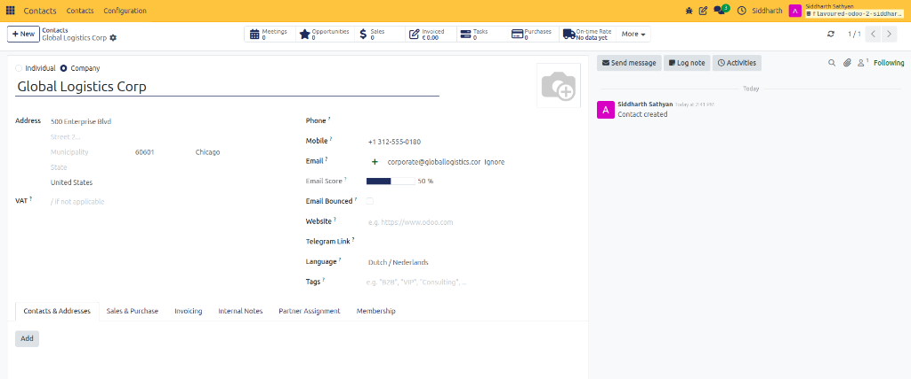
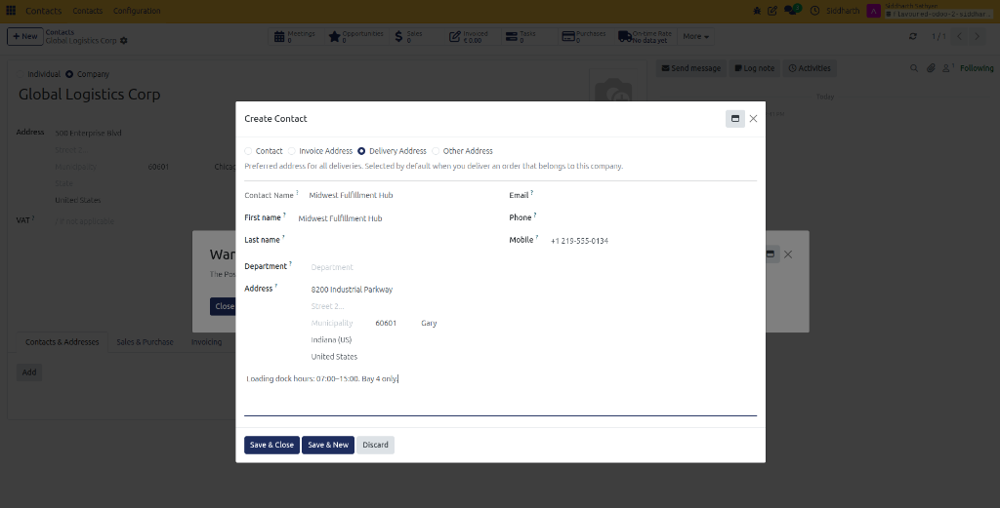
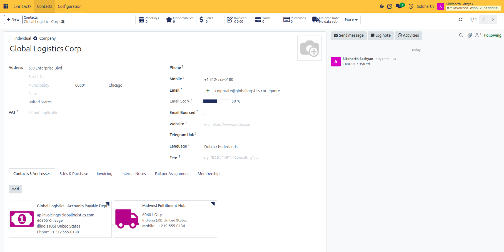

# Getting Started: Set Up an Enterprise Customer with Branch Locations

Welcome to CURQ 18 Contacts. In this tutorial, you will learn how to structure an enterprise customer account operating across multiple commercial sites: establishing a corporate headquarters record, attaching a dedicated shipping warehouse address, and configuring an accounts payable billing address.

By the end of this exercise, you will understand how CURQ routes sales deliveries and accounting invoices to distinct branch facilities automatically.

---

### Prerequisites
* Access to a standard CURQ 18 instance with the **Contacts** app installed.
* Standard default settings. No special multi-company permissions or configuration modules are needed.

---

### Step 1: Create the Main Corporate Headquarters

1. From the main CURQ dashboard, click the **Contacts** app icon.
2. In the top-left corner, click **New**.

   

3. Select the **Company** radio button.
4. Enter the primary corporate headquarters details:
   * **Name**: Type `Global Logistics Corp`.
   * **Address**: Enter `500 Enterprise Blvd, Chicago, IL 60601, United States`.
   * **Mobile**: Enter `+1 312-555-0180`.
   * **Email**: Enter `corporate@globallogistics.com`.
5. Click the cloud icon at the top to save.

   

Your main corporate account record is now established.

---

### Step 2: Add a Dedicated Delivery Warehouse Address

Enterprise customers frequently receive physical shipments at a distribution facility rather than their executive headquarters.

1. On the `Global Logistics Corp` record, select the **Contacts & Addresses** tab.
2. Click **Add**.
3. In the modal dialog, select the **Delivery Address** radio option.
4. Enter the logistics facility coordinates:
   * **Contact Name**: Type `Midwest Fulfillment Hub`.
   * **Address**: Enter `8200 Industrial Parkway, Gary, IN 46402, United States`.
   * **Mobile**: Enter `+1 219-555-0134`.
   * **Internal Notes**: Type `Loading dock hours: 07:00-15:00. Bay 4 only.`

   

5. Click **Save & Close**.

The Midwest Fulfillment Hub now appears with a dedicated **Delivery Address** badge on the parent record.

---

### Step 3: Add an Accounts Payable Invoicing Address

Now, let us configure a separate destination where accounting invoices and billing reminders should be sent:

1. On the **Contacts & Addresses** tab, click **Add** again.
2. In the modal dialog, select the **Invoice Address** radio option.
3. Enter the financial department details:
   * **Contact Name**: Type `Global Logistics - Accounts Payable Dept`.
   * **Address**: Enter `PO Box 1042, Chicago, IL 60690, United States`.
   * **Email**: Enter `ap-invoicing@globallogistics.com`.
   * **Phone**: Enter `+1 312-555-0188`.
4. Click **Save & Close**.

---

### Step 4: Verify Multi-Branch Address Routing

Let us confirm how the parent company card displays its connected operational facilities:

1. Review the **Contacts & Addresses** grid on the `Global Logistics Corp` card.
2. Notice the two distinct sub-cards:
   * **Accounts Payable Dept**: Tagged with the invoice banknote icon.
   * **Midwest Fulfillment Hub**: Tagged with the delivery truck icon.

   

Congratulations! You have successfully configured a multi-branch corporate hierarchy. Whenever your commercial team creates a Sales Order for `Global Logistics Corp`, CURQ automatically routes physical deliveries to the Gary warehouse and accounting invoices to the Chicago AP department.

---

### Next Steps

* To learn how to configure payment terms, credit limits, and sales order warning alerts, see [How-To: Create and Manage Contacts](../how-to/01-create-and-manage-contacts.md).
* To explore all address type technical definitions and EDI GLN rules, see [Reference: Contacts and Addresses Tab](../reference/01-contact-form-field-definitions.md#contacts-and-addresses-tab).
* To understand the relational database architecture powering multi-address hierarchies, see [Explanation: Understanding Unified Partner Architecture and Hierarchies](../explanation/01-understanding-unified-partner-architecture-and-hierarchies.md).
