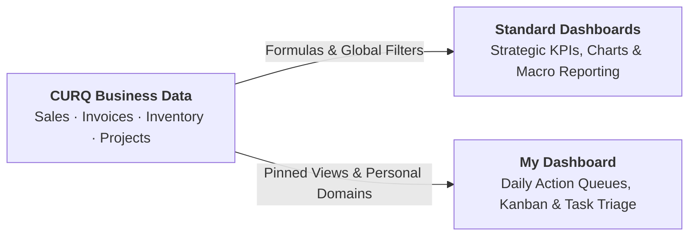

# Understanding Spreadsheet Dashboards vs. My Dashboard

This document explains the architectural principles, underlying data pipelines, and operational paradigms distinguishing CURQ's two dashboard frameworks: **Standard Spreadsheet Dashboards** and **My Dashboard**. Understanding this distinction allows organizations to build effective reporting architectures that balance strategic aggregate analytics with daily tactical execution.

---

## 1. The Dual Operational Challenge: Strategic Visibility vs. Tactical Execution

Modern enterprise management demands two fundamentally different analytical capabilities:

1. **Strategic Aggregated Visibility (The Macro View)**:
   * Executive leadership and department directors need high-level, cross-functional summaries: quarterly revenue pacing, product category profitability, customer acquisition costs, and employee headcount distributions.
   * This view requires mathematical aggregations, historical trend comparisons, period-over-period percentages, and visual charts.

2. **Tactical Operational Execution (The Micro View)**:
   * Individual contributors and frontline team members need immediate visibility into their immediate daily queues: urgent delivery orders scheduled for today, overdue customer invoices needing phone follow-up, or unanswered support tickets assigned to their desk.
   * This view requires interactive list, Kanban, and card views with direct single-click record modification.

Traditional ERP solutions often attempt to force both use cases into a single rigid interface, resulting in either sluggish operational lists cluttered with complex formulas or rigid executive charts that cannot link back to frontline tasks.

CURQ solves this by implementing two specialized dashboard architectures: **Standard Dashboards** for aggregated cross-functional reporting, and **My Dashboard** for personalized operational tracking.

---

## 2. Architectural Comparison

| Architectural Dimension | Standard Dashboards | My Dashboard |
| :--- | :--- | :--- |
| **Primary Framework** | CURQ Spreadsheet Engine. | Action Window Board Engine. |
| **Primary Audience** | Executives, department managers, business analysts. | Individual contributors, operators, team members. |
| **Scope & Privacy** | Organization-wide or department-wide; shared layout across authorized roles. | 100% private per user login; layout and pinned cards visible only to the creator. |
| **Data Engine** | Embedded spreadsheet grid executing dynamic mathematical formulas (`=SUM`, `=AVERAGE`). | Relational database views embedding live action windows. |
| **Filter Mechanics** | Global header filters (Date, Country, Product, Team) that recalculate all connected widgets simultaneously. | Independent per-widget query domains configured at the time of pinning. |
| **Drill-Down Capability** | Clicking a KPI card or chart bar dynamically opens filtered source records. | Embedded records are directly clickable to open full form views. |
| **Creation Mechanism** | Created by System Administrators via **Configuration > Dashboards**. | Self-service; pinned by any user via the view's **Actions / Settings (⚙) > Dashboard** menu. |

---

## 3. How Standard Dashboards Work: The Spreadsheet Architecture

Standard Dashboards are powered by the CURQ Spreadsheet calculation engine. Rather than storing static chart screenshots, standard dashboards store a JSON payload representing a complete multi-tab spreadsheet model.

### 3.1 Embedded Data Queries
Spreadsheets contain specialized formulas (such as `=ODOO.PIVOT(...)` or `=ODOO.FILTER(...)`) that query the relational database. When a user opens a dashboard:
1. The spreadsheet engine evaluates the global filters selected in the top bar (such as `Date = Last 90 Days` and `Country = United States`).
2. These filter parameters are injected dynamically into the spreadsheet's data queries.
3. The formulas recalculate cell values across the grid in real time.
4. Bound SVG charts and Scorecards update immediately to reflect the calculated cells.

### 3.2 Drill-Down Action Routing
Each KPI card and chart series can be configured with an underlying business model and search filter. When an executive clicks on the **Quotations** card:
* The dashboard framework extracts the active global filters.
* It constructs an action window with a combined domain filter.
* The system opens the standard list view for Sales Orders, pre-filtered to the exact records contributing to that KPI.

---

## 4. How My Dashboard Works: The Board Architecture

My Dashboard functions as a modular layout container that aggregates disparate action windows into a responsive multi-column CSS grid.

### 4.1 View Serialization and Embedding
When a view is appended to My Dashboard via **Actions / Settings (⚙) > Dashboard**:
1. CURQ extracts the active view definition: the target view (e.g., Invoices), the view type (e.g., list), and the active search filter criteria.
2. It registers the dashboard widget associated with the user's personal profile.
3. The widget definition is serialized into an XML architecture stored in the user's session profile.

### 4.2 Live Transactional Execution
Unlike spreadsheet dashboards, widgets in My Dashboard do not rely on pre-calculated formulas. Each card executes a live database query matching its saved action window. When an inventory clerk updates a delivery order from their dashboard widget, the changes persist immediately into the database without requiring formula recalculation.

---

## 5. Choosing the Right Framework

Use this operational guideline when deciding where to build or access reports:

* **Choose Standard Dashboards when**:
  * You need to track high-level department KPIs (Revenue, Gross Margin, Burn Rate).
  * Multiple users need to analyze the same dataset with shared comparison benchmarks.
  * You require advanced mathematical modeling, percentage variances, or multi-metric combo charts.
  * You need to filter performance across global dimensions (Timeframe, Country, Sales Team).

* **Choose My Dashboard when**:
  * You need a personal morning triage screen showing tasks assigned directly to you.
  * You want to monitor active operational queues (Overdue Invoices, Deliveries Waiting Availability).
  * You require immediate record editing and status progression without leaving the dashboard page.
  * You want to customize your layout without requiring system administrator intervention.

---

## Related Documentation

* [Explore Standard Dashboards and KPIs](../getting-started/01-explore-standard-dashboards-and-kpis.md)
* [Set Up Your First Custom Dashboard](../getting-started/02-set-up-your-first-custom-dashboard.md)
* [Understanding Dashboard Security and Data Aggregation](./02-understanding-dashboard-security-and-data-aggregation.md)
* [Dashboard Configuration and Group Specifications](../settings-and-fields/01-dashboard-configuration-and-group-specifications.md)
* [Dashboard Chart and Filter Definitions](../settings-and-fields/02-dashboard-chart-and-filter-definitions.md)
