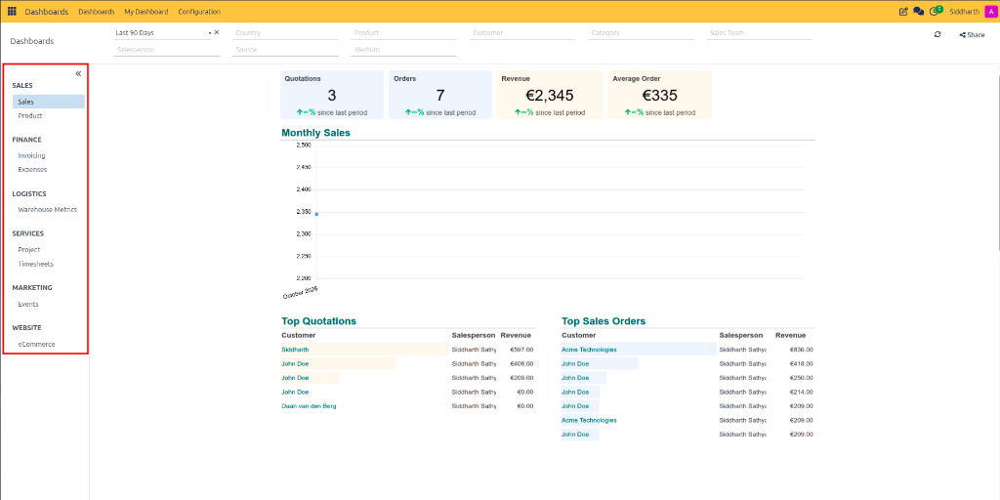
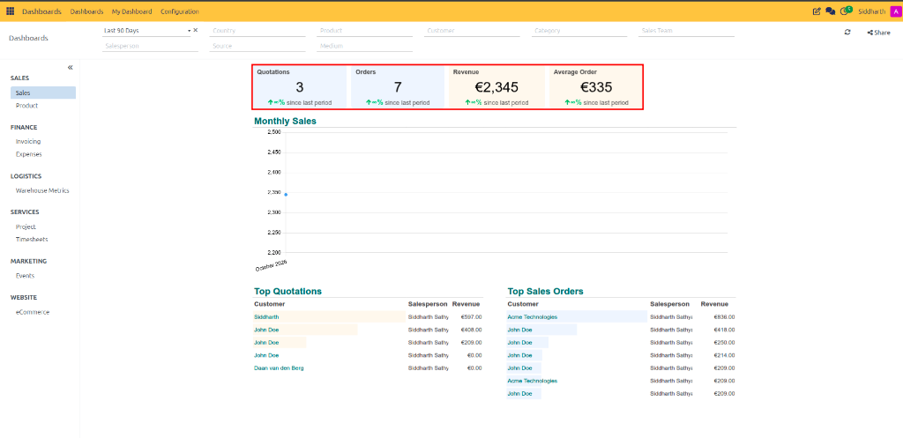
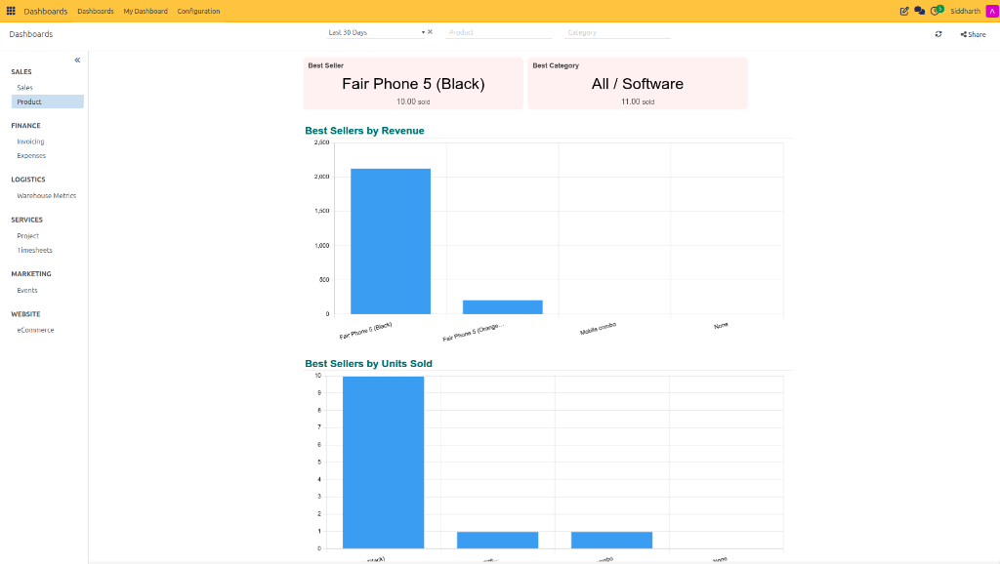
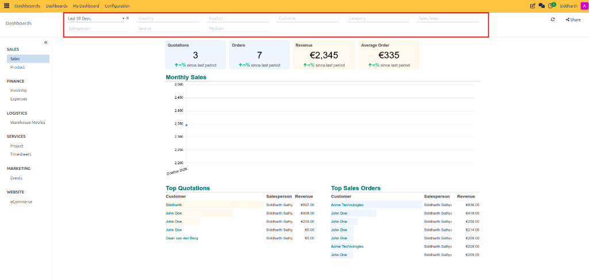
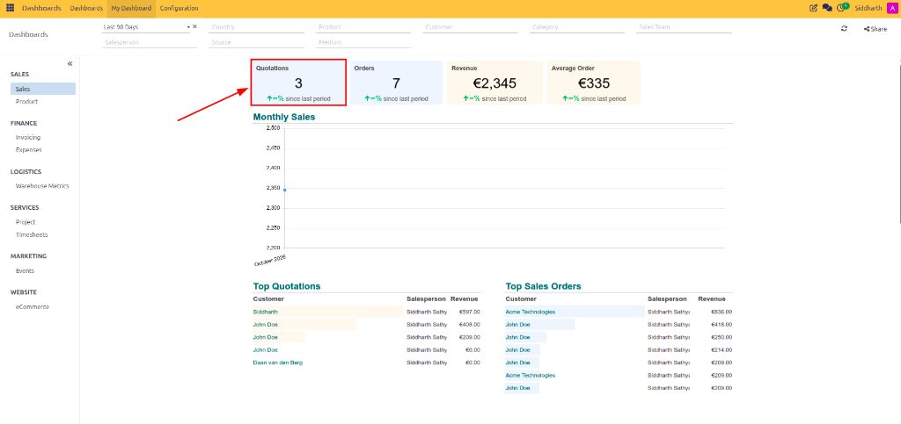
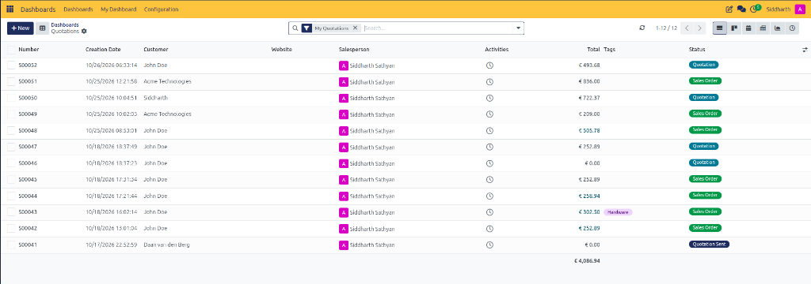

# Explore Standard Dashboards and KPIs

Welcome to CURQ Dashboards. The **Dashboards** application delivers real-time business visibility across your entire organization by consolidating critical metrics, financial performance, and operational health into interactive visual workspaces. Powered by the enterprise `spreadsheet_dashboard` engine, standard dashboards eliminate manual spreadsheet compiling and provide instant insights with live drill-down capabilities.

In this tutorial, you will explore how CURQ organizes enterprise dashboards, understand the KPI hierarchy, and complete a hands-on exercise to navigate dashboards, apply filters, and drill down into transactional records in 5 quick steps.

```{mermaid}
flowchart LR
    A["`**Operational Apps**
    Sales, CRM, Invoicing, Inventory`"] --> B["`**Live Aggregation Engine**
    Pre-calculated KPIs & Trends`"]
    B --> C["`**Standard Dashboards**
    Executive & Department Views`"]
    C --> D["`**Granular Drill-Down**
    Source Orders, Invoices & Tasks`"]
```

> **Prerequisites**
> * Access to a standard CURQ instance with the **Dashboards** app installed (`spreadsheet_dashboard`).
> * Standard user account permissions with access to departmental modules (such as Sales or CRM).

---

## Open the Dashboards Workspace

To access your organization's standard dashboards:

1. Click the main application menu at the top left of CURQ and select **Dashboards**.
2. Review the left navigation sidebar:
   * Dashboards are structured under departmental groups *(such as **Sales**, **Finance**, **Logistics**, **Services**, **Marketing**, and **Website**)*.
3. Click on the dashboard you want to inspect *(for example, click **Sales** under the **Sales** group)*:

   

4. The dashboard canvas immediately loads with live summary cards, monthly sales trends, and top customer tables.

---

## Read Summary KPI Cards and Benchmarks

Each standard dashboard features headline KPI cards at the top of the canvas for an immediate 3-second operational health check:

1. Locate the top summary metric cards *(such as **Quotations**, **Orders**, **Revenue**, and **Average Order**)*:

   

2. Observe the comparison indicators beneath the primary values. These indicators denote percentage changes compared to the preceding timeframe.
3. Note how values refresh dynamically based on confirmed transactions in the system.

---

## Analyze Top Performer KPIs

Beyond aggregate totals, standard dashboards spotlight top-ranking operational segments to help you identify what is driving performance:

1. In the left navigation sidebar under **Sales**, click **Product**.
2. Review the headline performer metric cards:
   * **Best Seller**: Displays the highest-volume product and total units sold *(such as `Fair Phone 5 (Black)`)*.
   * **Best Category**: Highlights the product category generating the greatest sales volume *(such as `All / Software`)*.

   

3. Review the column charts below (*Best Sellers by Revenue* and *Best Sellers by Units Sold*) to evaluate product demand.

---

## Apply Dimensional and Date Range Filters

Standard dashboards feature a global filter bar across the top to focus your analysis on specific periods or segments without modifying underlying reports:

1. Locate the filter controls at the top of the dashboard:

   

2. **Select a Date Range**: Click the timeframe dropdown *(such as **Last 90 Days** or **This Month**)* to adjust the analytical window.
3. **Filter by Dimensions**: Select specific dimensions to narrow the scope:
   * **Country**: Filter metrics by customer geographical territory.
   * **Product & Category**: Isolate figures for an individual product line or category.
   * **Customer**: Focus on a specific client account.
   * **Salesperson & Sales Team**: View performance for a specific team or representative.
   * **Source & Medium**: Track marketing campaign attribution.
4. Watch as all KPI scorecards and graphical charts recalculate immediately.

---

## Drill Down into Source Records

Every metric card and chart element is linked directly to the underlying transactional database:

1. Click directly on any headline KPI card *(for example, click on the **Quotations** card indicated by the red arrow)*:

   

2. CURQ opens the list view of matching quotation records with the active dashboard filters automatically applied:

   

3. Review the individual transactions, update records, or click the **Dashboards** breadcrumb at the top left to return to your dashboard view.

---

## Summary of Achievements

In this tutorial, you learned to:
* Navigate departmental dashboard groups in the left sidebar.
* Interpret headline summary metrics, growth indicators, and top performer cards.
* Apply multi-dimensional date and category filters.
* Drill down from high-level visual KPIs into granular source records.

---

## Related Documentation

* [Set Up Your First Custom Dashboard](./02-set-up-your-first-custom-dashboard.md)
* [Navigate and Filter Standard Dashboards](../task-guides/01-navigate-and-filter-standard-dashboards.md)
* [Dashboard Chart and Filter Definitions](../settings-and-fields/02-dashboard-chart-and-filter-definitions.md)

