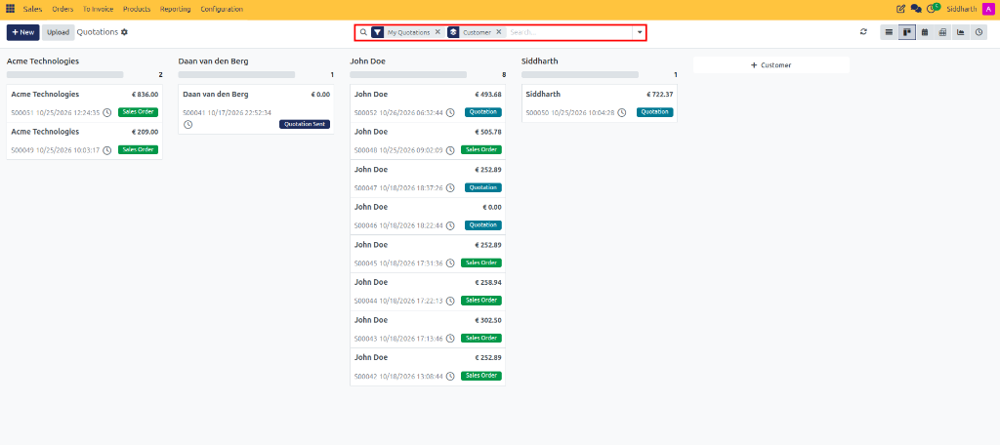
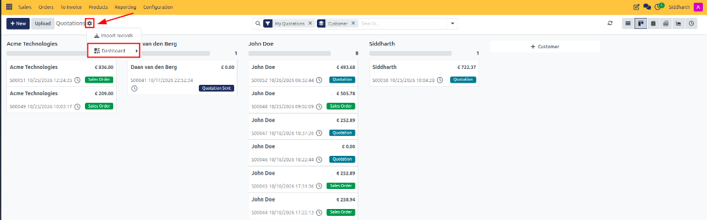
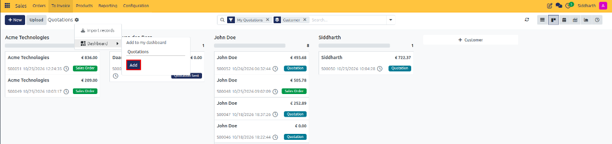
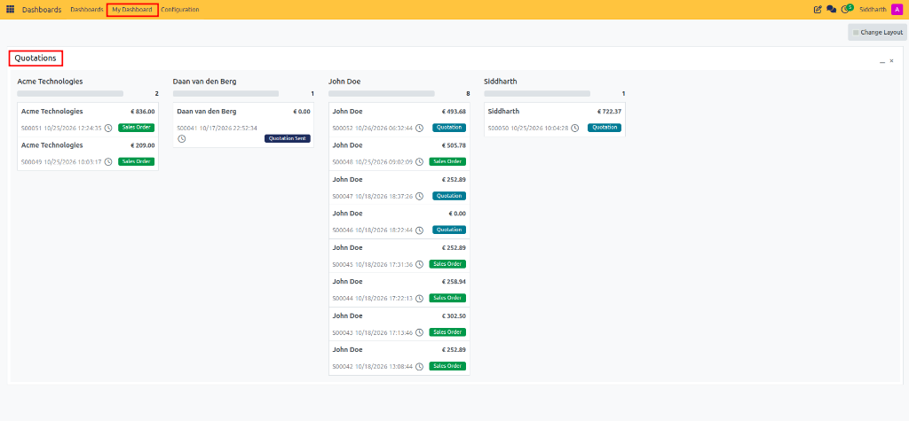
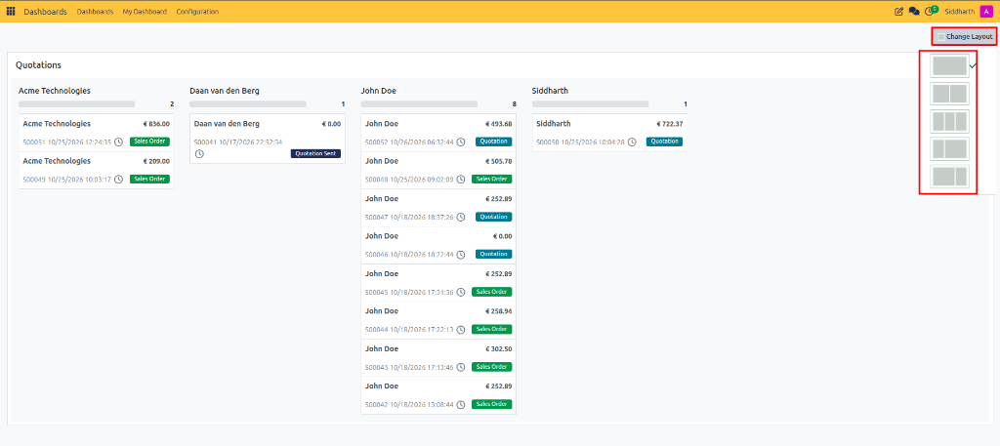
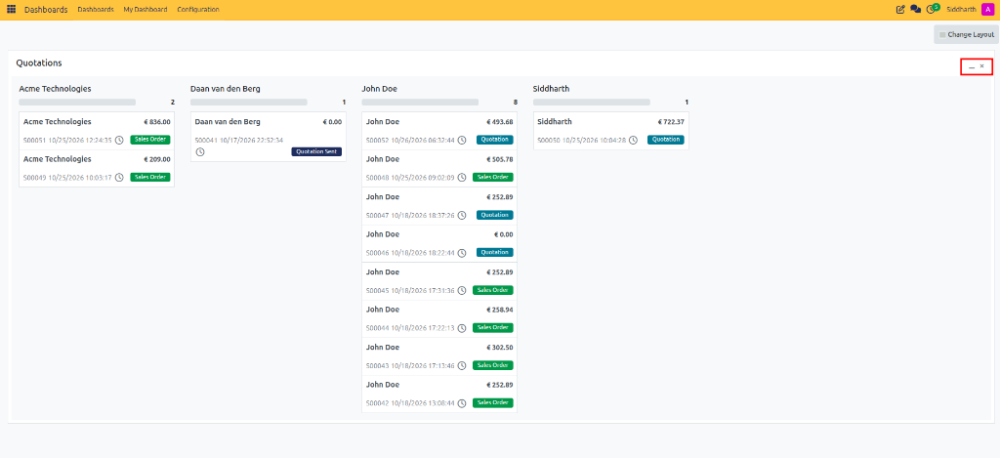
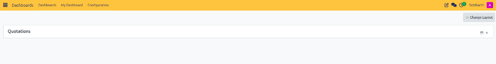

# Set Up Your First Custom Dashboard

While standard dashboards provide company-wide departmental analytics, **My Dashboard** gives every CURQ user a private, fully customizable operational workspace. Powered by the CURQ `board` framework, My Dashboard allows you to assemble personal lists, Kanban cards, graphs, and pivot tables from across the entire business suite into a single, cohesive command center.

In this tutorial, you will learn how to pin business views from across CURQ to your personal dashboard, configure multi-column layouts, and organize responsive widgets to streamline your daily morning routine.

```{mermaid}
flowchart LR
    A["`**Operational Views**
    Sales Orders, CRM Leads, Tasks`"] -->|"Filter & Gear Menu"| B["`**Add to Dashboard**
    Custom Widget Label`"]
    B --> C["`**My Dashboard**
    Private User Cockpit`"]
    C --> D["`**Interactive Controls**
    Reorder, Fold, Column Layout`"]
```

> **Prerequisites**
> * Access to a standard CURQ instance with the **Dashboards** (`spreadsheet_dashboard`) and **My Dashboard** (`board`) modules installed.
> * Standard user account permissions.

---

## Open and Filter a Source View

You can pin almost any List, Kanban, Graph, or Pivot view to My Dashboard. Begin by navigating to a view that you check frequently throughout your workday:

1. Open **Sales > Orders** (or **Sales > Quotations**).
2. Switch to your desired view type *(such as Kanban view)* and use the search bar to apply your desired filters and groupings *(such as filtering by **My Quotations** and grouping by **Customer**)*:

   

3. Make sure the displayed cards and filter criteria reflect exactly what you want to see on your dashboard.

---

## Pin the View to My Dashboard

Once your view is filtered, pin it directly into your personal dashboard workspace:

1. Click the **Actions / Settings gear icon** (`⚙`) located in the control bar next to the view title:
2. Select **Dashboard** from the dropdown menu:

   

3. In the flyout menu under **Add to my dashboard**, enter or confirm the title for your new widget *(for example, `Quotations`)*:

   

4. Click **Add**. CURQ registers the view query and attaches it to your dashboard profile.

---

## Access My Dashboard and Review Pinned Widgets

Now, view your new widget inside the centralized dashboard environment:

1. Open the **Dashboards** application from the main menu.
2. In the navigation bar, click **My Dashboard**.
3. Your newly pinned Kanban view appears immediately as an interactive widget:

   

4. Test clicking on any record card inside the widget. CURQ opens the full form view without navigating away permanently from your dashboard.

---

## Adjust the Column Layout

Customize the layout structure of My Dashboard to fit your display screen:

1. In the top action bar of My Dashboard, click the **Change Layout** button:

   

2. Choose your preferred column arrangement:
   * **1 Column**: Full-width display, ideal for wide data tables and detailed financial lists.
   * **2 Columns**: Balanced split layout, perfect for comparing daily priorities side-by-side.
   * **3 Columns**: Compact multi-column dashboard, suited for high-resolution monitors and operational monitoring.
3. The workspace automatically shifts widgets into the selected column grid.

---

## Reorder, Minimize, and Organize Widgets

Tailor widget positioning and visibility to maintain a clean workspace:

1. **Reorder Widgets**: Click and hold the title bar of any widget, drag it to a different column or vertical position, and release to drop it in place.
2. **Minimize Widgets**: Click the minus (`-`) icon in the top right of the widget header:

   

3. The widget collapses into a compact bar, saving valuable vertical screen space while remaining instantly accessible:

   

4. Click the expand (`+`) icon to reopen the widget when needed.

---

## Summary of Achievements

In this tutorial, you learned to:
* Filter operational views and pin them to your personal workspace using the gear menu.
* Access and navigate **My Dashboard**.
* Switch between 1, 2, and 3 column responsive layouts.
* Drag-and-drop widgets to prioritize critical morning tasks.
* Minimize and fold cards to maximize workspace efficiency.

---

## Related Documentation

* [Explore Standard Dashboards and KPIs](./01-explore-standard-dashboards-and-kpis.md)
* [Create and Manage My Dashboard](../task-guides/02-create-and-manage-my-dashboard.md)
* [Understanding Spreadsheet Dashboards vs. My Dashboard](../core-concepts/01-understanding-spreadsheet-dashboards-vs-my-dashboard.md)

