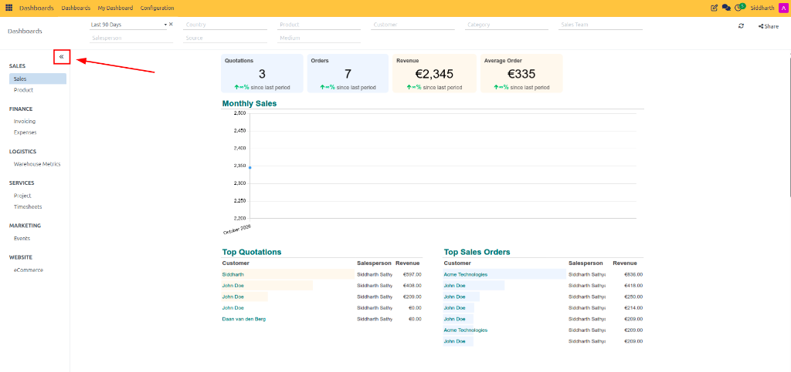
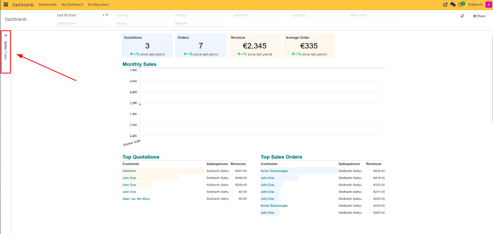
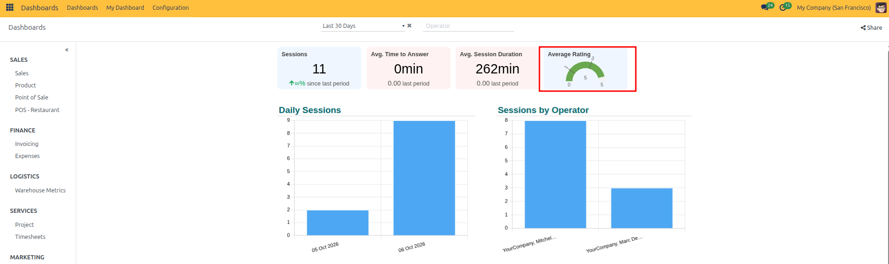
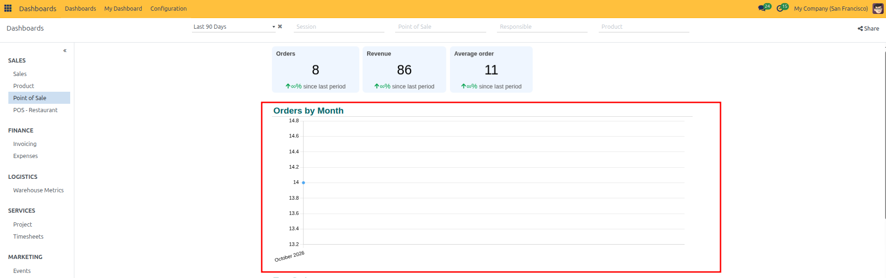
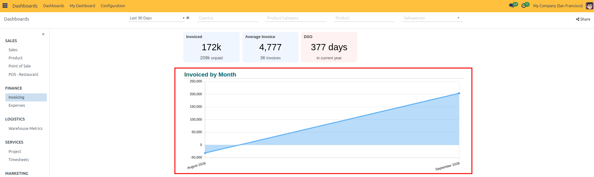
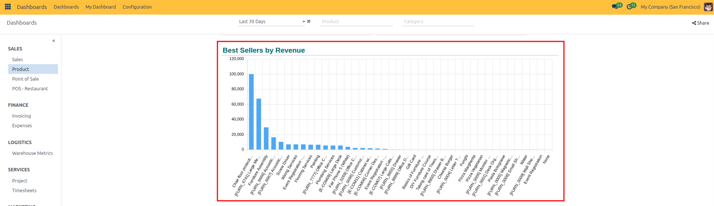
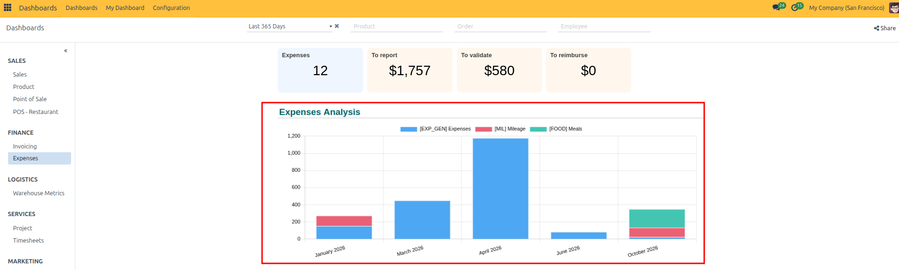
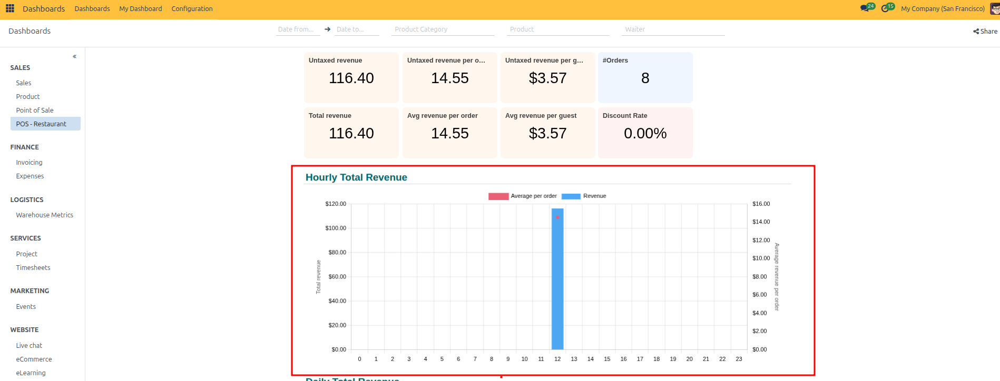
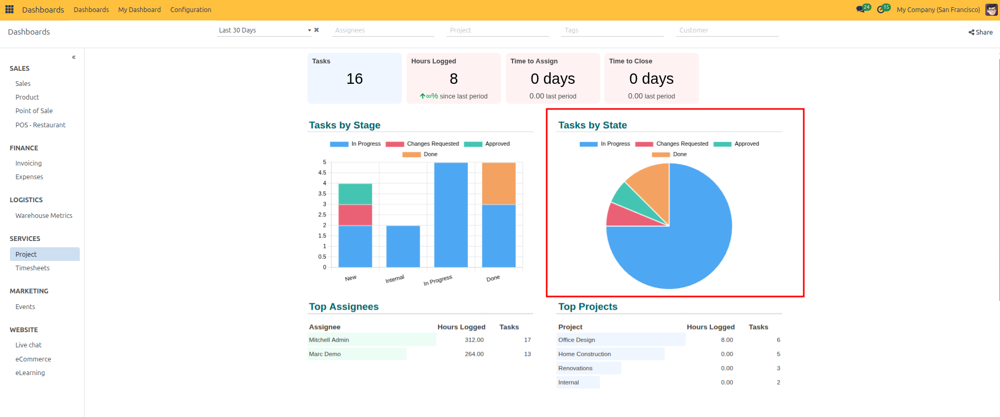

# Navigate and Filter Standard Dashboards

Standard Dashboards provide unified, real-time departmental visibility by aggregating transactional data into intuitive visualizations, scorecards, and operational benchmarks. This guide explains how to open standard dashboards, navigate workspace sidebars, interpret diverse chart types, apply multi-dimensional filters, and drill down into underlying business records.

---

## Access Standard Dashboards and Adjust Workspace Views

Standard dashboards are grouped by functional areas in the left sidebar navigation drawer.

### Select a Dashboard
1. Open the **Dashboards** application from the main navigation menu.
2. In the left sidebar, click on the desired department dashboard category *(such as **Sales**, **Finance**, or **Logistics**)*:

   

3. The central workspace loads with live calculations and charts corresponding to the selected business domain.

### Collapse and Expand the Navigation Sidebar
To maximize canvas space for wide financial tables or complex multi-series charts:
1. Click the collapse double arrow (`«`) icon next to the sidebar header:

   

2. The sidebar collapses into a narrow margin, giving full screen width to your charts and metrics.
3. To reopen the navigation drawer, click the expand icon (`»`) on the far left edge:

   

---

## Interpret KPI Cards and Analytical Chart Formats

Each standard dashboard utilizes specialized visual components tailored to distinct analytical tasks.

### Summary and Benchmark KPI Scorecards
Headline scorecards summarize key financial and operational metrics, displaying the primary figure along with period-over-period percentage variance against the preceding timeframe:

* **Primary Value**: Current metric total for the active timeframe.
* **Variance Indicator**: Green upward arrow or red downward arrow denoting positive or negative movement against the comparison period.

### Top Performer Metric Cards
Top performer cards isolate high-impact items driving business outcomes:

* **Best Seller**: Ranks top products by volume or gross revenue.
* **Best Category**: Highlights top-performing product categories.

### Qualitative Gauges and Ratings
Gauge widgets display scores along a defined radial scale to illustrate benchmark health at a glance *(such as customer satisfaction ratings out of 5 stars)*:

### Plotted Timelines: Line and Area Charts
Timelines visualize historical trends, trajectory pacing, and seasonality:

* **Line Charts**: Track periodic counts or milestones over time *(such as orders per month)*:

  

* **Area Charts**: Emphasize volume under the curve for cumulative measures *(such as monthly invoiced revenue)*:

  

### Categorical Comparisons: Bar and Column Charts
Bar charts compare distinct entities or categories side-by-side:

* Identifies top-performing sales reps, product families, or regional branches.

### Component Breakdowns: Stacked Bar Charts
Stacked charts divide a single aggregate bar into component segments, illustrating both the overall total and each constituent element *(such as monthly expenses broken into mileage, meals, and general operating costs)*:

### Dual-Metric Relationships: Combo Charts
Combo charts plot two metrics sharing a common horizontal axis but utilizing different scales—such as total revenue plotted as vertical bars and average revenue per order plotted as an overlay line:

### Proportional Share: Pie and Donut Charts
Pie charts illustrate how a 100% total distributes across defined operational stages or categories *(such as project tasks divided across In Progress, Blocked, Review, and Done)*:

---

## Apply Dimensional and Date Range Filters

Global dashboard filters allow you to segment and slice dashboard data dynamically without permanently modifying underlying spreadsheets.

### Select a Timeframe Filter
1. Click the date dropdown at the top left of the dashboard canvas.
2. Choose from pre-configured periods:
   * **Last 30 Days** / **Last 90 Days** / **Last 365 Days**
   * **This Month** / **This Quarter** / **This Year**
   * **Custom Date Range**: Select explicit start and end dates.
3. Click the clear (`x`) icon next to the date dropdown to remove the timeframe filter and view all-time data.

### Apply Dimensional Segment Filters
Narrow results by organizational or commercial attributes:
* **Country**: Filter transactions by customer delivery or billing country.
* **Product**: Select one or more specific products.
* **Customer**: Focus on an enterprise account or client group.
* **Sales Team / Salesperson**: Analyze specific regional teams or individual contributors.
* **Campaign Source & Medium**: Evaluate marketing campaign attribution.

All connected scorecards, graphs, and tables recalculate immediately upon selecting or deselecting a filter option.

---

## Drill Down into Underlying Source Records

Every visual card and chart on a standard dashboard connects directly to the underlying transactional database.

1. Click directly on any headline KPI card *(such as **Quotations**)*:

   

2. CURQ opens the list view of matching records, automatically inheriting all active dashboard date and dimension filters:

   

3. Review, edit, or export the matching records.
4. Click the **Dashboards** breadcrumb link in the top bar to return immediately to your dashboard view.

---

## Share Filtered Dashboard Views

To collaborate with colleagues on specific analytical views:
1. Apply your desired date ranges and dimensional filters.
2. Click the **Share** button located in the top right corner of the dashboard toolbar.
3. Copy the generated permalink URL. When colleagues open the link, CURQ renders the dashboard with the exact filter parameters pre-applied.

---

## Related Documentation

* [Explore Standard Dashboards and KPIs](../getting-started/01-explore-standard-dashboards-and-kpis.md)
* [Dashboard Chart and Filter Definitions](../settings-and-fields/02-dashboard-chart-and-filter-definitions.md)
* [Configure Dashboard Groups and Access Rights](./03-configure-dashboard-groups-and-access-rights.md)

