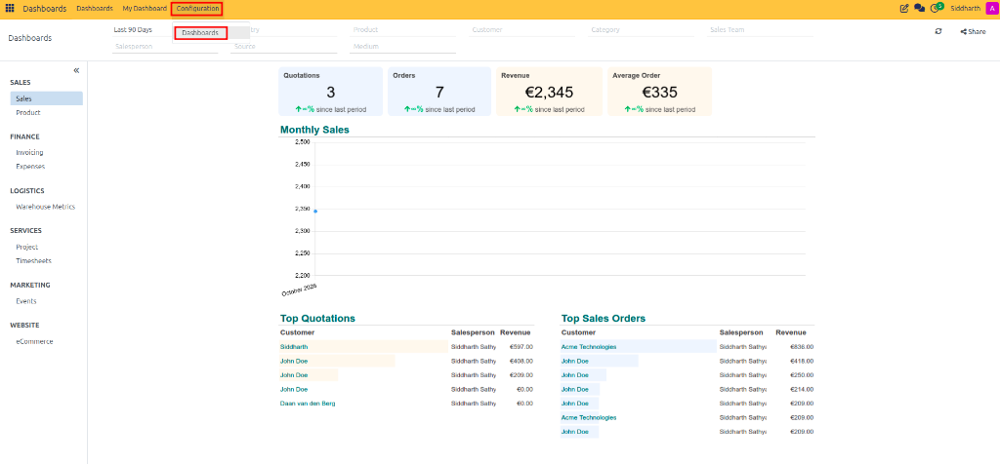
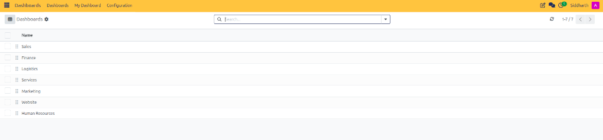

# Configure Dashboard Groups and Access Rights

Dashboard groups act as organizational category containers in the left navigation sidebar of the **Dashboards** application. System administrators can configure groups to organize standard dashboards by functional department, adjust category display sequences, assign granular access rights, and manage multi-company visibility.

---

## Access the Dashboards Configuration Interface

To configure dashboard groups and manage associated spreadsheets:

1. Open the **Dashboards** application from the main navigation menu.
2. In the top navigation bar, click **Configuration**.
3. Select **Dashboards**:

   

4. The **Dashboards** list displays all active category groups *(such as Sales, Finance, Logistics, Services, and Human Resources)* along with their attached spreadsheets.

---

## Reorder Groups in the Sidebar Navigation

The vertical sequence in the Dashboards list view directly dictates the display order of categories in the left navigation drawer:

1. In the **Dashboards > Configuration > Dashboards** list view, locate the drag handle (`⠿`) on the far left edge of each group row.
2. Click and hold the drag handle.
3. Drag the row vertically to the desired sequence position and release:

   

4. The new display sequence saves automatically and updates the sidebar order across all user sessions.

---

## Related Documentation

* [Dashboard Configuration and Group Specifications](../settings-and-fields/01-dashboard-configuration-and-group-specifications.md)
* [Understanding Dashboard Security and Data Aggregation](../core-concepts/02-understanding-dashboard-security-and-data-aggregation.md)
* [Navigate and Filter Standard Dashboards](./01-navigate-and-filter-standard-dashboards.md)

