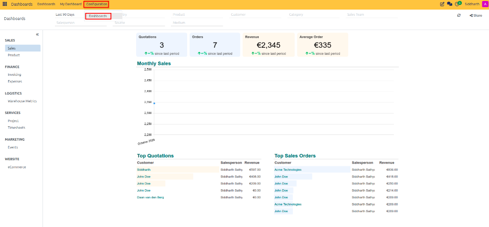
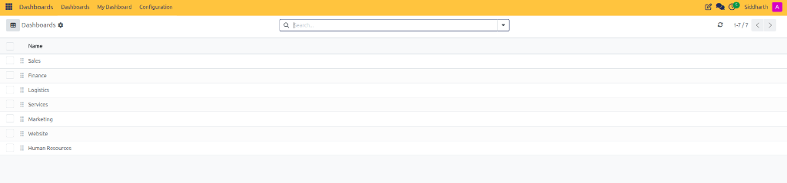

# Configure Dashboard Groups and Access Rights

Dashboard groups act as organizational category containers in the left navigation sidebar of the **Dashboards** application. System administrators can configure groups to organize standard dashboards by functional department, adjust category display sequences, assign granular access rights, and manage multi-company visibility.

> **Prerequisites**
> * Active user account with **Dashboards / Administrator** rights.
> * Underlying business application activity and reporting data available.
>
> **Warning (Configuration Advisory):** Modifying dashboard groups and access rights requires administrative privileges. Because misconfiguration can lead to operational disruptions or workflow errors, configuration by a user administrator with the assistance of an authorized CURQ advisor or consultant is advised.

---

## 1. Access the Dashboards Configuration Interface

To configure dashboard groups and manage associated spreadsheets:

1. Open the **Dashboards** application from the main navigation menu.
2. In the top navigation bar, click **Configuration**.
3. Select **Dashboards**:

   

4. The **Dashboards** list displays all active category groups *(such as Sales, Finance, Logistics, Services, and Human Resources)* showing each group's **Name**, **Sequence**, and attached **Spreadsheets**.

> For complete field definitions of dashboard category containers, see [**Dashboard Group Configuration Fields**](../settings-and-fields/01-dashboard-configuration-and-group-specifications.md#1-dashboard-group-configuration-fields).

---

## 2. Reorder Groups in the Sidebar Navigation

The vertical sequence in the Dashboards list view directly dictates the display order of categories in the left navigation drawer:

1. In the **Dashboards > Configuration > Dashboards** list view, locate the drag handle (`⠿`) on the far left edge of each group row.
2. Click and hold the drag handle.
3. Drag the row vertically to the desired sequence position and release:

   

4. The new display sequence saves automatically and updates the sidebar order across all user sessions.

---

## 3. Configure Spreadsheet Dashboards, Access Groups, and Publishing

Within any dashboard group record, administrators control individual spreadsheet visibility, multi-company scoping, and user access permissions under the **Spreadsheets** tab:

1. Click a dashboard group row from **Dashboards > Configuration > Dashboards** to open its form.
2. Locate the **Spreadsheets** line items and configure the required attributes:
   * **Name**: Define the display title shown in the left navigation sidebar.
   * **Group**: Assign a security group *(such as `Sales / Administrator` or `Accounting / Officer`)* to restrict access. Leave blank only for non-sensitive organization-wide dashboards.
   * **Company**: Assign a specific operating company in multi-company environments so the dashboard renders only when operating within that entity.
   * **Is Published**: Check to make the dashboard visible in user workspaces, or uncheck to keep it hidden while editing.
   * **Active**: Toggle off to archive obsolete dashboards without deleting underlying data.
   * **Data (Spreadsheet JSON)**: Underlying spreadsheet grid formulas, scorecards, and embedded queries.
3. Click the cloud icon (or save) to commit your updated access groups and publishing controls.

> For detailed field behavior and publishing controls, see [**Spreadsheet Dashboard Line Attributes**](../settings-and-fields/01-dashboard-configuration-and-group-specifications.md#2-spreadsheet-dashboard-line-attributes).

---

> **Tip (Advised Settings):** Restrict dashboard group management to administrative roles; grant view-only access to standard user groups to prevent accidental layout alteration.

---

## Related Documentation

* [Dashboard Configuration and Group Specifications](../settings-and-fields/01-dashboard-configuration-and-group-specifications.md)
* [Understanding Dashboard Security and Data Aggregation](../core-concepts/02-understanding-dashboard-security-and-data-aggregation.md)
* [Navigate and Filter Standard Dashboards](./01-navigate-and-filter-standard-dashboards.md)
* [Dashboard Chart and Filter Definitions](../settings-and-fields/02-dashboard-chart-and-filter-definitions.md)
