# Overview & Send Your First Message and Collaborate

Welcome to CURQ Discuss. The **Discuss** application serves as the real-time communications engine and collaboration backbone across the entire enterprise. It connects team members through open discussion channels, private direct chats, instant audio and video meetings, and record-level chatter directly embedded inside every customer quotation, invoice, and project task.

In this tutorial, you will build a clear mental model of how CURQ organizes business communication and complete a hands-on exercise to send your first message, mention a teammate, react with emojis, start a direct message, and triage your inbox in 5 quick steps.

```{mermaid}
flowchart LR
    A["`**Discuss Workspace**
    Channels & Direct Chats`"] <--> B["`**Central Inbox**
    @Mentions & Alerts`"]
    A <--> C["`**Document Chatter**
    Sales, CRM & Invoices`"]
    A <--> D["`**Audio & Video**
    Instant WebRTC Calls`"]
```

---

## Hands-On Exercise: Send Your First Message and Collaborate

## Prerequisites
* Access to a standard CURQ instance with the **Discuss** app installed.
* Standard default user accounts. No special administrative permissions or third-party meeting plugins are required.

---

## Step 1: Open the Discuss Workspace

You can access CURQ Discuss from any screen inside the system:

1. Click the main application menu at the top left and select **Discuss** (or **Chat**).
2. Alternatively, from inside any other app (such as Sales or CRM), click the **Chat bubble** icon in the top-right header to view your recent conversations or expand into the full workspace:

   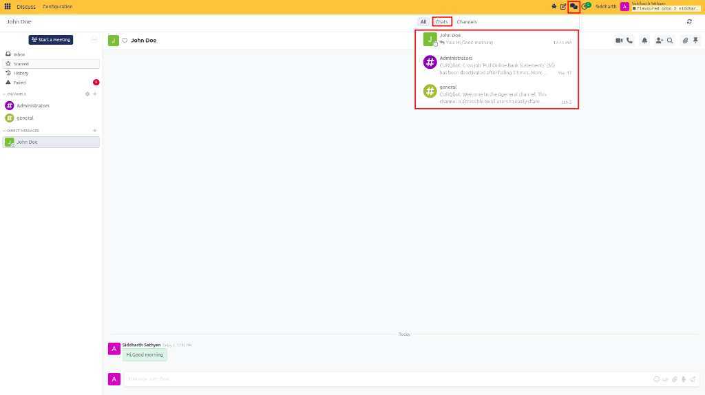

3. In the full Discuss workspace, review the left navigation sidebar:
   * **Inbox**: Central feed for messages where coworkers mention you or updates on documents you follow.
   * **Starred**: Saved messages bookmarked for later follow-up.
   * **History**: Archived notifications you have already read and cleared.
   * **Channels**: Public and private rooms organized by topic or department.
   * **Direct Messages**: One-on-one and private group conversations.

   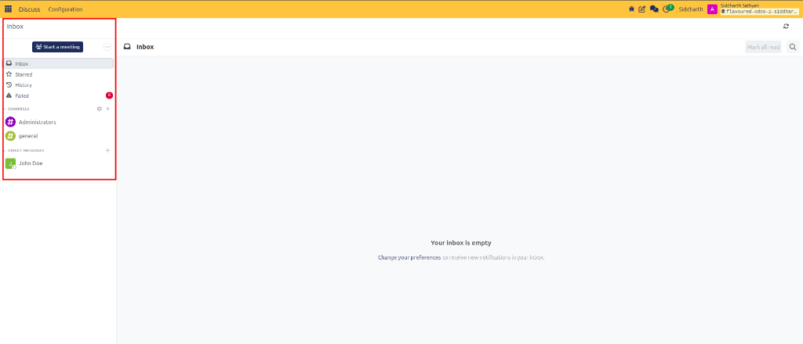

---

## Step 2: Open or Join a Channel

Channels allow teams to discuss specific operational topics without cluttering one-on-one message threads:

1. In the left sidebar, locate the **Channels** section.
2. Click the **+** (plus) icon next to **Channels**.
3. Type a channel name (for example, `operations`). The system automatically prepends the `#` symbol.
4. If the channel already exists in your system, click on it to join. If it is new, click **Create: #operations**:

   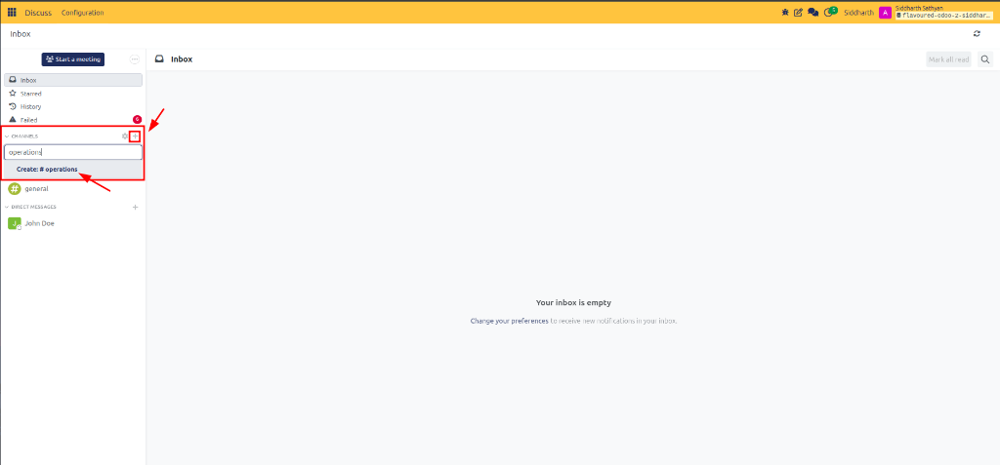

5. The channel opens immediately in the center chat pane:

   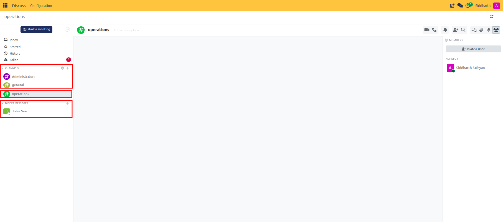

---

## Step 3: Send a Message with an @Mention and an Emoji Reaction

Now let us send your first message and alert a colleague directly:

1. Click in the message composer box at the bottom of the channel window.
2. Type an introductory note, followed by the `@` symbol to mention a teammate (e.g., `@John Doe` or `@Siddharth Sathyan`):

   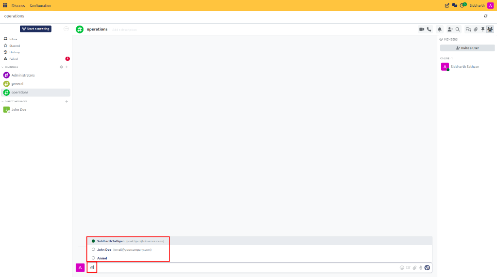

3. Select your coworker's name from the autocomplete dropdown. When you send the message, CURQ sends an immediate alert directly into their **Inbox**.
4. Type your message (e.g., `Hi,Good morning`):
   ```text
   Hi,Good morning
   ```
5. Press **Enter** to publish the message to the channel feed:

   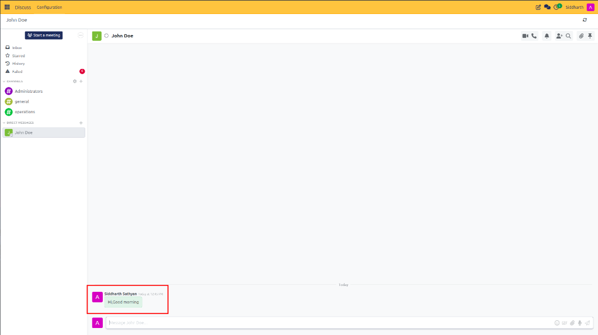

6. Hover your mouse over the sent message bubble to reveal the quick-actions toolbar.
7. Click the **Smiley Face** icon to open the emoji picker, or type a keyword like `sun` in the emoji search box:

   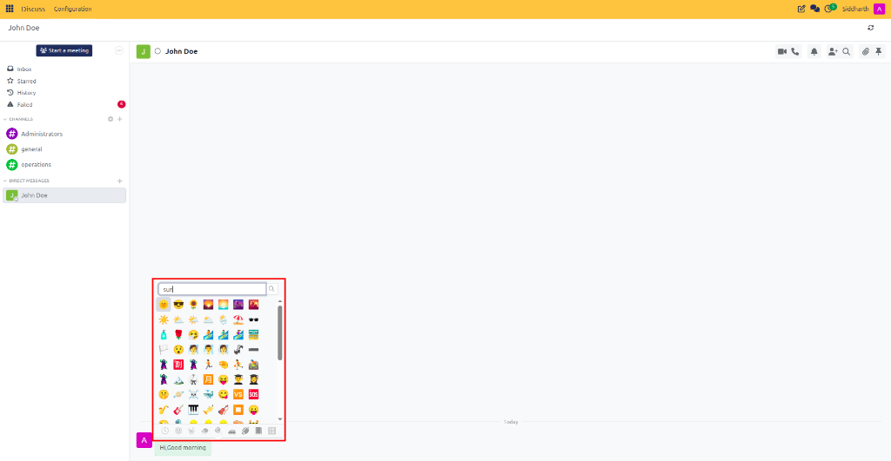

8. Select your desired emoji (such as `☀️` or `👍`). The emoji counter badge appears directly under the message bubble:

   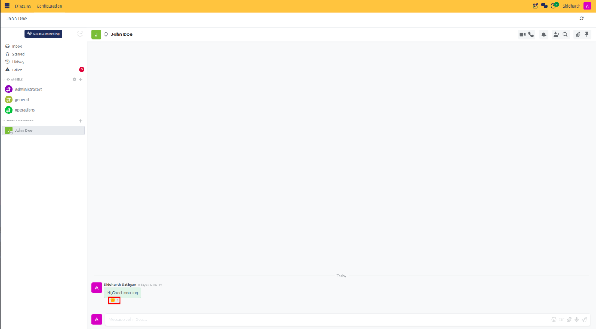

---

## Step 4: Start a Direct Message with a Colleague

When you need to hold a private one-on-one discussion:

1. In the left sidebar, click the **+** (plus) icon next to **Direct Messages**:

   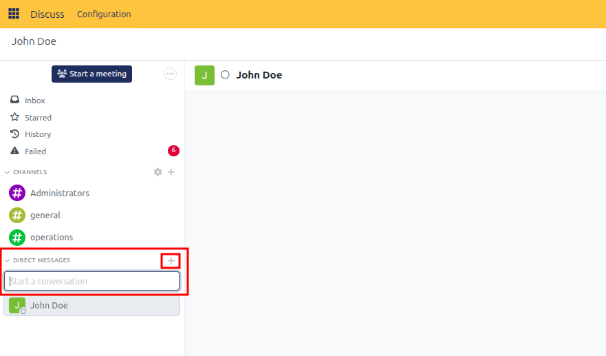

2. Type the name of your colleague (e.g., `George Watson` or `John Doe`) and select them from the suggestions list:

   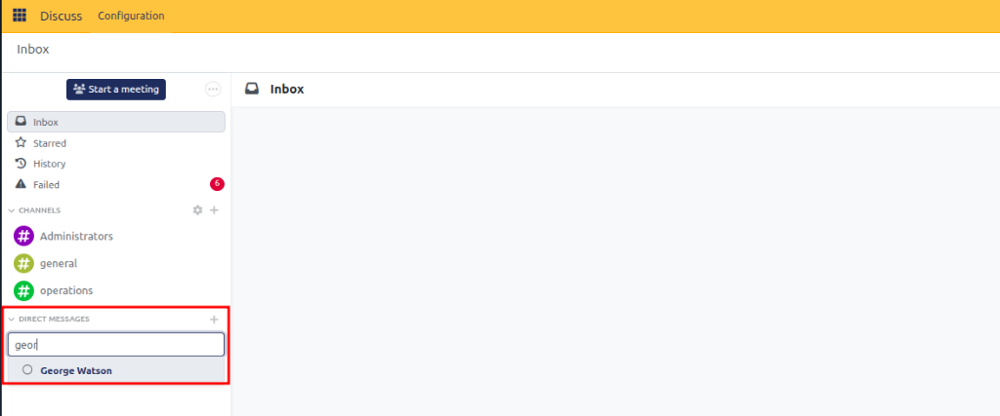

3. Notice the colored availability badge next to their avatar:
   * **Green filled circle**: Online and actively using CURQ.
   * **Orange filled circle**: Away or idle (inactive for 30 minutes).
   * **Hollow circle (`○`)**: Offline.
   * **Green heart (`♥`)**: Automated system assistant (e.g., OdooBot).
4. The private direct message window opens with a dedicated composer:

   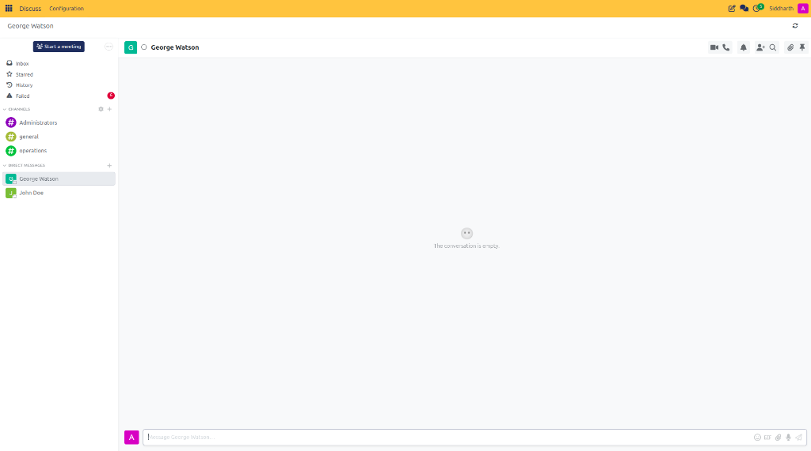

5. Type a private note and press **Enter**. Your private conversation feed displays real-time messages between you and your colleague:

   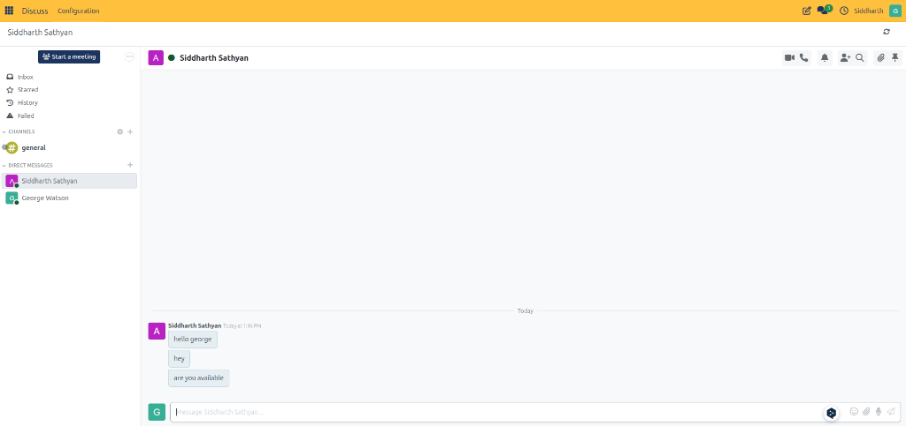

---

## Step 5: Triage Your Inbox and Mark Notifications as Read

Whenever teammates message you or mention you in conversations, updates arrive with unread notifications:

1. A green unread counter appears next to the conversation or channel name in the left sidebar.
2. Click into the conversation to open the incoming thread.
3. Notice the yellow notification banner at the top displaying the count of unread messages (e.g., `1 new message`):

   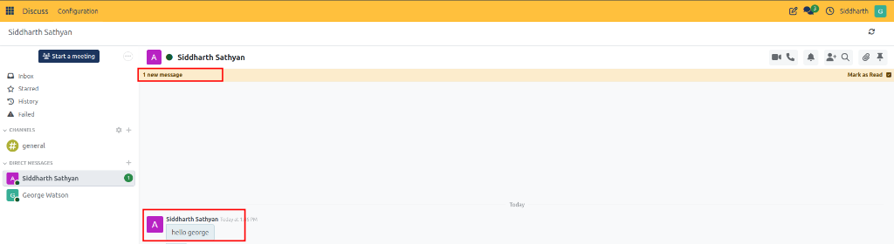

4. Click **Mark as Read** in the top yellow banner to clear the unread alert and reset the counter.
5. In your central **Inbox**, clearing read notifications similarly archives them into **History**, keeping your daily workspace completely clutter-free.

Congratulations! You have completed your first collaboration workflow in CURQ Discuss. You now know how to navigate the workspace, interact in channels, mention coworkers, send direct messages, and manage your inbox.

---

## Exploring Further: Key Capabilities of CURQ Discuss

Now that you understand the fundamentals of CURQ Discuss, explore the architectural principles and advanced tools available in the application:

## 1. Document Chatter Integration
Discuss does not live in an isolated silo. It powers the communication pane (Chatter) on every CRM lead, sales quotation, inventory delivery, and accounting invoice across CURQ. When you log notes or mention coworkers on a business record, that conversation is permanently bound to the transaction, creating an unbroken operational audit trail.

## 2. Instant Video & Voice Conferencing
Hold high-definition audio and video meetings directly in your browser without third-party meeting licenses or downloads. Click the purple **Start a meeting** button or use the header phone and camera icons to start one-on-one or multi-party video conferences with screen sharing.

## 3. Reusable Canned Responses
Speed up routine customer communications and internal answers using the colon (`:`) shortcut syntax. Insert pre-written, department-approved replies into any chat window or invoice chatter with a single keystroke.

## 4. Focused Do-Not-Disturb Modes
Prevent notification fatigue with granular mute options. Silence pings across all channels during deep-focus work blocks or configure per-channel alert rules to ensure you only receive alerts for mentions that truly require your attention.

---

### Related Documentation
* [Create and Manage Channels](../task-guides/01-create-and-manage-channels.md)
* [Send Direct and Group Messages](../task-guides/02-send-direct-and-group-messages.md)
* [Channel and Chat Settings Definitions](../settings-and-fields/01-channel-and-chat-settings-definitions.md)
* [Understanding Unified Business Communication and Chatter Architecture](../core-concepts/01-understanding-unified-business-communication-and-chatter-architecture.md)
