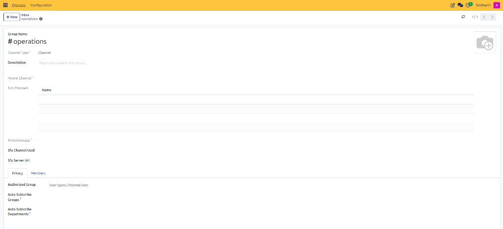
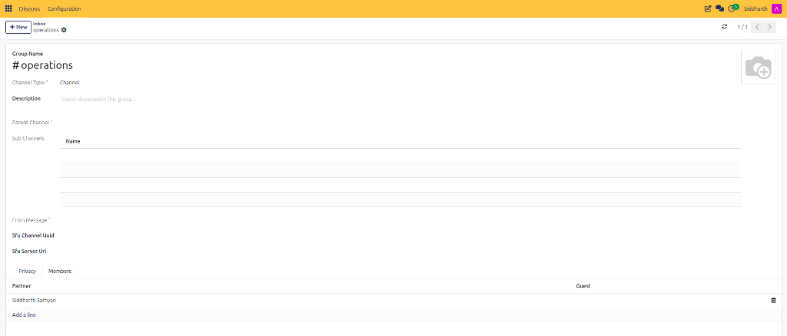

# Set Up a Team Channel and Host an Instant Meeting

Welcome to CURQ Discuss. In this tutorial, you will learn how to create a structured team communication space and host a real-time collaborative video session. You will configure a dedicated department channel, set member access permissions, invite coworkers, and launch an instant video conference with screen sharing in 4 straightforward steps.

By the end of this exercise, you will understand how to coordinate project teams and replace lengthy external meetings with lightweight, built-in CURQ video sessions.

```{mermaid}
flowchart LR
    A["`**Create Channel**
    #operations`"] --> B["`**Set Privacy & Members**
    Invite Coworkers`"] --> C["`**Launch Meeting**
    Instant WebRTC Call`"] --> D["`**Collaborate**
    Video, Audio & Screen Share`"]
```

---

## Hands-On Exercise: Set Up a Channel and Host a Meeting

## Prerequisites
* Access to a standard CURQ instance with the **Discuss** app installed.
* A computer equipped with a functional microphone and webcam (optional for screen sharing).
* A modern web browser (Google Chrome, Mozilla Firefox, or Microsoft Edge) with permissions enabled for media devices.

---

## Step 1: Create the Team Channel

Let us begin by establishing a central room for department communications:

1. From the main CURQ dashboard, click the **Discuss** app icon.
2. In the left navigation sidebar, click the **+** (plus) icon next to the **Channels** heading.
3. Type the channel name: `operations`. CURQ automatically formats the name as `#operations`:

   

4. Press **Enter** or click **Create: #operations**.
5. The new channel opens immediately, displaying an empty conversation feed:

   

---

## Step 2: Configure Channel Privacy and Invite Teammates

By default, newly created channels are public to all internal users. If you need to restrict membership to a specific operational team:

1. Hover over `#operations` in the left sidebar and click the **Gear** (Settings) icon.
2. In the channel form view, enter a brief description in the **Description** field (e.g., `Daily logistics, order fulfillment, and dispatch updates`).
3. Select the **Privacy** tab:
   * View the default **Authorized Group** (e.g., `User types / Internal User`) or configure group access rules.

   

4. Select the **Members** tab:
   * Click **Add a line**.
   * Select a teammate (e.g., `George Watson` or `John Doe`) from the dropdown to add them to the channel roster.

   

5. Click the cloud icon in the top header to save your channel configuration.

---

## Step 3: Launch an Instant Video Call with the "Start a meeting" Button

When urgent issues arise and text messaging is too slow, launch an immediate video meeting without leaving your browser:

1. Return to the Discuss workspace.
2. At the top of the left sidebar, click the purple **Start a meeting** button (or press the keyboard shortcut `m`):

   

3. When prompted by your web browser, select your camera and microphone, then click **Allow while visiting the site** (or **Allow this time**):

   

4. CURQ instantly opens the conference window and displays the **Invite People** dialog:
   * Select teammates from the list (such as `George Watson`, `John Doe`, or `Anmol`) and click **Invite to Group Chat** to ring them directly.
   * Alternatively, click the copy button at the bottom of the popover to share the direct meeting URL.

   

---

## Step 4: Test In-Call Controls and Screen Sharing

Now that your call is active, familiarize yourself with the media control toolbar located at the bottom of the conference window:


1. **Microphone (Mute)**: Click the microphone icon to mute or unmute your voice during discussions.
2. **Deafen (Headset)**: Click the headset icon to temporarily silence all incoming audio from other participants.
3. **Camera**: Click the camera icon to turn your webcam video broadcast on or off.
4. **Screen Share (Monitor)**: Click the monitor icon to share your screen. In your browser dialog, choose whether to share your entire desktop, a single application window, or a specific browser tab.
5. **More Options (Three Dots)**: Adjust audio sensitivity thresholds and hardware device settings.
6. **Hang Up (Red Phone)**: When your discussion is complete, click the red phone icon to disconnect.

Because you used the **Start a meeting** feature, the temporary conference room closes automatically once all participants disconnect, leaving your permanent channels clean and uncluttered.

Congratulations! You have configured a team communication channel and hosted an instant real-time conference.

---

### Related Documentation
* [Create and Manage Channels](../task-guides/01-create-and-manage-channels.md)
* [Start and Manage Voice and Video Calls](../task-guides/04-start-and-manage-voice-and-video-calls.md)
* [Voice and Video Hardware and Backgrounds](../task-guides/08-configure-voice-and-video-hardware-and-backgrounds.md)
* [Voice, Video, and Canned Responses Specifications](../settings-and-fields/03-voice-video-and-canned-responses-specifications.md)
* [Understanding Channels, Collaboration, and WebRTC Architecture](../core-concepts/02-understanding-channels-collaboration-and-webrtc-architecture.md)
