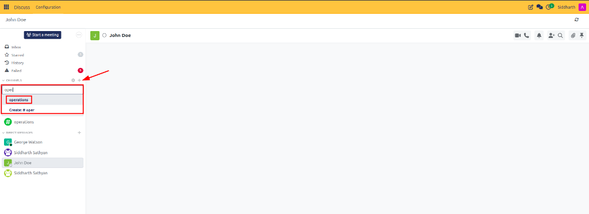

# Create and Manage Channels

Create public and private communication rooms, configure channel access permissions, invite coworkers, search existing channels, and manage group membership in CURQ Discuss.

---

## Task 1: Create a Public Channel

Public channels are open to all internal employees and serve as transparent communication spaces for company-wide announcements, general discussions, or cross-functional interest groups.

1. Navigate to the **Discuss** app from your main dashboard (or open the top-right chat menu).
2. In the left navigation sidebar, locate the **Channels** heading.
3. Click the **+** (plus) icon next to **Channels**:

   

4. Type a name for your channel (e.g., `company-news` or `sales-leads`). Channel names automatically lowercase and prefix with `#`.
5. Click **Create: #channel-name** (or press **Enter**).
6. The newly created channel opens immediately in your main chat window and appears in your personal sidebar list:

   

> [!NOTE]
> For technical definitions of channel access levels and privacy properties, see [Channel Form Properties](../settings-and-fields/01-channel-and-chat-settings-definitions.md).

---

## Task 2: Create a Private Restricted Channel

Private channels restrict access to invited participants only. They do not appear in public search directories for non-members, making them ideal for sensitive executive discussions, HR reviews, or private project pods.

1. In the left sidebar, click the **+** (plus) icon next to **Channels**.
2. Type the desired private channel name (e.g., `management-review`).
3. Click **Create: #management-review**.
4. Once the channel opens, click the **Gear** (Settings) icon next to the channel name in the left sidebar.
5. In the channel form view, select the **Privacy** tab.
6. Under **Who can follow the group's activities?**, select **Invited people only**:

   

7. Click the cloud icon (or navigate away) to save. The channel is now strictly private.

---

## Task 3: Configure Channel Descriptions and Access Rules

To provide clear guidance to participants and establish channel governance:

1. Hover over the channel name in the sidebar and click the **Gear** icon to open the configuration form.
2. In the **Description** field, enter a concise statement outlining the channel's purpose, response expectations, and acceptable topics.
3. Under the **Privacy** tab, configure the following options:
   * **Auto Subscribe Groups**: Select one or more user groups (e.g., `Sales / User` or `Accountant`). All existing and newly created users in those groups are automatically enrolled into the channel without manual invitations.
4. Click the cloud icon in the top-left toolbar to save changes.

> [!TIP]
> Use **Auto Subscribe Groups** for vital department channels (such as `#finance-ops` for accountants) so new hires are automatically placed into relevant channels upon account creation.

---

## Task 4: Add or Remove Channel Members

### Add Teammates to a Channel
1. Open the target channel in Discuss.
2. In the top-right header toolbar, click the **People** icon to expand the members drawer:

   

3. Click **Invite a User**.
4. In the search box, select the colleague you wish to add.
5. Alternatively, open the channel settings form (Gear icon), select the **Members** tab, click **Add a line**, and select users from the list:

   

### Remove Members from a Channel
1. Open the channel settings form (Gear icon) and navigate to the **Members** tab.
2. Locate the person you wish to remove from the list.
3. Click the **Trash Can** (Delete) icon on the right end of their row.
4. Click the cloud icon to confirm removal. The user loses immediate access to the channel feed.

---

## Task 5: Search and Join an Existing Channel

If a colleague has already created a public channel and you want to participate:

1. Click the **+** (plus) icon next to **Channels** in the sidebar.
2. Begin typing keywords matching the channel name (e.g., `operations`):

   

3. When the matching channel appears in the suggestion dropdown, click on it.
4. CURQ adds the channel to your sidebar and displays the message history immediately.

---

## Task 6: Leave or Unsubscribe from a Channel

When a project concludes or you no longer require updates from a specific room:

1. Locate the channel under your **Channels** list in the left sidebar.
2. Hover over the channel name and click the **X** (Leave) icon that appears beside it.
3. A confirmation modal appears asking if you want to leave `#channel-name`. Click **Leave Channel**.
4. The channel is removed from your sidebar. For public channels, you can rejoin at any time using the search tool; for private channels, an existing member must reinvite you.

---

### Related Documentation
* [Send Direct and Group Messages](02-send-direct-and-group-messages.md)
* [Collaborate with Mentions, Reactions, and Attachments](03-collaborate-with-mentions-reactions-and-attachments.md)
* [Channel and Chat Settings Definitions](../settings-and-fields/01-channel-and-chat-settings-definitions.md)
* [Understanding Channels, Collaboration, and WebRTC Architecture](../core-concepts/02-understanding-channels-collaboration-and-webrtc-architecture.md)
