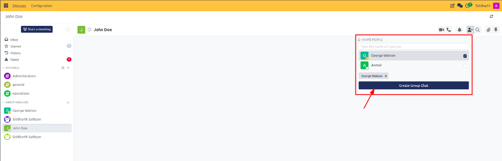
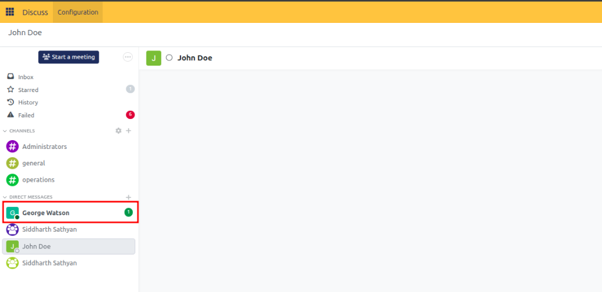

# Send Direct and Group Messages

Initiate private conversations with individual colleagues, create multi-user group chats, monitor live coworker availability, and manage unread message notifications across CURQ Discuss.

---

## Task 1: Start a One-on-One Direct Message

Direct messages provide private, encrypted communications visible exclusively to the participants:

1. Open **Discuss** from your main application dashboard.
2. In the left navigation sidebar, locate the **Direct Messages** section.
3. Click the **+** (plus) icon:

   

4. In the search box, begin typing the colleague's name (e.g., `Siddharth Sathyan`):

   

5. Select the person from the dropdown list.
6. The conversation opens in the center window, displaying recent exchange history and a dedicated message composer:

   

7. Type your message in the bottom composer and press **Enter** (or click the Send arrow) to transmit.

---

## Task 2: Create a Multi-User Private Group Chat

When coordinating a quick project between several colleagues without creating a permanent channel:

1. Click the **+** (plus) icon next to **Direct Messages** in the sidebar.
2. Type and select the first participant from the list.
3. Before pressing enter, continue typing the names of additional colleagues in the same search box.
4. Alternatively, open an existing 1-on-1 direct message conversation and click the **Add Person** icon in the top header.
5. In the invite popover, search for the additional coworker (e.g., `George Watson`) and click **Create Group Chat**:

   

6. CURQ converts the conversation into a multi-party group chat, keeping previous messages intact and granting the newly added member access to subsequent messages.

---

## Task 3: Interpret Real-Time User Presence Status

CURQ automatically monitors user activity in the browser to inform coworkers of real-time availability:

1. Look at the small colored circle positioned next to a user's avatar in direct messages, member lists, or autocomplete dropdowns:
   * **Green filled circle (`●`)**: **Online**. The user currently has CURQ open and is actively clicking, typing, or navigating.
   * **Orange filled circle (`●`)**: **Away / Idle**. The user is logged in, but has been inactive for 30 consecutive minutes.
   * **Hollow circle (`○`)**: **Offline**. The user closed their browser tab, signed out, or lost connection.
   * **Green heart (`♥`)**: **System Assistant**. Indicates automated bots (such as CURQBot).

> [!NOTE]
> Presence indicators are automated by system heartbeat events. Users cannot manually force an "Away" or "Invisible" state while remaining active in the platform.

---

## Task 4: Use the Top-Bar Quick-Chat Dropdown from Any Application

You do not need to leave the Sales, Accounting, or CRM applications to chat with colleagues:

1. While working anywhere inside CURQ, locate the **Chat bubble** icon in the top-right navigation bar.
2. Click the icon to open the quick-chat dropdown popover:

   

3. Review recent channel posts and direct messages sorted chronologically by latest activity.
4. Click on any thread to open a floating chat window in the bottom-right corner of your screen.
5. You can reply, send files, or minimize the chat window while continuing your work on customer orders or invoices.
6. Click the expand icon (two diagonal arrows) in the floating window to transition into the full Discuss workspace at any point.

---

## Task 5: Manage Unread Messages and the Unread Banner

When coworkers send you messages while you are working in another tab or application:

1. A green numerical badge appears next to the conversation name in your sidebar, indicating unread messages:

   

2. Click on the conversation to enter the chat pane.
3. CURQ highlights unread posts using two distinct visual indicators:
   * A prominent yellow banner across the top showing the count of new messages.
   * A horizontal red separator line in the feed marking where your unread messages begin.

   

4. To clear the alert and acknowledge the messages, click **Mark as Read** in the top yellow banner (or simply scroll through to the bottom of the feed). The unread counter immediately disappears from your sidebar.

---

### Related Documentation
* [Create and Manage Channels](01-create-and-manage-channels.md)
* [Collaborate with Mentions, Reactions, and Attachments](03-collaborate-with-mentions-reactions-and-attachments.md)
* [Configure Notification Preferences and Do-Not-Disturb](05-configure-notification-preferences-and-dnd.md)
* [Channel and Chat Settings Definitions](../settings-and-fields/01-channel-and-chat-settings-definitions.md)
