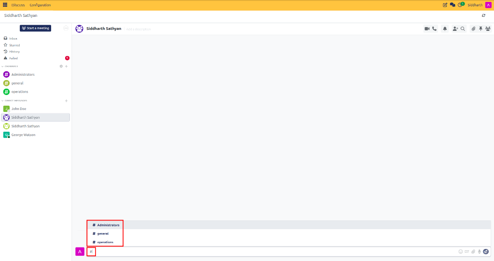
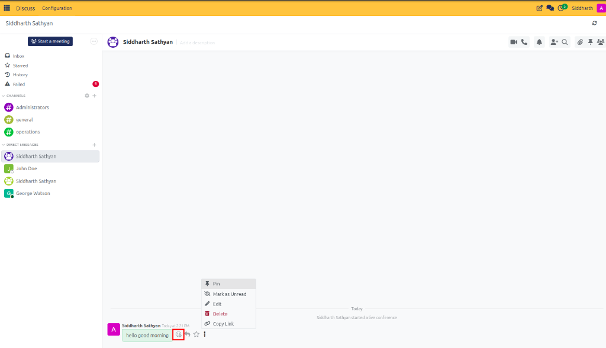
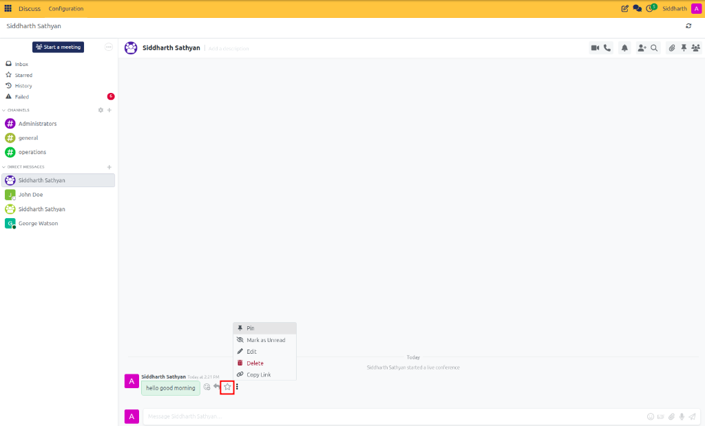
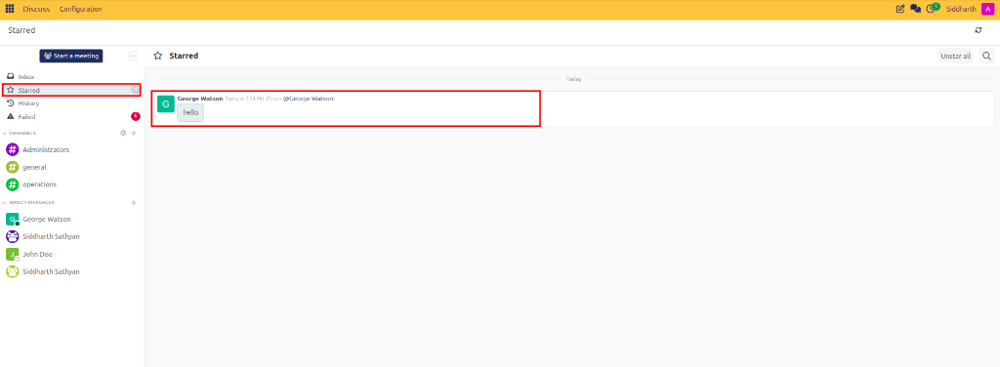
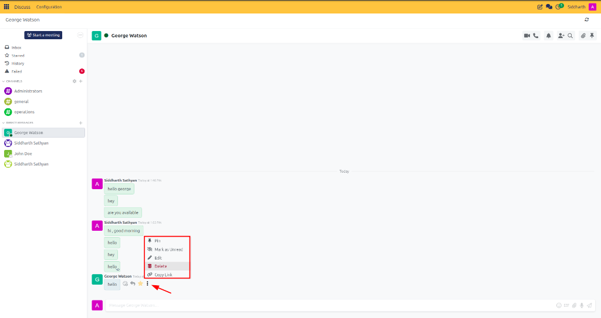

# Collaborate with Mentions, Reactions, and Attachments

Tag colleagues in discussions, reference topic channels, add emoji reactions, attach business documents, star important messages, and organize conversation feeds in CURQ Discuss.

---

## Task 1: Tag Coworkers with @Mentions

Mentioning a coworker draws their immediate attention to a conversation and sends an alert directly to their central **Inbox**:

1. In any channel or direct chat message composer, type the `@` character.
2. An autocomplete dropdown appears showing matching colleagues, their avatars, live presence circles, and email addresses:

   

3. Continue typing the coworker's first or last name to filter the list.
4. Press **Tab** or **Enter** (or click with your mouse) to insert the mention tag.
5. Finish typing your note and press **Enter** to publish. The recipient receives an instant badge in their **Inbox** with a direct jump link to the specific message.

> [!NOTE]
> Mentioning `@channel` or `@everyone` alerts all enrolled members of that room simultaneously. Use broadcast mentions selectively to prevent notification fatigue.

---

## Task 2: Insert Channel Shortcuts with #Links

You can create clickable hyperlinks to other discussion rooms directly in your text:

1. In the composer, type the `#` character.
2. A list of all accessible public and private channels appears:

   

3. Select the desired room (e.g., `#operations` or `#general`).
4. CURQ inserts a clickable channel badge into the message. Teammates can click this link to jump straight into that room.

---

## Task 3: Add Emoji Reactions and Quote Messages

Lightweight emoji reactions enable fast acknowledgments without creating clutter in team channels:

1. Hover your cursor over any message bubble in the feed.
2. In the floating action menu, click the **Smiley Face** (Add Reaction) icon:

   

   * The emoji reaction picker opens:

     

   * Search or select an emoji (such as `👍`, `❤️`, `🎉`, or `🚀`).
   * The emoji counter attaches beneath the message bubble:

     

3. To quote a teammate's message in your reply:
   * Hover over their message and click the **Curved Arrow** (Quote) icon.
   * CURQ embeds the quoted text block into your message composer with an attribution header.
   * Add your comment below the quoted block and press **Enter**.

---

## Task 4: Attach Files, PDFs, and Images

Share contracts, spreadsheets, invoices, or screenshots directly within chat feeds:

1. Open the target conversation.
2. Click the **Paperclip** icon at the left side of the composer (or drag and drop files directly from your computer into the chat window).
3. Select your file from the system file browser (e.g., a PDF quotation or PNG screenshot).
4. The file renders as an upload preview with filename and size details.
5. Add an optional caption in the text box and press **Enter**.
6. Images and PDFs display inline previews within the chat stream that colleagues can view full-screen without downloading.

---

## Task 5: Star Messages for Later Follow-Up

When you receive critical instructions or reference links that you need to revisit later:

1. Hover over the message bubble.
2. Click the **Star** icon in the floating action menu:

   

3. The star highlights in yellow, bookmarking the message.
4. To retrieve your saved messages at any time, click **Starred** in the left navigation sidebar. All bookmarked messages across every channel and direct chat are gathered in one dedicated view:

   

5. To remove a message from this list, hover over it and click the yellow star again to unstar (or click **Unstar all** at the top right of the Starred view).

---

## Task 6: Edit, Delete, Pin, and Copy Link to Messages

Manage your sent messages and highlight permanent guidelines:

1. Hover over any message you have posted and click the **Three Vertical Dots** (More Actions) menu:

   

2. Select from the available options:
   * **Pin**: Pins the announcement to the conversation header drawer so all members can review it easily.
   * **Mark as Unread**: Reapplies unread status to this message and all subsequent messages.
   * **Edit**: Opens the text block in editable mode. Make your correction and press **Enter** (or `Esc` to cancel). An *(edited)* indicator appears beside the timestamp.
   * **Delete**: Removes the message permanently from the chat feed.
   * **Copy Link**: Copies a direct permalink URL to your clipboard.

---

### Related Documentation
* [Create and Manage Channels](01-create-and-manage-channels.md)
* [Manage Conversation Header Tools and Search](07-manage-conversation-header-tools-and-search.md)
* [Channel and Chat Settings Definitions](../settings-and-fields/01-channel-and-chat-settings-definitions.md)
