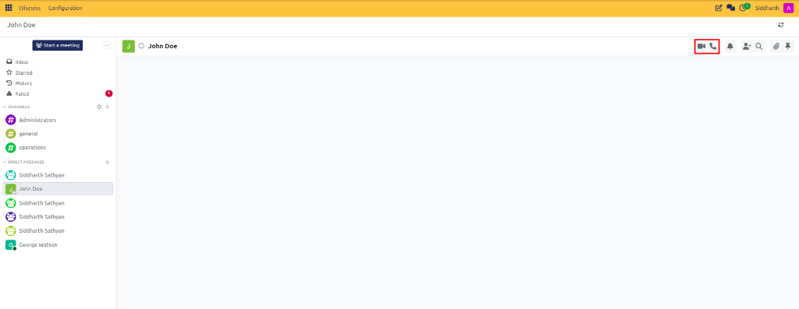
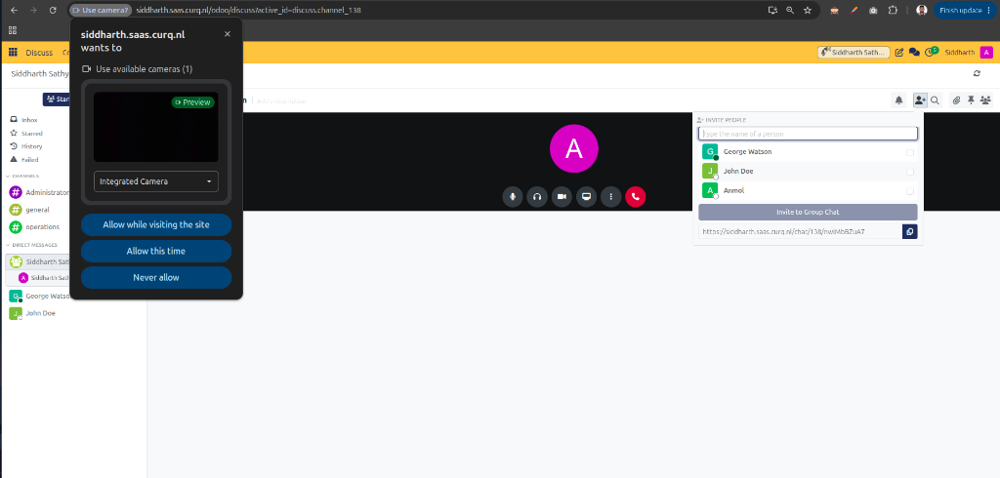
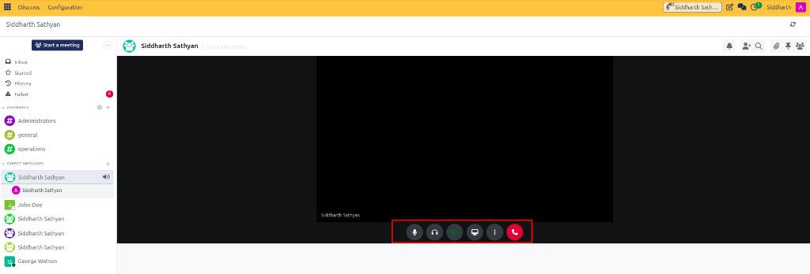
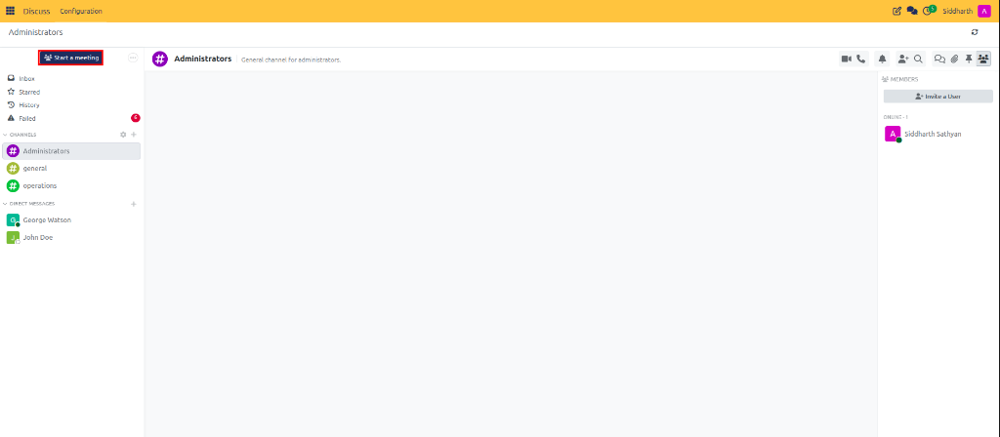
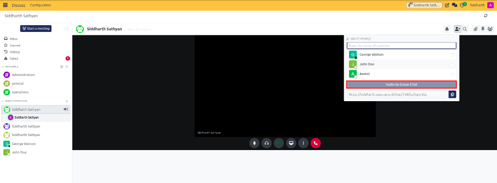

# Start and Manage Voice and Video Calls

Host peer-to-peer audio and video calls, grant device permissions, manage in-call controls, share your desktop screen, and launch instant conferences in CURQ Discuss.

---

## Task 1: Start a Call from a Conversation Header

Start an audio or video call directly inside any active channel or direct chat without third-party meeting accounts:

1. Open the target channel or direct conversation in Discuss.
2. In the top-right header toolbar, locate the call initiation icons:

   

3. Choose your call format:
   * Click the **Phone** icon to start an audio-only voice call.
   * Click the **Camera** icon to start a video conference with camera broadcast enabled.
4. An invitation alert chimes for all enrolled channel or direct chat participants, and the interactive conference pane expands.

---

## Task 2: Grant Browser Permissions for Microphone and Camera

When connecting to a call for the first time, your web browser prompts you for access to your hardware:

1. Look for the browser permission popup near the top address bar:

   

2. Select your physical microphone and webcam devices from the dropdown menus.
3. Click **Allow** (or **Remember this decision**).
4. If you accidentally clicked "Block":
   * Click the padlock or site settings icon on the left of your browser address bar.
   * Reset permissions for Camera and Microphone to **Allow**.
   * Refresh your browser tab.

---

## Task 3: Use In-Call Controls and Screen Sharing

Once connected to a call, manage your media transmission using the toolbar at the bottom of the conference window:

1. **Microphone (Mute/Unmute)**: Click to silence your microphone. When muted, a red diagonal slash appears across the icon.
2. **Deafen (Headset)**: Click the headset icon to deafen. This silences all incoming audio from other callers while simultaneously muting your microphone.
3. **Camera (Video On/Off)**: Toggle your webcam broadcast on or off.
4. **Screen Share (Monitor)**:
   * Click the monitor icon to share visual content.
   * In the browser selection window, choose to broadcast:
     * **Entire Screen**: Shares all active application windows and desktop notifications.
     * **Window**: Restricts sharing to a single software application (e.g., a PDF viewer or spreadsheet).
     * **Chrome / Browser Tab**: Shares an individual browser tab with audio streaming support.
   * Click **Share**. A blue indicator confirms active screen broadcasting. Click the monitor icon again to stop sharing.
5. **Settings (Three Dots)**: Access quick audio sensitivity thresholds and hardware device switches.
6. **Hang Up (Red Phone)**: Disconnect from the call.

---

## Task 4: Launch Instant Conferences via "Start a meeting"

To start an immediate conference without creating or cluttering a permanent channel:

1. In the left navigation sidebar of Discuss, click the purple **Start a meeting** button:

   

   *(You can also press the single-key keyboard shortcut `m` while anywhere in Discuss).*
2. CURQ immediately creates a temporary WebRTC conference room and activates your camera feed.
3. The **Invite People** modal opens automatically:

   

4. Once all attendees finish and hang up, CURQ automatically destroys the temporary room, leaving no unused channels in your workspace.

---

## Task 5: Invite Participants and Share Direct Call Links

To add colleagues or external team members into an active call:

1. Inside the active meeting window, open the **Invite People** popover.
2. Search for teammates by name and click them to send an immediate incoming call notification to their screen.
3. To invite participants via URL, click the **Copy Link** button at the bottom of the popover:

   

4. Paste the link into a channel, document chatter, or email. Anyone with authenticated access to your CURQ instance can click the link to enter the call immediately.

---

### Related Documentation
* [Configure Voice and Video Hardware and Backgrounds](08-configure-voice-and-video-hardware-and-backgrounds.md)
* [Voice, Video, and Canned Responses Specifications](../settings-and-fields/03-voice-video-and-canned-responses-specifications.md)
* [Understanding Channels, Collaboration, and WebRTC Architecture](../core-concepts/02-understanding-channels-collaboration-and-webrtc-architecture.md)
