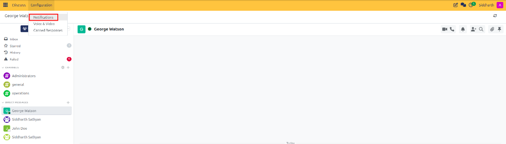
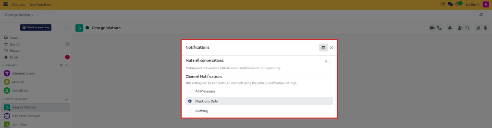
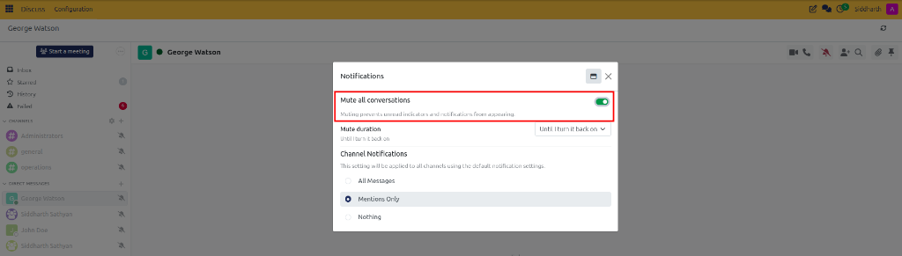
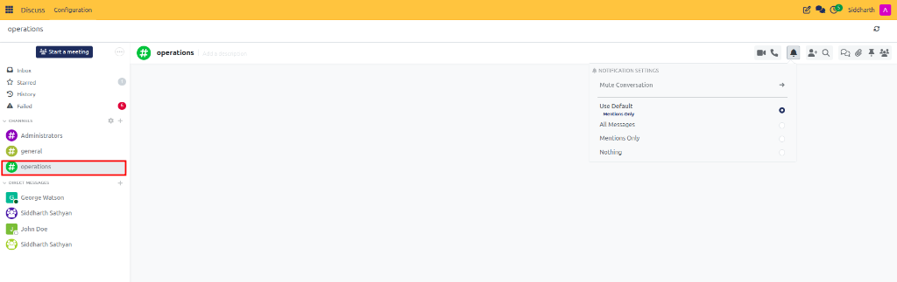

# Configure Notification Preferences and Do-Not-Disturb

Set global notification defaults, configure temporary Do-Not-Disturb focus timers, and customize channel alert overrides in CURQ Discuss.

---

## Task 1: Configure Global Channel Notification Rules

Set baseline alert behaviors across all channels you join to prevent notification overload:

1. Open the **Discuss** application.
2. In the top navigation menu, click **Configuration** and select **Notifications**:

   

3. In the **Notifications** dialog, locate the **Channel Notifications** section:

   

4. Select one of the three baseline options:
   * **All Messages**: Triggers an alert popup and sound for every message posted in every channel. (Recommended only for small teams or dedicated monitoring workstations).
   * **Mentions Only** *(Default & Recommended)*: Alerts you only when someone directly tags you (`@yourname`) or uses `@channel`.
   * **Nothing**: Completely suppresses channel alerts. New messages appear only when you actively navigate to the room.
5. Click outside the modal or close the window; changes take effect immediately across all default channels.

---

## Task 2: Enable Temporary Do-Not-Disturb Focus Timers

When presenting during meetings, hosting calls, or focusing on high-priority deep work, silence all incoming notification sounds and desktop popups across the entire system:

1. Navigate to **Discuss > Configuration > Notifications**.
2. Click the toggle switch next to **Mute all conversations** to turn it on (displays green):

   

3. Under **Mute duration**, select the desired silence window:
   * **For 15 minutes**
   * **For 1 hour**
   * **For 3 hours**
   * **For 8 hours**
   * **For 24 hours**
   * **Until I turn it back on** (permanent mute until manually disabled)

### Operational Behaviors While Muted:
* Desktop banner alerts and chime audio effects are completely silenced.
* Numerical unread counters are suppressed to eliminate visual distraction.
* A prominent warning banner appears at the top of conversations reminding you that notifications are paused.
* Once the timer elapses, CURQ restores standard alert delivery automatically.
* To cancel the mute early, return to the dialog and switch **Mute all conversations** off, or click **Unmute Conversation** from the banner.

---

## Task 3: Set Per-Channel Notification Overrides

If a critical channel requires immediate attention or a high-volume social channel is too noisy, override your global baseline for that specific room:

1. Open the channel from the left sidebar (e.g., `#operations`).
2. In the top-right header toolbar, click the **Bell** icon to open the **Notification Settings** menu:

   

3. Select an override rule:
   * **Use Default**: Follows your global rules configured in Discuss settings (displays your current default, such as *Mentions Only*).
   * **All Messages**: Notifies you of every message posted in this room, regardless of global settings.
   * **Mentions Only**: Alerts you only when directly tagged.
   * **Nothing**: Completely silences this channel while keeping alerts active for other rooms.
4. To silence this single room temporarily without muting company-wide chats, click **Mute Conversation** and choose an individual duration (e.g., *For 1 hour* or *For 8 hours*). The bell turns into a red slashed bell.

---

### Related Documentation
* [Manage Conversation Header Tools and Search](07-manage-conversation-header-tools-and-search.md)
* [Notifications and User Preferences Specifications](../settings-and-fields/02-notifications-and-user-preferences-specifications.md)
* [Understanding Unified Business Communication and Chatter Architecture](../core-concepts/01-understanding-unified-business-communication-and-chatter-architecture.md)
