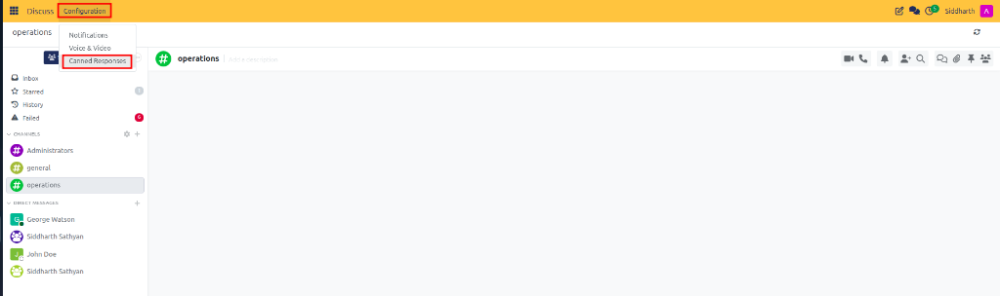
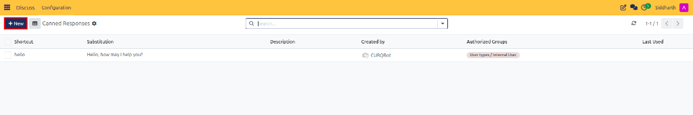
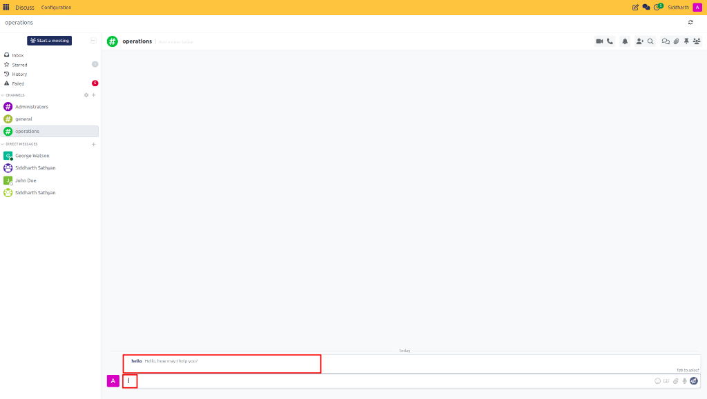

# Create and Use Canned Responses

Standardize recurring client messages, create shortcut triggers, share pre-written responses across departments, and insert templates into chat windows and record chatter in CURQ Discuss.

---

## Task 1: Create a Personal Canned Response

Personal canned responses allow individual sales reps, customer service agents, or project managers to quickly insert reusable text snippets using a simple keyboard shortcut:

1. Open the **Discuss** application from your main dashboard.
2. In the top navigation bar, click **Configuration** and select **Canned Responses**:

   

3. In the canned responses list view, click **New** (or click the top row of the editable table):

   

4. Configure the template fields:
   * **Shortcut**: Enter the trigger keyword without the colon (e.g., `quote-followup`). The system will trigger this snippet when you type `:quote-followup`.
   * **Substitution**: Type the full text body that will replace the shortcut.
   * **Description**: Enter an explanatory label (e.g., `Standard follow-up for open customer quotations`).
   * **Authorized Groups**: Leave this field blank to keep the template strictly personal to your account.
5. Click the cloud icon (or press `Enter`) to save.

---

## Task 2: Create Shared Department Canned Responses

To enforce uniform brand messaging, consistent payment instructions, or approved legal disclaimers across an entire team:

1. Navigate to **Discuss > Configuration > Canned Responses**.
2. Click **New**.
3. Enter the **Shortcut** (e.g., `bank-details`) and **Substitution** text containing official corporate bank coordinates, IBAN, and payment remittance instructions.
4. In the **Authorized Groups** field:
   * Click the dropdown and select one or more user groups (e.g., `Sales / User`, `Accounting / Accountant`, or `Helpdesk / User`).
5. Click the cloud icon to save.
6. The canned response is now available to every employee who belongs to the designated authorized groups.

---

## Task 3: Insert Canned Responses into Messages and Record Chatter

Canned responses work across the entire platform, including channels, direct chats, and document chatter feeds on Sales Orders, CRM Leads, and Customer Invoices:

1. Click inside any message composer box or chatter pane.
2. Type a colon (`:`) followed immediately by the initial letters of the shortcut (e.g., `:hello` or `:quote`):

   

3. A suggestions dropdown appears displaying matching shortcuts, descriptions, and preview text.
4. Select the desired snippet by pressing **Tab**, **Enter**, or clicking with your mouse.
5. CURQ immediately replaces the shortcut with the full substitution text.
6. Customize any dynamic values (such as customer names or dates) directly in the text before clicking **Send**.

---

## Task 4: Search, Filter, and Manage Canned Responses

Organize and maintain your template library over time:

1. Open **Discuss > Configuration > Canned Responses**.
2. In the top search bar, use the default filter **My canned responses** to view templates you created personally.
3. Remove the filter or select **Shared canned responses** in the Filters dropdown to inspect department-wide templates.
4. To edit an existing template:
   * Click directly on the table row to open inline editing.
   * Update the shortcut keyword, substitution text, or authorized groups.
5. To delete obsolete templates:
   * Select the checkbox next to the target template row.
   * Click the **Action** (Gear) menu at the top and select **Delete**.

---

### Related Documentation
* [Collaborate Using Record Chatter](09-collaborate-using-record-chatter.md)
* [Voice, Video, and Canned Responses Specifications](../settings-and-fields/03-voice-video-and-canned-responses-specifications.md)
* [Understanding Unified Business Communication and Chatter Architecture](../core-concepts/01-understanding-unified-business-communication-and-chatter-architecture.md)
