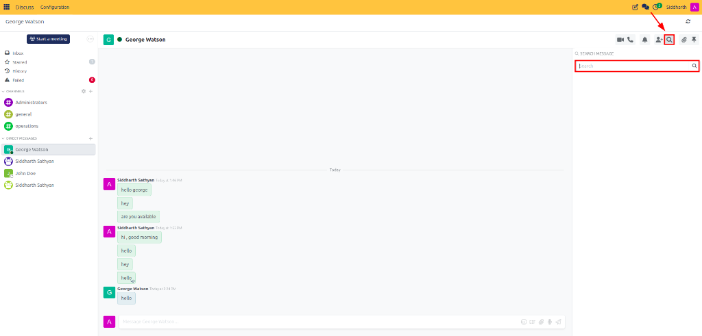
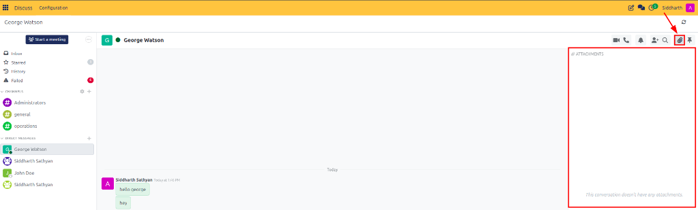
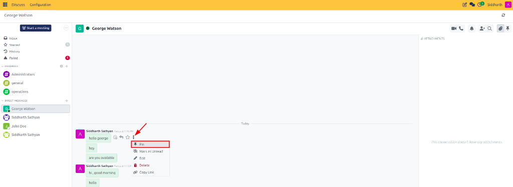
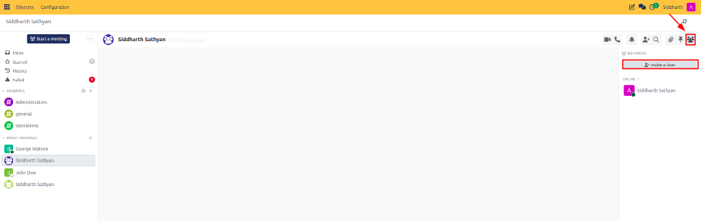

# Manage Conversation Header Tools and Search

Search conversation history, inspect shared attachments, govern external upload security, consult pinned messages, and manage participant directories in CURQ Discuss.

---

## Task 1: Search Message History within a Conversation

Quickly locate previous decisions, quotes, tracking numbers, or coworker responses without scrolling through hundreds of lines of text:

1. Open the target channel or direct conversation in Discuss.
2. In the top-right header toolbar, click the **Magnifying Glass** (Search) icon:

   

3. The search drawer slides open on the right side of the screen.
4. Type keywords, order numbers, or coworker names into the search input.
5. Search results display chronologically with author avatars, names, and timestamp stamps.
6. Click on any search snippet. CURQ immediately scrolls the main conversation feed directly to that message and highlights it briefly.

---

## Task 2: Browse Attachments in the Files Drawer

Locate files, contracts, PDF specifications, and images shared across the lifetime of a conversation:

1. Open the target channel or conversation.
2. In the top header toolbar, click the **Paperclip** (Attachments) icon:

   

3. The attachments drawer expands on the right side, organizing files into chronological date groups (Today, This Week, Last Month, Earlier).
4. Hover over any file card to view actions:
   * **Preview**: Click to inspect images or PDFs directly in an in-app lightbox modal.
   * **Download**: Save a local copy to your computer.
   * **Delete**: Remove the file attachment from the channel (available to the uploader or system administrators).

---

## Task 3: Configure External User Upload Security

Channels that include external portal users, suppliers, or client guests require file upload governance to protect corporate storage and prevent malicious file uploads:

1. Open the channel containing external participants.
2. Click the **Paperclip** icon in the header toolbar to expand the attachments drawer.
3. Locate the security toggle switch at the top of the drawer:
   * **File upload is disabled for external users** *(Default/Secure)*: External guests can participate in chat discussions and read text, but cannot attach files or upload media.
   * **File upload is enabled for external users**: Allows external portal users and clients to attach receipts, photos, or documents directly into the channel feed.
4. Toggle the switch to change the policy. The setting updates instantly for that channel.

---

## Task 4: Pin and Unpin Critical Messages

Keep crucial announcements, channel rules, working hours, or project deadlines permanently accessible to all channel members:

### Pin an Announcement
1. Locate the target message in the chat feed.
2. Hover over the message bubble and click the **Three Vertical Dots** (More Actions) menu.
3. Select **Pin**:

   

4. The message receives a small pin icon and is added to the channel's pinned registry.

### Consult and Unpin Announcements
1. Click the **Push Pin** icon in the top-right header toolbar to open the pinned messages drawer.
2. All active pinned messages appear in order.
3. Click a pinned item to scroll the conversation view directly to its original posting context.
4. To remove an announcement when it is no longer relevant, hover over it in the pinned drawer and click **Unpin**.

---

## Task 5: View and Manage Conversation Participants

Inspect live member presence and enroll new teammates:

1. In the top-right header toolbar, click the **People** (Members) icon:

   

2. The members drawer expands on the right side of the workspace.
3. Inspect the live availability badges next to each participant (Green = Online, Orange = Away, Hollow = Offline).
4. Click **Invite a User** at the top of the drawer to add new teammates.
5. In direct messages, clicking **Add Person** presents an option to **Create Group Chat**, seamlessly expanding the conversation into a multi-user room while preserving message history.

---

### Related Documentation
* [Create and Manage Channels](01-create-and-manage-channels.md)
* [Send Direct and Group Messages](02-send-direct-and-group-messages.md)
* [Channel and Chat Settings Definitions](../settings-and-fields/01-channel-and-chat-settings-definitions.md)
