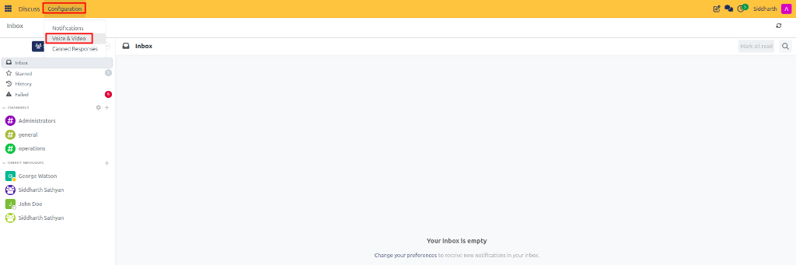
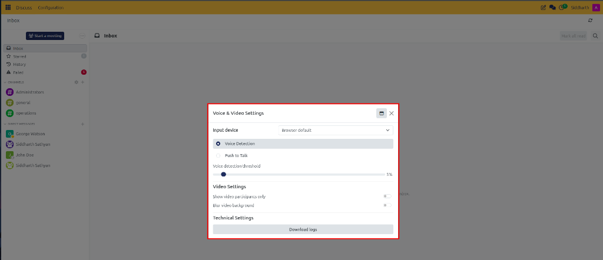
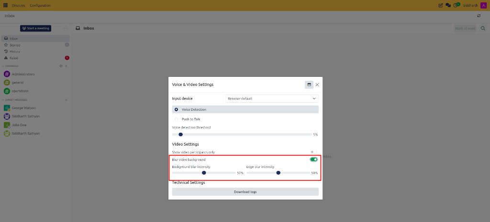
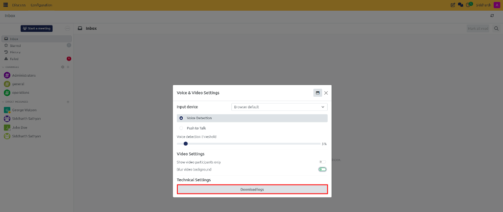

# Configure Voice and Video Hardware and Backgrounds

Adjust microphone hardware inputs, configure voice sensitivity and push-to-talk hotkeys, apply real-time video background blur, and export RTC diagnostic logs in CURQ Discuss.

---

## Task 1: Select Audio Input Hardware

Ensure crystal-clear audio during team calls by selecting the appropriate microphone:

1. Open the **Discuss** application.
2. In the top navigation menu, click **Configuration** and select **Voice & Video**:

   

3. The **Voice & Video Settings** dialog opens:

   

4. Under **Input device**, click the dropdown menu.
5. Select your dedicated headset, USB external microphone, or built-in system mic.
6. Selecting **Browser default** allows CURQ to follow whatever microphone is marked default in your operating system settings.

---

## Task 2: Configure Voice Detection Sensitivity vs Push-to-Talk

CURQ provides two distinct methods for transmitting audio during conferences:

### Option A: Automatic Voice Detection
Transmits your voice automatically whenever your speaking volume crosses a sensitivity threshold:
1. Under **Audio Settings**, ensure **Voice Detection** is selected.
2. Adjust the **Voice detection threshold** slider (default is `5%`):
   * **Lower Percentage (closer to 0%)**: Increases sensitivity, capturing softer voices or whispers.
   * **Higher Percentage (15% - 30%)**: Filters out background office hum, air conditioners, and mechanical keyboard clicks so the microphone opens only when you speak firmly.

### Option B: Push to Talk Hotkey
Keeps your microphone completely muted until you press and hold a designated shortcut:
1. Select **Push to Talk**.
2. Click inside the **Push-to-talk key** field and press your desired keyboard hotkey (e.g., `Space`, `Ctrl + Space`, or `Alt`).
3. Set the **Delay after releasing push-to-talk** slider (default is `200 ms`):
   * This brief buffer keeps the microphone open for a fraction of a second after releasing the key, ensuring the last syllable of your sentence is never clipped off.

---

## Task 3: Configure Video Display Rules and Background Blur

Protect privacy in home offices or busy environments and optimize video layout:

### Show Video Participants Only
1. Under **Video Settings**, toggle on **Show video participants only**.
2. When active, participants who have turned off their webcams are hidden from the primary video grid, dedicating screen space to active speakers and screen shares.

### Apply Real-Time Background Blur
1. Toggle on **Blur video background**:

   

2. Adjust the dual blur refinement sliders:
   * **Background blur intensity**: Controls how heavily your surroundings are obscured (from subtle softening at 30% to complete privacy masking at 100%).
   * **Edge blur intensity**: Adjusts the smoothing perimeter along the edge of your shoulders and hair to produce a clean, professional portrait effect.

---

## Task 4: Download RTC Technical Diagnostic Logs

If you experience dropped calls, audio stuttering, or media packet loss during WebRTC conferences:

1. Navigate to **Discuss > Configuration > Voice & Video**.
2. Scroll to the bottom under **Technical Settings**:

   

3. Click the **Download logs** button.
4. Your browser downloads a JSON file named `RtcLogs_YYYY-MM-DD_HH-mm.json`.
5. Attach this structured diagnostic file to your IT or helpdesk support ticket to inspect ICE connection states, network latency, codec negotiations, and bandwidth constraints.

---

### Related Documentation
* [Start and Manage Voice and Video Calls](04-start-and-manage-voice-and-video-calls.md)
* [Voice, Video, and Canned Responses Specifications](../settings-and-fields/03-voice-video-and-canned-responses-specifications.md)
* [Understanding Channels, Collaboration, and WebRTC Architecture](../core-concepts/02-understanding-channels-collaboration-and-webrtc-architecture.md)
