# Create and Send Your First Email Marketing Campaign

Welcome to CURQ Email Marketing. The **Email Marketing** application enables commercial teams, event organizers, and community managers to curate subscriber lists, design responsive email newsletters using modular drag-and-drop templates, execute split A/B tests, and track deliverability metrics in real time.

In this tutorial, you will create a subscriber mailing list, design a promotional newsletter, send a test email, and dispatch your first email broadcast in 5 steps.

```{mermaid}
flowchart LR
    A["`**Mailing List**
    Define Audience`"] --> B["`**Design Email**
    Choose Template`"]
    B --> C["`**Send Test**
    Verify Rendering`"]
    C --> D["`**Dispatch / Schedule**
    Queue Delivery`"]
    D --> E["`**Track Results**
    Opens & Clicks`"]
```

> **Prerequisites**
> * Access to a standard CURQ instance with the **Email Marketing** app installed (`mass_mailing`).
> * Outgoing email server configured or active demo email credentials.
> * Basic contact permissions to create and manage mailing lists.

---

## Step 1: Open the Mailing Lists Workspace

Access the subscriber management area in Email Marketing:

1. Click the main application menu at the top left of CURQ and select **Email Marketing**.
2. In the top navigation bar, click **Mailing Lists** and select **Mailing Lists** (highlighted in red):

   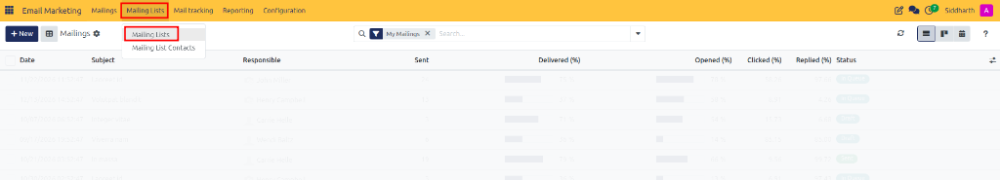

3. The **Mailing Lists** dashboard opens, displaying all configured subscriber segments and their active performance metrics *(Total Contacts, Contacts, Mailings, % Bounce, % Opt-out, and % Blacklist)*:

   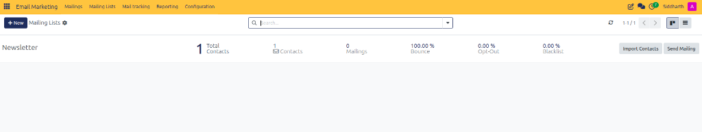

---

## Step 2: Create a New Subscriber Mailing List

Set up a dedicated subscriber container for your email broadcast:

1. In the top-left control panel, click **+ New** (highlighted in red):

   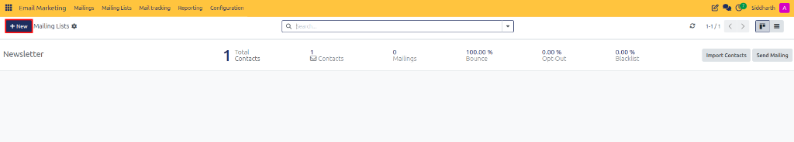

2. A blank mailing list creation form opens:

   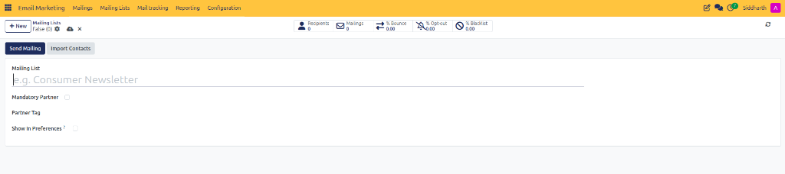

3. Configure the list parameters:
   * **Mailing List**: Enter a clear, descriptive name *(e.g., `Consumer Newsletter`)*.
   * **Mandatory Partner**: Check this option if contacts on this list must be linked to an existing partner record in CURQ Contacts.
   * **Partner Tag**: Optionally assign an internal partner tag to categorize subscriber contacts.
   * **Show In Preferences ?**: Check this option to allow contacts to subscribe or unsubscribe from this list on their customer preference portal page.

---

## Step 3: Add Contacts to Your Mailing List

Populate your list with initial subscriber email addresses:

1. On the saved mailing list form, click **Import Contacts** (highlighted in red) to upload recipient records:

   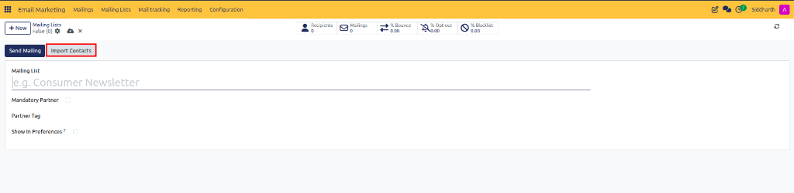

2. The **Import Mailing Contacts** modal dialog opens directly over the record:

   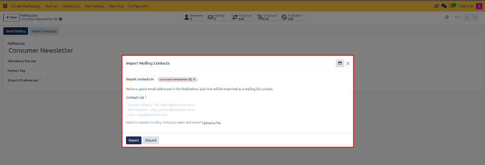

3. Enter or paste subscriber email addresses *(e.g., `"Damien Roberts" <d.roberts@example.com>`)* into the **Contact List** field (or click **Upload a file** for bulk spreadsheet files), then click **Import** (highlighted in red):

   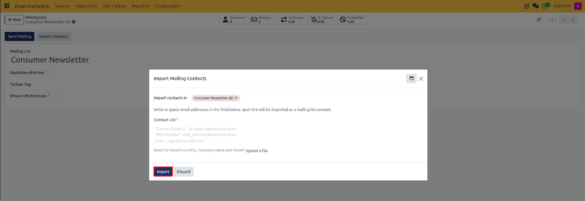

---

## Step 4: Design Your Email Mailing

Initialize and compose your email broadcast:

1. In the top navigation bar, click **Mailings** (highlighted in red) to open the broadcast list view:

   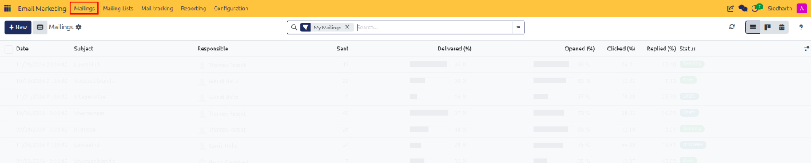

2. In the top-left control panel, click **+ New** (highlighted in red):

   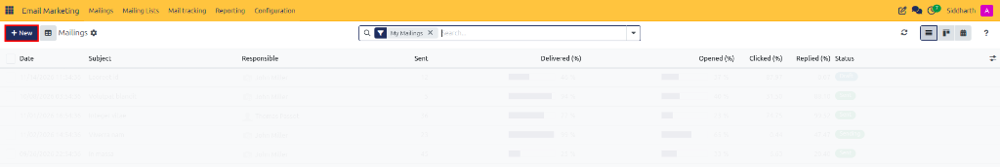

3. The mailing composer form view opens, displaying the header fields and responsive layout template gallery:

   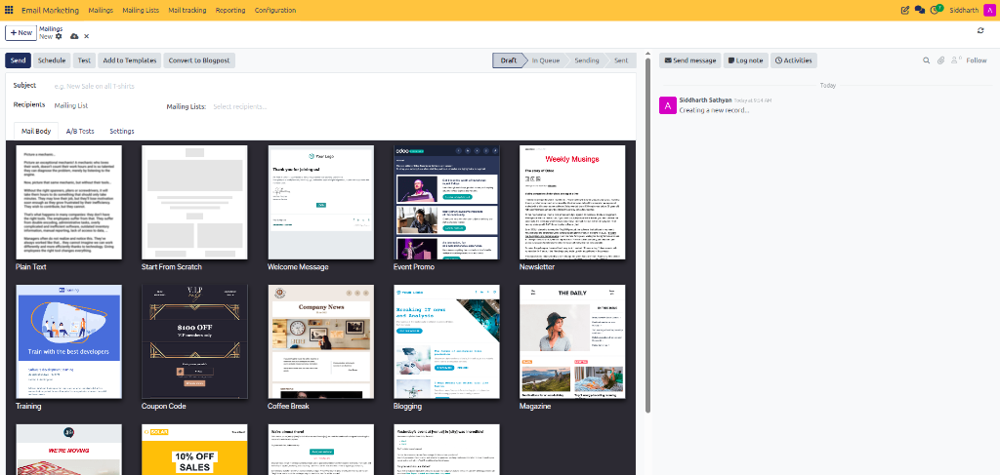

4. Complete the email header details:
   * **Subject**: Enter a compelling subject line *(e.g., `New Sale on all T-shirts`)*.
   * **Recipients**: Keep the default `Mailing List` selection.
   * **Mailing Lists**: Select your newly created subscriber list *(e.g., `Consumer Newsletter`)*.
5. In the **Mail Body** tab, select a pre-designed layout from the template grid *(such as `Plain Text`, `Start From Scratch`, `Welcome Message`, `Event Promo`, `Newsletter`, or `Coupon Code`)*.
6. Use the visual drag-and-drop editor to customize headers, text blocks, call-to-action buttons, and product cards.

### (Optional) Enable A/B Testing on a Draft Mailing

To compare different subject lines or content layouts across a sample audience before broadcasting to all recipients:

1. In the mailing form notebook, click the **A/B Tests** configuration tab (highlighted in red):

   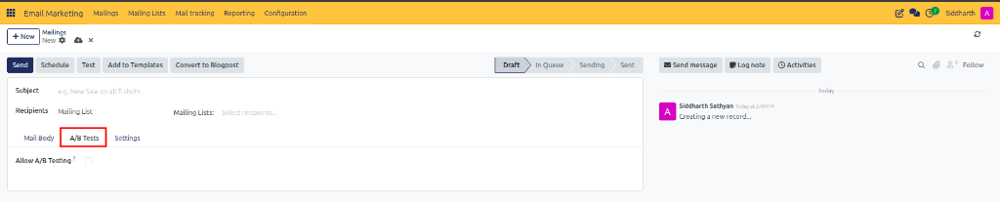

2. Mark the **Allow A/B Testing** checkbox.
3. Configure your testing parameters:
   * **Percentage (%)**: Set the sample audience percentage *(e.g., `10%` or `20%`)* to receive the test.
   * **Winner Selection**: Choose whether the winner is determined by **Highest Open Rate**, **Highest Click Rate**, or **Highest Reply Rate**.
   * **Send Final On**: Set the scheduled date and time when the winning variation is automatically dispatched to the remaining recipients.
4. Click **Create an Alternative Version** to author the contrasting variant *(such as an alternative subject line or CTA button)*.

---

## Step 5: Test and Launch Your Broadcast

Verify message layout before launching the broadcast to your subscribers:

1. In the top-left action bar of the mailing form, review the action options (highlighted in red) and click **Test**:

   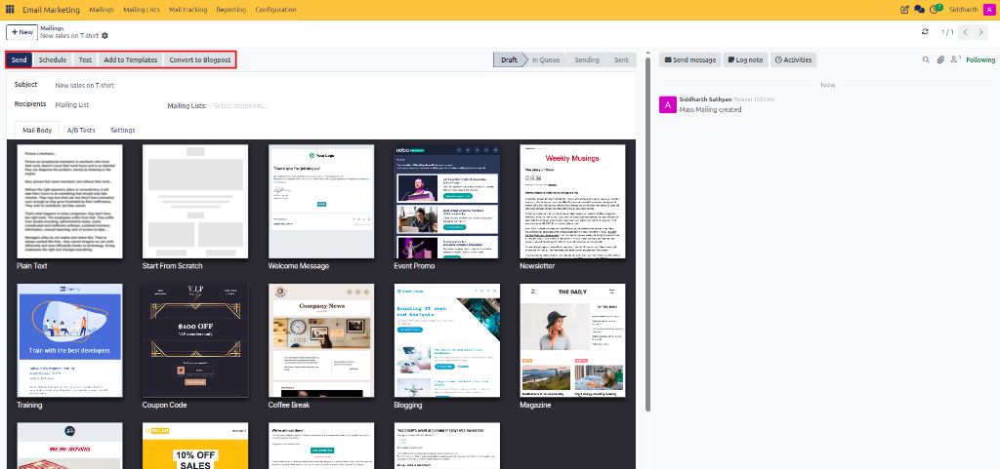

2. The **Test Mailing** dialog appears

3. Enter your personal email address and click **Send Test**.
4. Review the test message in your email client to verify formatting, image resolution, and button links.
5. Return to CURQ and choose your dispatch method:
   * **Send**: Broadcasts the mailing immediately to all list subscribers.
   * **Schedule**: Specifies a future calendar date and time for automatic dispatch.

---

## Related Documentation

* [Manage Subscriber Lists and Track Campaign Engagement](./02-manage-subscriber-lists-and-track-campaign-engagement.md)
* [Design, Schedule, and Send Email Mailings](../task-guides/04-design-schedule-and-send-email-mailings.md)
* [Understanding Email Marketing Architecture and Delivery Mechanisms](../core-concepts/01-understanding-email-marketing-architecture-and-delivery-mechanisms.md)
