# Manage Subscriber Lists and Track Campaign Engagement

Effective email marketing requires continuous subscriber list hygiene and real-time performance evaluation. CURQ 18 Email Marketing tracks delivery statuses, recipient engagement rates, link clickthroughs, and unsubscribe patterns to help marketing teams optimize their outreach strategies.

This tutorial guides you through inspecting contact subscriber records, monitoring list health, evaluating mass mailing metrics, and reviewing opt-out analytics.

```{mermaid}
flowchart LR
    A["`**Broadcast Sent**
    Dispatch Queue`"] --> B["`**Delivery Metrics**
    Delivered & Bounced`"]
    B --> C["`**Engagement**
    Opens & Clicks`"]
    C --> D["`**Feedback & Opt-Outs**
    Unsubscribes & Blacklist`"]
```

> **Prerequisites**
> * Access to **Email Marketing** with permissions to view contacts and reporting analytics.
> * At least one completed or active email broadcast sent to a subscriber mailing list.

---

## 1. Subscriber List and Engagement Workflow

### 1.1 Inspect Subscriber Contacts and Subscription Dates

Review individual subscriber records and their subscription timelines:

1. In the top navigation bar of Email Marketing, click **Mailing Lists** and select **Mailing List Contacts** (highlighted in red):

   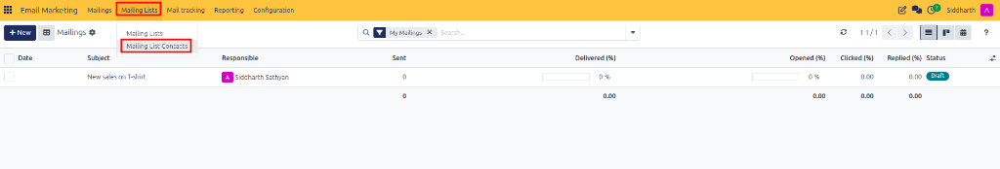

2. The **Mailing List Contacts** overview opens, listing all contact profiles, associated email addresses, bounce indicators, and subscription statuses:

   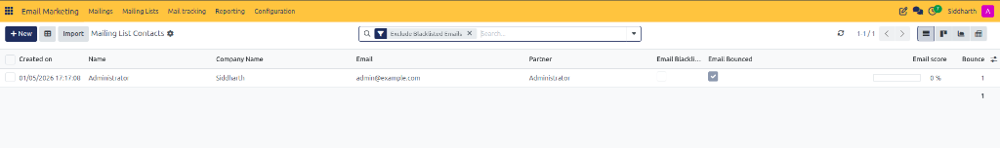

3. Click on a contact *(e.g., John Smith)* to inspect their profile details, company, tags, and their exact **Subscription Date** (highlighted in red):

   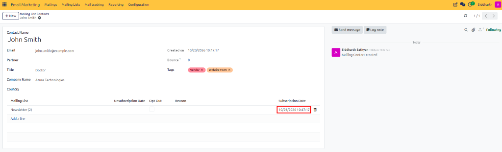

---

### 1.2 Update Contact Subscriptions and Manage Unsubscribes

Maintain list hygiene by managing subscriber memberships:

1. Open a contact form to review their contact attributes, linked company, tags, and assigned lists:

   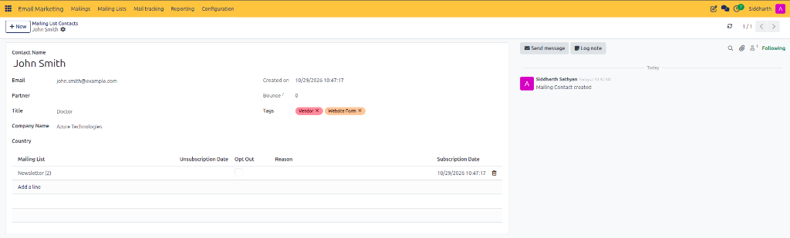

2. In the subscriptions table, click **Add a line** and select an additional list *(e.g., `Consumer Newsletter (0)`)* from the dropdown selector (highlighted in red):

   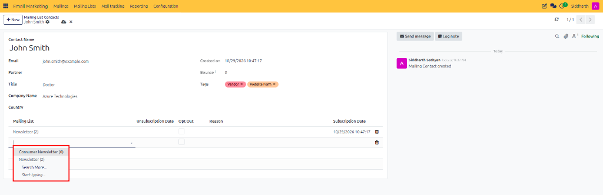

3. If a contact requests removal from a specific list, click the delete trash can icon on the list row to unsubscribe them without deleting their master contact record:

   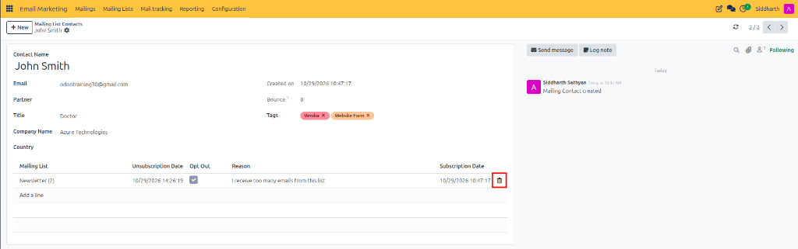

> For complete subscriber profile attributes and opt-out flags, see [**Mailing Contact Fields**](../settings-and-fields/01-mailing-and-campaign-field-definitions.md#mailing-contact-fields).

---

### 1.3 Monitor Real-Time Metrics via Smart Buttons

Track live engagement directly from the mailing list and campaign headers:

1. Navigate to **Mailing Lists > Mailing Lists** and select your active list *(e.g., `Newsletter`)*.
2. Review the statistical smart buttons displayed in the top header (highlighted in red):

   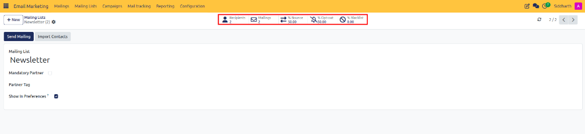

   * **Recipients**: Total assigned contacts subscribed to the mailing list.
   * **Mailings**: Number of email broadcasts dispatched to this audience.
   * **% Bounce**: Percentage of dispatched emails rejected by destination mail servers.
   * **% Opt-out**: Percentage of recipients who unsubscribed from the mailing list.
   * **% Blacklist**: Percentage of recipients whose email addresses have been blacklisted.

3. If you organize mailings under marketing campaigns, open **Campaigns** to view aggregate revenue and engagement smart buttons in the campaign header (highlighted in red):

   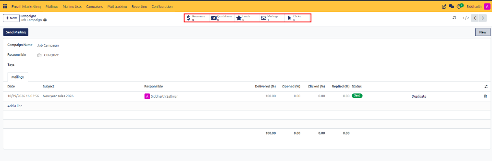

   * **Revenues**: Commercial sales generated through linked opportunities and quotation orders.
   * **Quotations & Leads**: Pipeline leads and quotation orders initiated via campaign responses.
   * **Mailings**: Total number of email broadcasts associated with the campaign.
   * **Clicks**: Total tracked link clickthroughs across all campaign mailings.

> For KPI calculation rules and delivery rate formulas, see [**Analytical Smart Button Metrics**](../settings-and-fields/01-mailing-and-campaign-field-definitions.md#analytical-smart-button-metrics).

---

### 1.4 Evaluate Mass Mailing Analytics and Engagement Graphs

Analyze open rates, click rates, and delivery trends across your campaigns:

1. In the top navigation bar, click **Reporting** and select **Mass Mailing Analysis** (highlighted in red):

   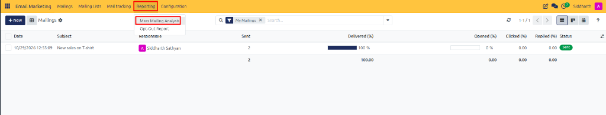

2. The **Mass Mailing Analysis** dashboard opens in a graphical bar chart view:

   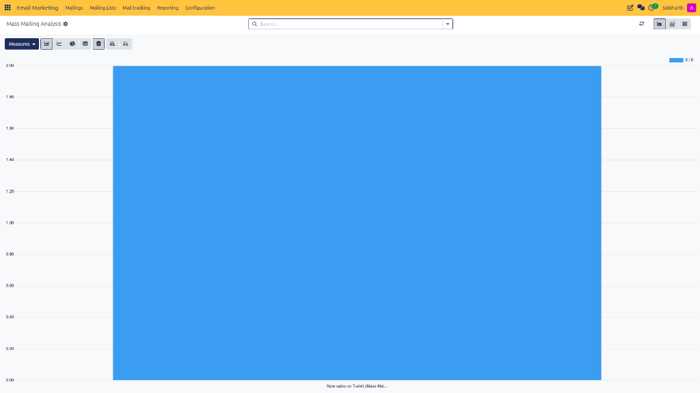

3. Click the **Measures** selector in the top control panel to switch between performance metrics:

   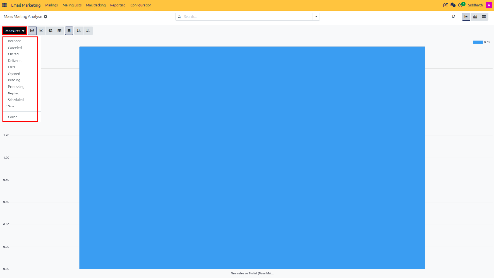

   * **Delivered**: Total emails successfully received by remote mail servers.
   * **Opened**: Total recipients who viewed the email body.
   * **Clicked**: Total recipients who clicked at least one tracked URL.
   * **Bounced**: Messages rejected by recipient mail servers due to invalid addresses or full inboxes.

---

### 1.5 Audit Opt-Out Feedback and Unsubscribe Reasons

Investigate why recipients unsubscribe to improve content relevance and cadence:

1. Click **Reporting** and select **Opt-Out Report** (highlighted in red):

   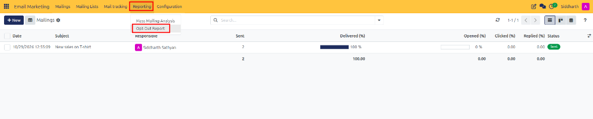

2. The **Opt-Out Report** dashboard displays unsubscribe counts categorized by recipient feedback reasons in an intuitive pie chart:

   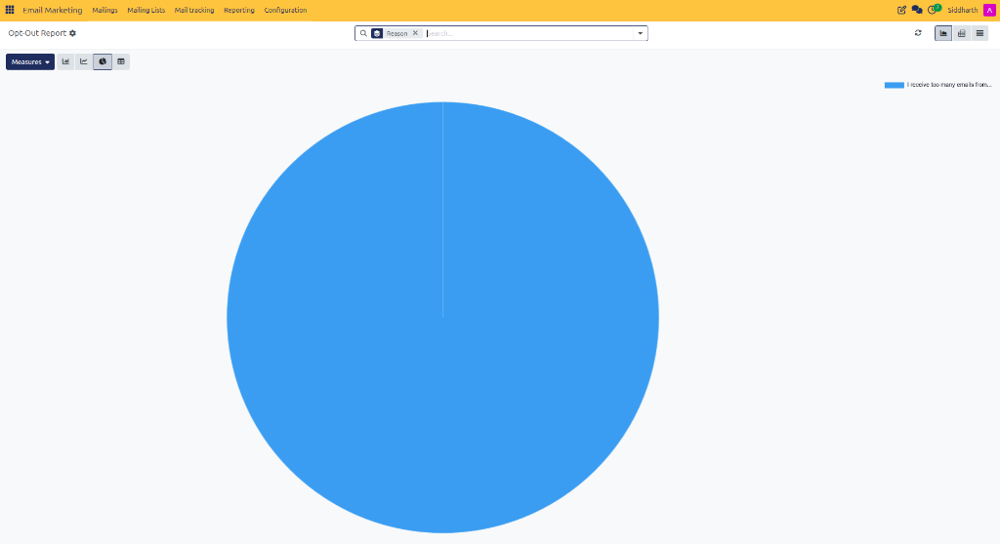

3. Use these insights to refine audience segmentation and minimize subscriber attrition.

---

## Related Documentation

* [Mailing and Campaign Field Definitions](../settings-and-fields/01-mailing-and-campaign-field-definitions.md)
* [Create and Send Your First Email Marketing Campaign](./01-create-and-send-your-first-email-marketing-campaign.md)
* [Generate and Analyze Email Marketing Reports](../task-guides/06-generate-and-analyze-email-marketing-reports.md)
* [Manage Blacklisted Emails and Opt-Out Reasons](../task-guides/05-manage-blacklisted-emails-and-opt-out-reasons.md)
