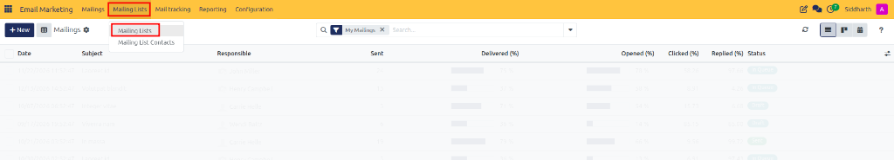
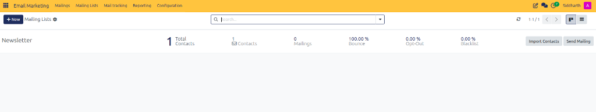
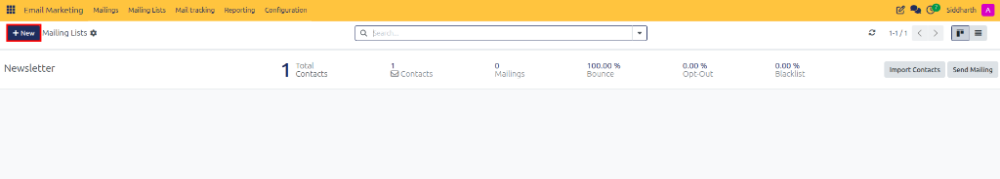
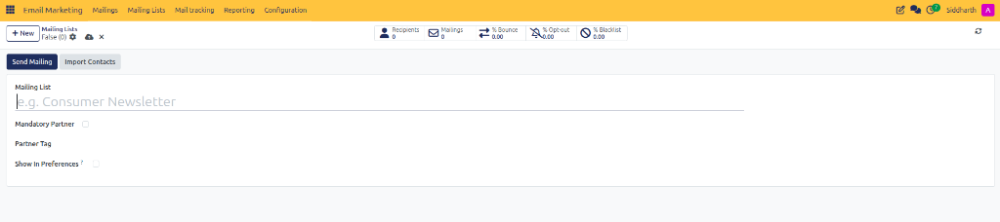
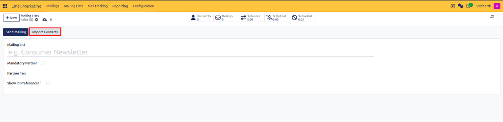
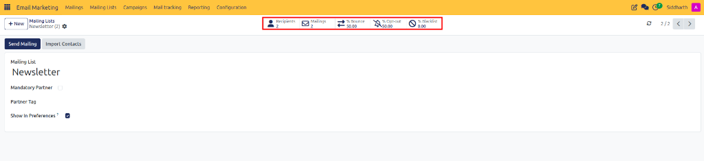

# Create and Manage Subscriber Mailing Lists

This guide covers how to access the Mailing Lists workspace, create new subscriber lists, configure public preferences, and manage subscriber contacts in CURQ 18 Email Marketing.

---

## Task 1: Open the Mailing Lists Workspace

Access your organization's subscriber segments:

1. Open the **Email Marketing** application from the main CURQ menu.
2. In the top navigation bar, click **Mailing Lists** and select **Mailing Lists** (highlighted in red):

   

3. Review the existing mailing lists in the dashboard view, including subscriber counts, broadcast history, bounce percentages, and opt-out rates:

   

---

## Task 2: Create a New Mailing List

Initialize a dedicated subscriber audience container:

1. In the top-left control panel, click **+ New** (highlighted in red):

   

2. A blank mailing list form opens:

   

3. Enter a descriptive title in the **Mailing List** field *(e.g., `VIP Wholesale Buyers`)*.
4. Configure optional governance parameters:
   * **Mandatory Partner**: Check this box to enforce that all subscribers added to this list must have a corresponding Contact record in CURQ.
   * **Partner Tag**: Specify a tag to automatically group linked contacts.
   * **Show In Preferences ?**: Check this box if you want recipients to see and manage their subscription to this list via customer portal preference pages.

---

## Task 3: Import Contacts and Manage List Actions

Populate your list with subscribers and monitor operational actions:

1. Save the mailing list record.
2. Review the action buttons available in the form header:

   

3. Click **Import Contacts** (highlighted in red) to upload an external customer list via CSV or Excel file.
4. Review the analytical smart buttons at the top of the form:

   

   * **Recipients**: Displays total assigned contacts and allows direct access to subscriber records.
   * **Mailings**: Shows all broadcasts dispatched to this audience.

---

## Edge Cases & Recovery Steps

* **Duplicate Email Addresses**: If an imported file contains duplicate email addresses, CURQ automatically consolidates them to ensure each contact receives only one email per broadcast.
* **Accidental Deletion**: Deleting a mailing list removes list associations but does not delete the underlying master Contact profiles in the Contacts app.
* **Archived Lists**: If a seasonal campaign concludes, archive the mailing list from the **Action > Archive** menu to hide it from active selection without losing historical analytics.

---

## Related Documentation

* [Manage Mailing List Contacts and Subscriptions](./02-manage-mailing-list-contacts-and-subscriptions.md)
* [Design, Schedule, and Send Email Mailings](./04-design-schedule-and-send-email-mailings.md)
* [Mailing and Campaign Field Definitions](../settings-and-fields/01-mailing-and-campaign-field-definitions.md)
