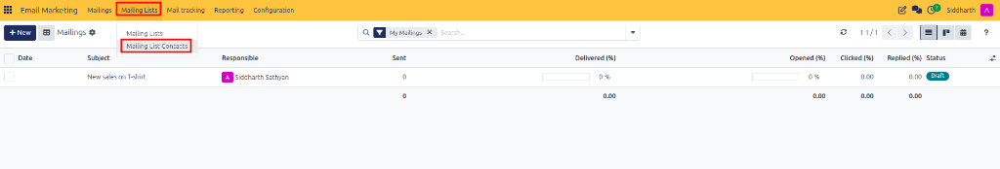
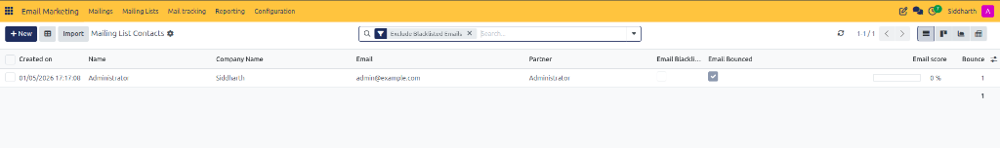
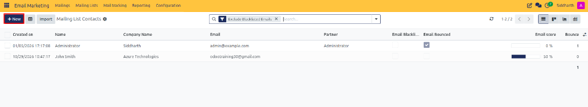
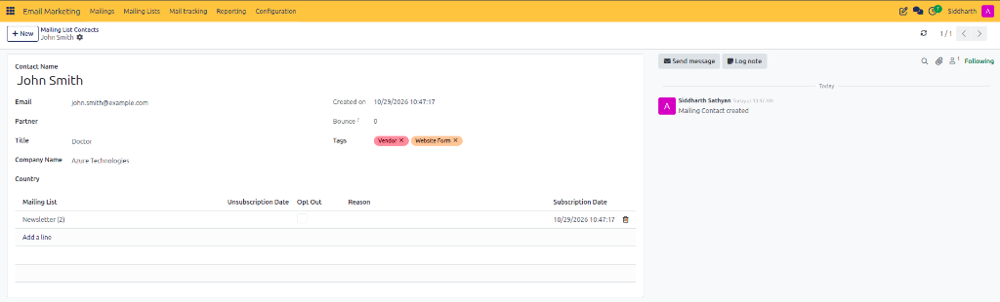
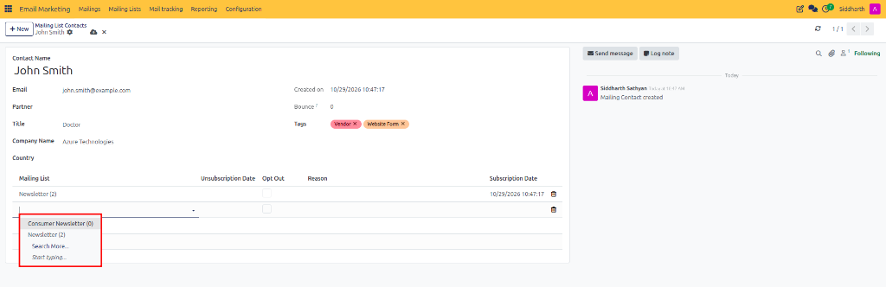
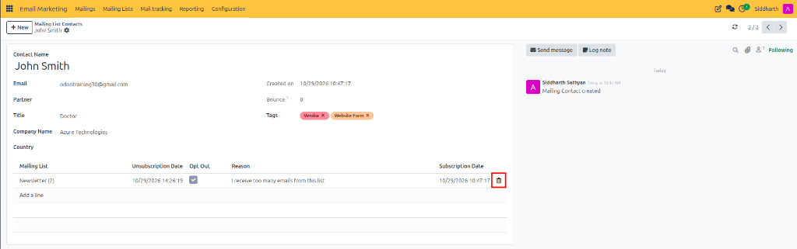
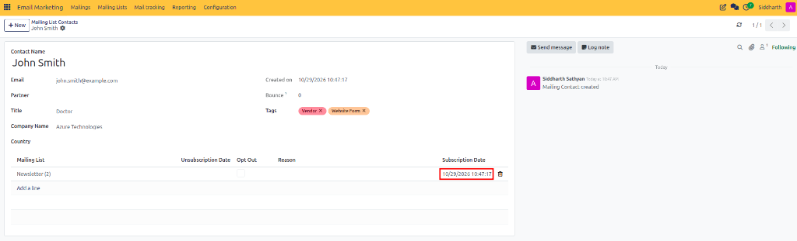

# Manage Mailing List Contacts and Subscriptions

This guide covers how to inspect contact profiles, assign contacts to subscriber lists, monitor subscription dates, and manage opt-outs in CURQ 18 Email Marketing.

> **Prerequisites**
> * Active user account with **Email Marketing / User** rights.
> * Partner master directory active in the **Contacts** application.

---

## 1. Contact Creation and List Subscription

### 1.1 Open Mailing List Contacts

Access the central subscriber directory:

1. In the top navigation bar of Email Marketing, click **Mailing Lists** and select **Mailing List Contacts** (highlighted in red):

   

2. The **Mailing List Contacts** overview opens, showing all subscriber profiles and email addresses across lists:

   

---

### 1.2 Create a New Contact Profile

Manually add an individual subscriber:

1. In the top-left control panel, click **+ New** (highlighted in red):

   

2. A blank contact form view opens:

   

3. Fill in the contact details:
   * **Name**: Enter the contact's full name.
   * **Email**: Enter their primary email address *(required for message delivery)*.
   * **Company Name / Title / Country**: Optional attributes used for segmentation.

---

### 1.3 Assign and Remove List Subscriptions

Manage which mailing lists the contact belongs to:

1. On the contact form, locate the subscriptions table.
2. Click **Add a line** and select from the dropdown selector (highlighted in red) to add the contact to an active subscriber list *(such as `Consumer Newsletter`)*:

   

3. To remove a subscription, click the trashcan delete icon (highlighted in red) at the end of the line:

   

> For complete subscriber profile attributes, **Subscription Date**, **Opt-Out**, and **Bounce Count** fields, see [**Mailing Contact Fields**](../settings-and-fields/01-mailing-and-campaign-field-definitions.md#4-mailing-contact-fields).

---

## 2. Monitor Subscription Timelines

Audit when contacts joined your mailing lists:

1. Open the target contact record.
2. Inspect the **Subscription Date** field (highlighted in red) on each assigned list line to verify the exact registration timestamp:

   

---

## 3. Edge Cases & Recovery Steps

* **Contact Opted Out**: If a contact opted out of a list, the **Opt-Out** checkbox will be marked. Do not uncheck this box without explicit consent from the subscriber to ensure compliance with privacy laws.
* **High Bounce Counts**: If the **Bounce** counter shows repeated failures, verify the email syntax or contact the recipient to confirm their current address.
* **Bulk Export**: Select multiple contacts in the list view, click the **Action** gear icon, and select **Export** to back up subscriber data.

---

## Related Documentation

* [Create and Manage Subscriber Mailing Lists](./01-create-and-manage-subscriber-mailing-lists.md)
* [Manage Blacklisted Emails and Opt-Out Reasons](./05-manage-blacklisted-emails-and-opt-out-reasons.md)
* [Mailing and Campaign Field Definitions](../settings-and-fields/01-mailing-and-campaign-field-definitions.md)
* [Mailing and Campaign Field Definitions](../settings-and-fields/01-mailing-and-campaign-field-definitions.md)
