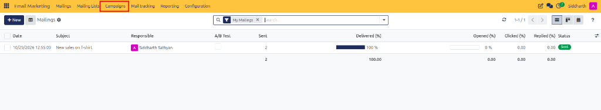
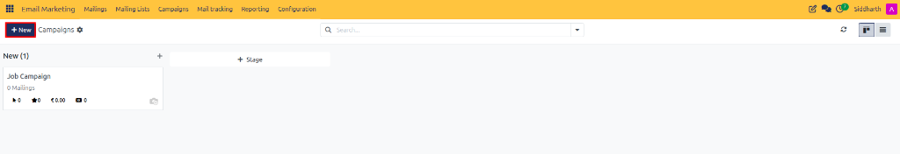
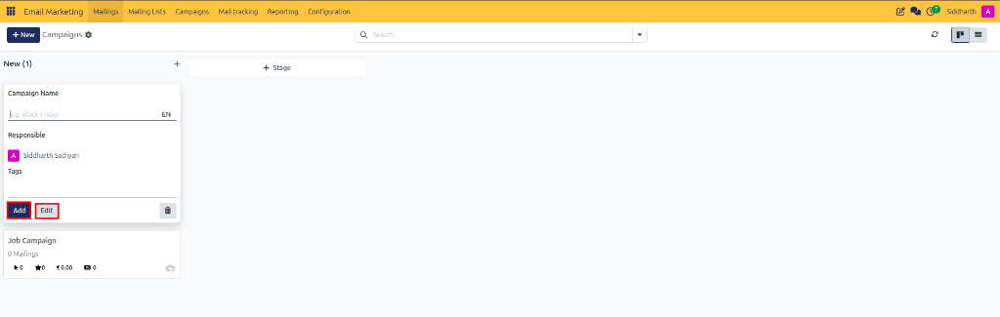
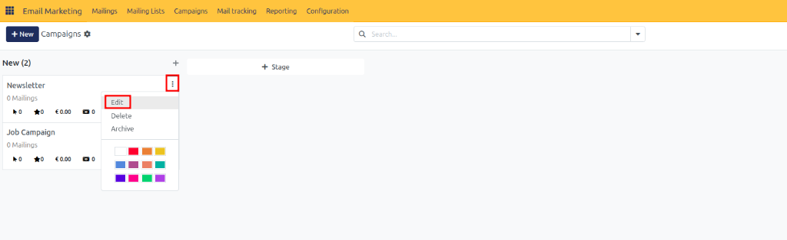
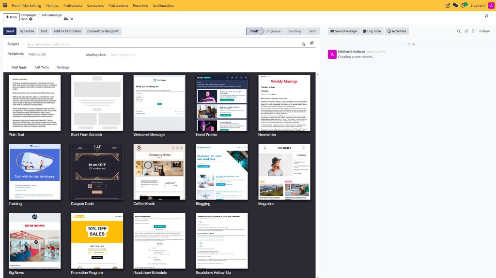
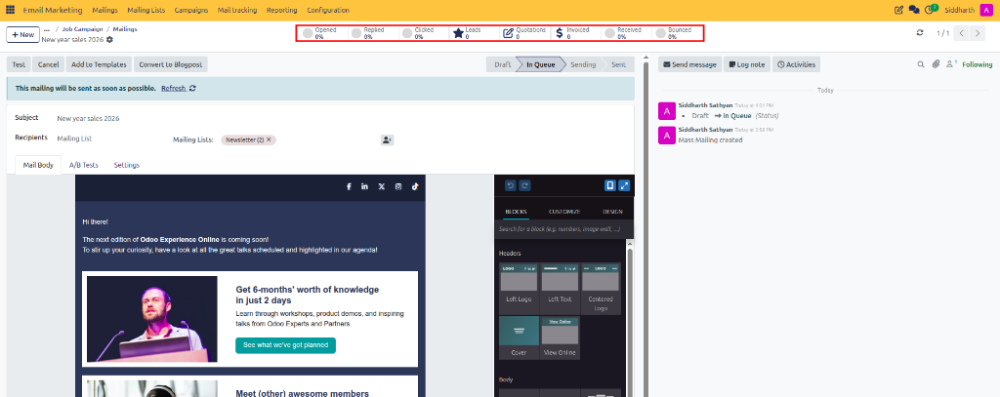

# Create and Organize Marketing Campaigns

This guide covers how to access the campaigns dashboard, create marketing initiatives, manage campaign pipeline stages, assign tags, compose mailings, and track performance metrics in CURQ 18 Email Marketing.

> **Prerequisites**
> * Active user account with **Email Marketing / User** rights.
> * Configured outgoing mail server and marketing list segments.

---

## 1. Create Marketing Campaigns

### 1.1 Open the Campaigns Dashboard

Access the campaign management workspace:

1. In the top navigation bar, click **Campaigns** (highlighted in red):

   

2. The campaigns dashboard displays active marketing initiatives across Kanban pipeline stages *(e.g., `New`)*:

   

3. To add a new pipeline stage, click **+ Stage** (or the add column icon) in the Kanban header.

---

### 1.2 Create a New Marketing Campaign

Define a new strategic marketing initiative directly from the Kanban board:

1. Click **+ New** (highlighted in red) at the top left of the Campaigns dashboard.
2. An inline quick-create card opens under the initial stage column:
   * **Campaign Name**: Enter a clear, descriptive campaign title *(e.g., `Black Friday` or `Newsletter`)*.
   * **Responsible**: Assign the marketing team member overseeing campaign execution.
   * **Tags**: Add organizational tags for filtering and reporting classification.

> For complete campaign field definitions, tags, and stage attributes, see [**Campaign Header Fields**](../settings-and-fields/01-mailing-and-campaign-field-definitions.md#2-campaign-header-fields).

   

3. Click **Add** (highlighted in red) to immediately create the campaign card on the board, or click **Edit** (highlighted in red) to open the full campaign form for advanced configuration.

---

## 2. Edit, Configure, or Archive Campaign Cards

Manage existing campaigns directly from the Kanban workspace:

1. Locate the target campaign card on the Kanban board.
2. Click the three dots menu icon (**⋮**, highlighted in red) in the top-right corner of the card:

   

3. Select an action from the dropdown menu:
   * **Edit** (highlighted in red): Opens the full campaign form view to adjust tags, linked activities, or smart button metrics.
   * **Delete**: Removes the campaign record.
   * **Archive**: Hides completed campaigns from the active board while preserving historical analytical data.
   * **Color Palette**: Assign a color swatch to visually categorize cards across stages.

---

## 3. Link Mailings and Track Campaign Engagement

### 3.1 Create and Link Mailings to a Campaign

Compose email broadcasts directly within your campaign initiative:

1. Open the target campaign record and click the **Mailings** smart button, then click **+ New** (or add a mailing directly from the campaign view).
2. The mailing composer opens with the campaign automatically linked in the breadcrumb hierarchy *(e.g., `Campaigns / Job Campaign / New`)*:

   

3. Complete the subject line, select recipients, and choose a responsive layout from the template gallery.
4. Compose, test, and dispatch the mailing according to your campaign schedule.

---

### 3.2 Track Campaign Mailing Engagement and Smart Button Metrics

Monitor real-time deliverability, engagement, and conversion metrics across linked broadcasts:

1. Open the target broadcast from the campaign's mailings view.
2. Review the smart buttons header bar (highlighted in red) to track live performance:

   

   * **Opened / Replied / Clicked**: Percentage of recipients who engaged with the broadcast content or links.
   * **Leads**: Number of CRM pipeline opportunities generated directly from recipient responses.
   * **Quotations / Invoiced**: Financial value of sales quotations and confirmed customer invoices resulting from the campaign mailing.
   * **Received / Bounced**: Percentage of successfully delivered messages versus failed email dispatches.

> For smart button metrics, revenue calculation, and conversion tracking, see [**Analytical Smart Button Metrics**](../settings-and-fields/01-mailing-and-campaign-field-definitions.md#5-analytical-smart-button-metrics).

---

## 4. Edge Cases & Recovery Steps

* **Unlinked Mailings**: If a mailing was created outside a campaign, open the mailing form, navigate to the **Settings** tab, and assign the target campaign in the **Mailing Campaign** field.
* **Archiving Completed Campaigns**: Once all campaign activities conclude, open the card menu and select **Archive** to maintain a clean Kanban workspace while preserving analytical reports.

---

## Related Documentation

* [Mailing and Campaign Field Definitions](../settings-and-fields/01-mailing-and-campaign-field-definitions.md)
* [Design, Schedule, and Send Email Mailings](./04-design-schedule-and-send-email-mailings.md)
* [Understanding Campaign Lifecycles and Subscriber Governance](../core-concepts/02-understanding-campaign-lifecycles-and-subscriber-governance.md)
* [Mailing and Campaign Field Definitions](../settings-and-fields/01-mailing-and-campaign-field-definitions.md)
