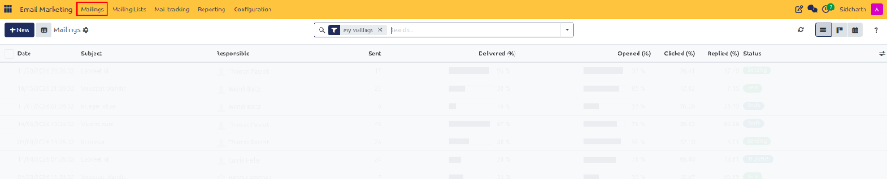
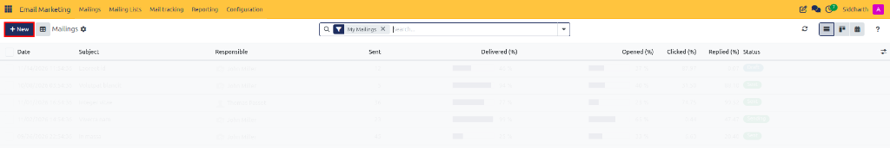
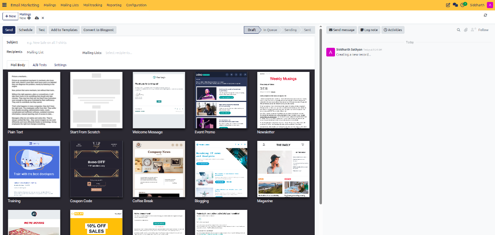
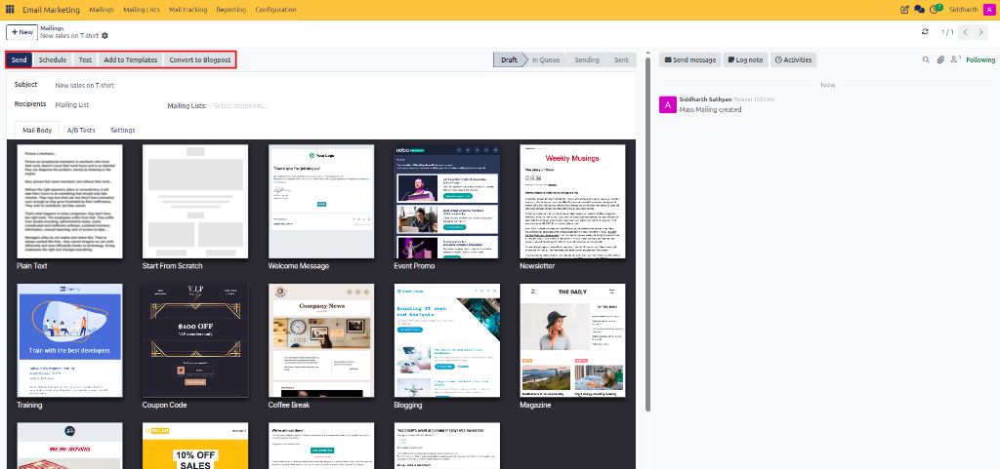

# Design, Schedule, and Send Email Mailings

This guide covers how to create a new email mailing, choose and customize responsive design templates, send test messages, and dispatch or schedule delivery in CURQ 18 Email Marketing.

> **Prerequisites**
> * Active user account with **Email Marketing / User** rights.
> * Configured outgoing mail server and marketing list segments.
>
> **Warning (Template Safety & Compliance Rule):** Before modifying production email templates, always create a duplicate copy to test layout and dynamic field tags. Deleting or modifying dynamic tags (such as `{{ object.name }}`) without verification can break outbound automated broadcasts. Always verify that unsubscribe links (`[[opt_out]]`) remain intact to prevent domain blacklisting.

---

## 1. Compose and Design Email Mailings

### 1.1 Initialize a New Email Mailing

Create a new mailing broadcast record:

1. In the top navigation bar, click **Mailings** (highlighted in red):

   

2. The **Mailings** list view displays all draft, in-queue, and completed email broadcasts.

3. In the top-left control panel, click **+ New** (highlighted in red) to open the composer:

   

---

### 1.2 Configure Recipients and Message Headers

Define message identification and target audience:

1. On the blank mailing form, enter the message headers:

   

2. Complete the essential fields:
   * **Subject**: The primary subject line visible in recipient inboxes.
   * **Preview Text**: A short secondary preview snippet displayed next to the subject.
   * **Recipients**: Choose **Mailing List** or select a business model *(e.g., `Contacts` or `Lead/Opportunity`)*.
   * **Select Mailing Lists**: Choose one or more subscriber lists to receive the broadcast.

> For complete field definitions and configuration specifications, see [**Mailing Record Fields**](../settings-and-fields/01-mailing-and-campaign-field-definitions.md#1-mailing-record-fields).

---

### 1.3 Choose a Responsive Layout Template

Select and customize the visual design of your email:

1. Scroll down to the template selection grid.
2. Choose a pre-built layout that fits your campaign objectives *(e.g., `Newsletter`, `Promotion`, or `Event Announcement`)*.
3. The visual building blocks appear. Click on text elements, images, and buttons to customize your content using the live editor.

---

## 2. Send a Test Email

Validate email rendering and link accuracy before broadcasting:

1. In the top-left action bar, review the action options (highlighted in red) and click **Test**:

   

2. The **Test Mailing** modal opens
3. Enter your test email address and click **Send Test**.
4. Open the email in desktop and mobile clients to verify design fidelity, image alignment, and CTA button destinations.

---

## 3. Launch or Schedule Broadcast Delivery

Dispatch the campaign to your target audience:

1. Return to the mailing form.
2. Choose your dispatch method:
   * **Immediate Send**: Click **Send** in the action bar, then confirm the prompt
   * **Scheduled Send**: Click **Schedule**, select the target calendar date and time, and click **Confirm**.
3. The mailing transitions to **In Queue** until the background scheduler transmits the messages.

---

## 4. Edge Cases & Recovery Steps

* **Canceling Queued Mailings**: If a mailing is in `In Queue` status and you need to abort delivery, open the record and click **Cancel** in the action bar before the scheduled time arrives.
* **Editing Sent Mailings**: Once a mailing transitions to `Sent`, the body content is permanently locked to preserve audit history. To reuse the content, select **Action > Duplicate** to create a fresh editable draft.

---

## Related Documentation

* [Create and Send Your First Email Marketing Campaign](../getting-started/01-create-and-send-your-first-email-marketing-campaign.md)
* [Generate and Analyze Email Marketing Reports](./06-generate-and-analyze-email-marketing-reports.md)
* [Understanding Email Marketing Architecture and Delivery Mechanisms](../core-concepts/01-understanding-email-marketing-architecture-and-delivery-mechanisms.md)
* [Mailing and Campaign Field Definitions](../settings-and-fields/01-mailing-and-campaign-field-definitions.md)
