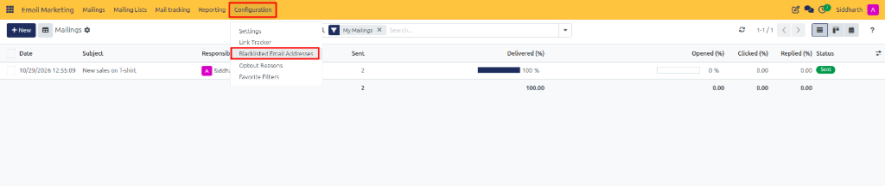
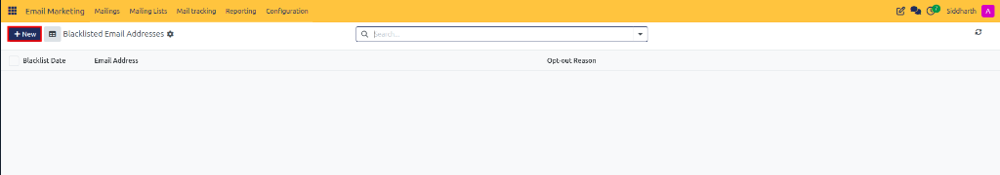
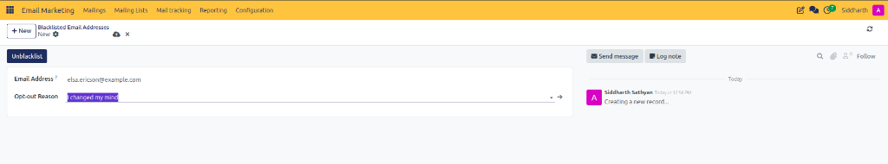
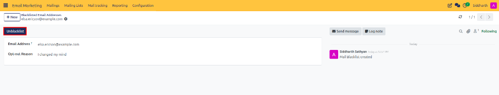
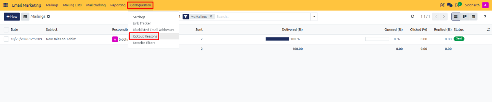
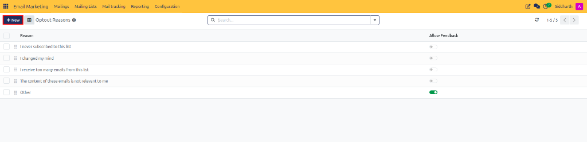

# Manage Blacklisted Emails and Opt-Out Reasons

This guide covers how to access the global email blacklist, manually manage suppression records, and customize opt-out feedback reasons in CURQ 18 Email Marketing.

---

## 1. Manage Blacklisted Email Addresses

### 1.1 Access Blacklisted Email Addresses

Open the global suppression list:

1. In Email Marketing, click **Configuration** and select **Blacklisted Email Addresses** (highlighted in red):

   

2. The **Blacklisted Email Addresses** list view displays all currently suppressed addresses across the system:

   

---

### 1.2 Manually Register or Unblacklist an Email Address

Manage individual suppression records:

1. To manually block an address, click **+ New** (highlighted in red) in the Blacklisted Email Addresses view.
2. Enter the target email address and select an opt-out reason in the form:

   

3. To unblacklist an address *(e.g., if a customer requests to re-subscribe)*, open their blacklist record and click **Unblacklist** (highlighted in red) in the top action bar:

   

> For complete field definitions and suppression criteria, see [**Global Email Blacklist Specifications**](../settings-and-fields/01-mailing-and-campaign-field-definitions.md#global-email-blacklist-specifications).

---

## 2. Configure Custom Opt-Out Feedback Reasons

Customize the reasons presented to recipients during the unsubscribe process:

1. Click **Configuration** and select **Opt-Out Reasons**:

   

2. The list view displays all configured feedback options:

   

3. Click **New** to add a new category *(such as `Receiving too frequently` or `No longer in this industry`)*.
4. Save the record. The reason will now appear on subscriber self-service unsubscribe pages.

> For complete field definitions and configuration details, see [**Opt-Out Reasons Specifications**](../settings-and-fields/01-mailing-and-campaign-field-definitions.md#opt-out-reasons-specifications).

---

## Edge Cases & Recovery Steps

* **Strict Overrides**: Global blacklist records override all individual mailing list subscriptions. If an address is blacklisted, it will not receive emails from any list until unblacklisted.
* **Audit Trail**: Every unblacklisting action is permanently recorded in the record chatter with the operating user's name and timestamp.

---

## Related Documentation

* [Manage Subscriber Lists and Track Campaign Engagement](../getting-started/02-manage-subscriber-lists-and-track-campaign-engagement.md)
* [Generate and Analyze Email Marketing Reports](./06-generate-and-analyze-email-marketing-reports.md)
* [Understanding Campaign Lifecycles and Subscriber Governance](../core-concepts/02-understanding-campaign-lifecycles-and-subscriber-governance.md)
* [Mailing and Campaign Field Definitions](../settings-and-fields/01-mailing-and-campaign-field-definitions.md)
