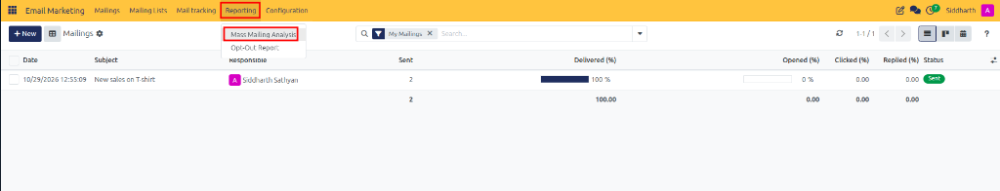
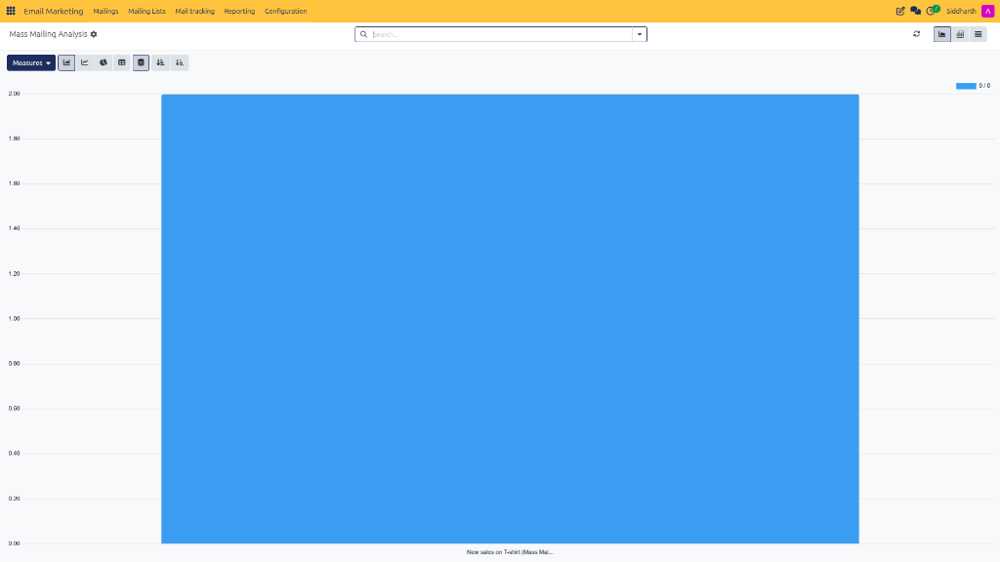
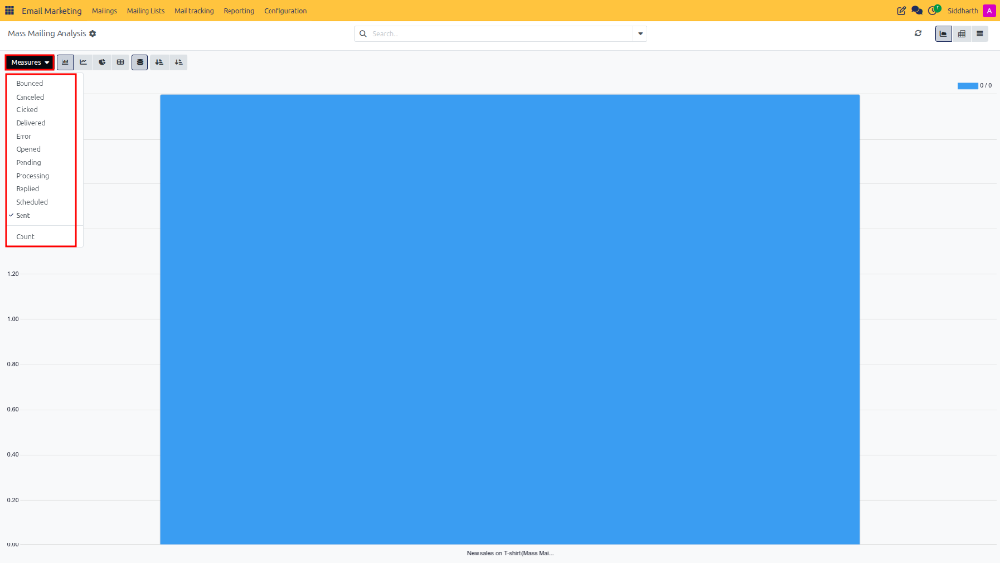
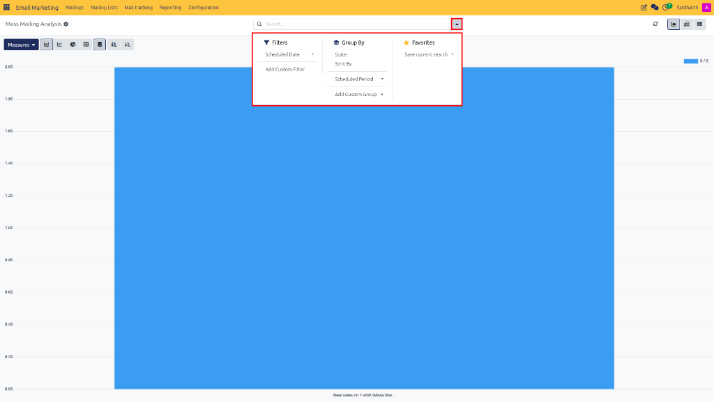
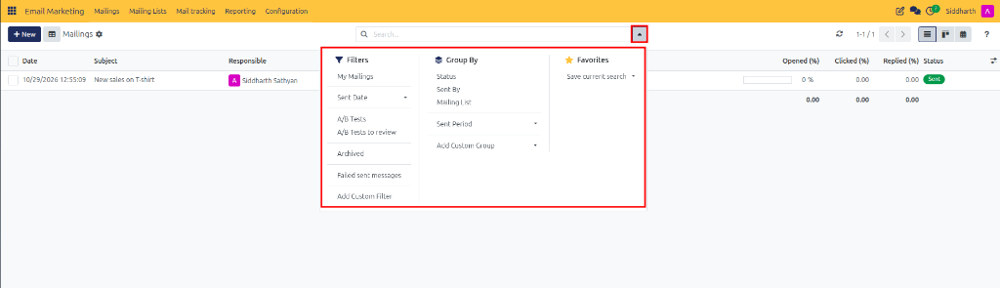
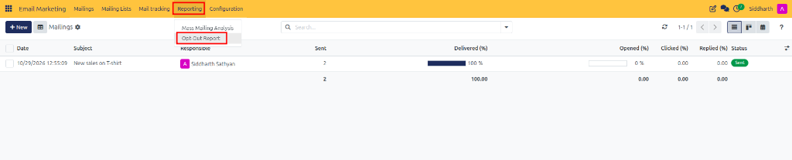
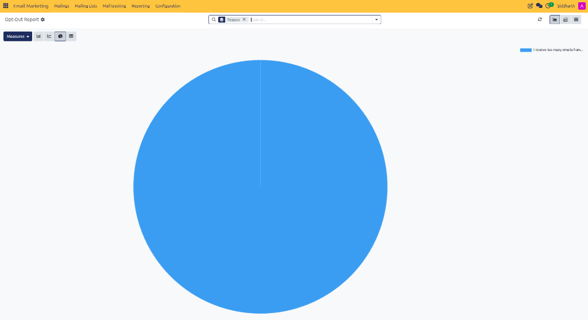

# Generate and Analyze Email Marketing Reports

This guide covers how to analyze mass mailing metrics, evaluate delivery and click statistics, apply custom measures and groupings, and inspect opt-out feedback reports in CURQ 18 Email Marketing.

---

## Task 1: Access Mass Mailing Analysis

Open the centralized marketing analytics dashboard:

1. In the top navigation bar, click **Reporting** and select **Mass Mailing Analysis** (highlighted in red):

   

2. The **Mass Mailing Analysis** dashboard opens in a graphical chart view, visualizing delivery and engagement counts:

   

---

## Task 2: Switch Analytical Views and Apply Measures

Inspect data across different analytical dimensions:

1. Use the view switch icons at the top right to toggle between **Bar Chart**, **Line Chart**, **Pie Chart**, and **Pivot Matrix**.
2. Click the **Measures** selector to evaluate specific key performance indicators:

   

   * **Delivered**: Total emails accepted by remote recipient mail servers.
   * **Opened**: Total and percentage of recipients who viewed the message.
   * **Clicked**: Total and percentage of recipients who clicked at least one link.
   * **Bounced**: Total undelivered emails returned due to delivery issues.

---

## Task 3: Apply Filters and Groupings

Segment reporting data to compare campaigns and timeframes:

1. Click the search bar dropdown in the top control panel to open the filter panel:

   

2. Apply filters to isolate specific criteria *(e.g., `Sent This Month`, `Campaign: Spring Sale`, or `Responsible`)*.
3. In the **Mailings** list view, use the grouping panel to organize records by status, mailing list, or campaign:

   

---

## Task 4: Inspect Opt-Out Feedback Analytics

Review why recipients are opting out of communications:

1. In the top navigation bar, click **Reporting** and select **Opt-Out Report** (highlighted in red):

   

2. The **Opt-Out Report** dashboard opens, categorizing unsubscribe responses in an interactive chart:

   

3. Review the distribution of reasons to determine if broadcast frequency, content relevance, or targeting criteria need adjustment.

---

## Edge Cases & Recovery Steps

* **Zero Opens Reported**: If an email shows zero opens despite delivered messages, check if image blocking is enabled on corporate recipient clients (open tracking relies on a 1x1 invisible pixel). Link clicks reliably confirm active opens even if tracking pixels are blocked.
* **Exporting Analytics**: Switch to the **Pivot View** or **List View**, click the **Action** gear icon, and select **Export** to generate an Excel spreadsheet for external reporting.

---

## Related Documentation

* [Manage Subscriber Lists and Track Campaign Engagement](../getting-started/02-manage-subscriber-lists-and-track-campaign-engagement.md)
* [Manage Blacklisted Emails and Opt-Out Reasons](./05-manage-blacklisted-emails-and-opt-out-reasons.md)
* [Understanding Campaign Lifecycles and Subscriber Governance](../core-concepts/02-understanding-campaign-lifecycles-and-subscriber-governance.md)
