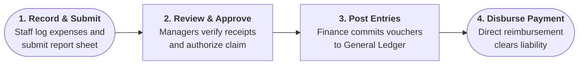
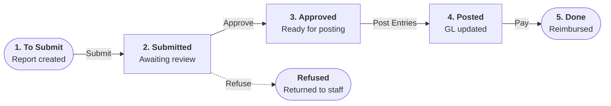

# Understanding the Expense Lifecycle and Accounting Flow

The Expenses module helps organizations manage employee expenditures from initial receipt capture to managerial verification, general ledger posting, customer reinvoicing, and reimbursement settlement. 

Employees can record expenses manually, upload digital receipts, drag and drop documents for optical character recognition (OCR), or submit receipts via email aliases. Managers review submitted expense reports, approving or refusing them with audit justifications. Once approved, the finance team posts expenses to the general ledger and settles employee reimbursements through direct bank transfers, cash, or checks.

---

## 1. Key Capabilities of CURQ Expenses

### 1.1 Multi-Channel Expense Capture
* **Expense Recording**: Capture expenditures manually or automatically through OCR document scanning and inbound email forwarding.
* **Expense Categories**: Configure expense types, fixed or variable reimbursement rates, general ledger accounts, purchase/sales taxes, and reinvoicing policies.
* **Expense Reports**: Group individual line items into consolidated expense report sheets for streamlined managerial review.

### 1.2 Governance, Accounting, and Analytics
* **Expense Approval**: Review, approve, or refuse submitted reports with mandatory justification logging in the record chatter.
* **Accounting Integration**: Post approved expenses to dedicated accounting journals, automatically generating balanced double-entry vouchers.
* **Employee Reimbursement**: Reimburse staff via bank transfers, cash, or checks individually or in batch.
* **Customer Reinvoicing**: Recharge project-related expenditures to client sales orders at cost or at standardized sales prices.
* **Expense Analysis**: Monitor spending patterns, evaluate departmental budgets, and identify high spenders using dynamic bar charts and pivot tables.

---

## 2. End-to-End Operational Lifecycle and State Machine

### 2.1 Sequential Processing Stages

CURQ Expenses structures employee expense management into four clear, sequential stages:

1. **Record & Submit**: Employees log expenditures via manual web entry, OCR receipt scanning, drag-and-drop, or email forwarding, and bundle them into an official expense report sheet.
2. **Review & Approve**: Supervisors verify receipts, policy limits, and project allocations, approving valid claims or refusing non-compliant reports with mandatory recorded explanations.
3. **Post to Accounting**: Finance posts approved claims to accounting journals *(e.g., `Vendor Bills`)*, recognizing the operating expense and deductible input VAT in the general ledger.
4. **Disburse Reimbursement**: Accounts payable registers direct bank or cash disbursements, settling the employee payable liability to **Done** / **In Payment**.

---

### 2.2 Lifecycle State Transitions

Every expense report transitions through a strict sequence of operational states:

| Lifecycle Status | Operational Description | Allowed Actions |
| :--- | :--- | :--- |
| **To Submit** | Initial creation state. Expenses are logged and bundled into a report sheet. | Edit lines, attach files, delete lines, **Submit to Manager**. |
| **Submitted** | Report is dispatched and awaiting managerial review. Lines are locked. | **Approve**, **Refuse**, Chatter collaboration. |
| **Approved** | Manager has authorized the claim. Ready for accounting commitment. | **Post Journal Entries**. |
| **Posted** | Journal entries are committed to the General Ledger. | **Pay** *(register payment)*, inspect **Journal Entry** stat button. |
| **Done** | Expense reimbursement process has been completed. | Audit history, view reconciliation vouchers. |
| **Refused** | Approver rejected the report with a mandatory explanation. | Review refusal reason in chatter, **Reset to Draft**. |

---

## 3. Payment Models and Accounting Mechanics

### 3.1 Employee-Paid vs. Company-Paid Models

CURQ Expenses fundamentally distinguishes between expenditures funded personally by staff and purchases settled using company funds:

| Dimension | Employee Paid *(Out-of-Pocket)* | Company Paid *(Corporate Account)* |
| :--- | :--- | :--- |
| **Payer** | Employee personal cash or personal card. | Corporate payment method or company funds. |
| **Reimbursement Required** | Yes. Funds must be returned to the employee. | No. Company funds were already settled at purchase. |
| **General Ledger Credit** | Employee Payable account *(Liability)*. | Company Bank or Cash clearing account *(Asset)*. |
| **Disbursement Channels** | Direct bank transfer, check, or cash. | Internal bank statement reconciliation. |

---

### 3.2 Standard Employee Reimbursement Journal Entry

When an approved expense report is posted via **Post Journal Entries**, CURQ executes balanced double-entry accounting transactions. When an employee incurs a `€ 1,200.00` client dining expense with 9% included tax (`€ 99.08` VAT, `€ 1,100.92` net):

| Line # | Account | Partner | Debit (Dr) | Credit (Cr) | Financial Impact |
| :--- | :--- | :--- | :--- | :--- | :--- |
| 1 | `Meals Operating Expense Account` | Employee | `€ 1,100.92` | `€ 0.00` | Expense increase (P&L) |
| 2 | `Input VAT / Tax Deductible Account` | Tax Authority | `€ 99.08` | `€ 0.00` | Tax asset increase (VAT) |
| 3 | `Employee Payable Account` | Siddharth Sathyan | `€ 0.00` | `€ 1,200.00` | Liability increase (Payable owed) |
| **Total** | | | **`€ 1,200.00`** | **`€ 1,200.00`** | **Balanced** |

---

### 3.3 Settlement and Payment Journal Entry

Upon reimbursement payment execution:

| Line # | Account | Partner | Debit (Dr) | Credit (Cr) | Financial Impact |
| :--- | :--- | :--- | :--- | :--- | :--- |
| 1 | `Employee Payable Account` | Siddharth Sathyan | `€ 1,200.00` | `€ 0.00` | Liability cleared |
| 2 | `Bank / Cash Account` | Corporate Bank | `€ 0.00` | `€ 1,200.00` | Asset decrease (Cash paid out) |
| **Total** | | | **`€ 1,200.00`** | **`€ 1,200.00`** | **Balanced** |

---

## Related Documentation

* [Create and Manage Expense Categories](../task-guides/01-create-and-manage-expense-categories.md)
* [Log Expenses and Attach Receipts](../task-guides/02-log-expenses-and-attach-receipts.md)
* [Submit and Track Expense Reports](../task-guides/03-submit-and-track-expense-reports.md)
* [Review, Approve, and Refuse Expenses](../task-guides/04-review-approve-and-refuse-expenses.md)
* [Post Expenses to Accounting Journals](../task-guides/05-post-expenses-to-accounting-journals.md)
