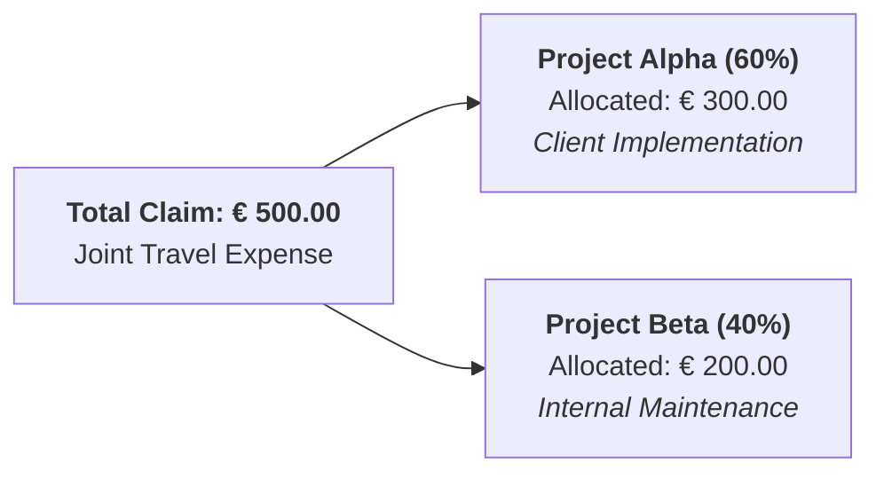

# Understanding Expense Reinvoicing and Analytic Costing

CURQ Expenses connects employee expenditures directly to customer billing and internal project accounting. This architecture enables companies to charge eligible costs back to clients and allocate expenses across multiple analytic cost centers.

---

## 1. Principles of Customer Expense Reinvoicing

When employees incur business expenses on behalf of a client *(such as project travel, meals, or equipment hire)*, organizations can recharge those costs directly through customer sales orders. 

By linking an active customer Sales Order in the **Customer to Reinvoice** field, CURQ tracks the billable expenditure through the approval lifecycle. Once approved and posted to the general ledger, the system automatically injects a corresponding billable line item into the client's Sales Order for customer invoicing.

---

## 2. Reinvoicing Policies and Price Calculations

Expense reinvoicing is governed by the **Re-Invoice Costs** policy configured on each expense category:

| Policy | Commercial Behavior | Financial Calculation | Ideal Use Case |
| :--- | :--- | :--- | :--- |
| **No** | The expense remains an internal corporate operating overhead. | Not reinvoiced. | General office supplies, internal staff training, administrative meals. |
| **At cost** | Re-bills the customer the exact amount incurred on the receipt. | `Sales Order Price = Purchase Cost` | Pass-through disbursements: client hotel stays, third-party tolls, client flight tickets. |
| **Sales price** | Re-bills the client using a fixed commercial catalog unit rate. | `Sales Order Price = Predefined Sales Price` | Fixed-rate client billables: travel mileage (€ 1.00/mile), daily consultant per diem rates. |

### Profit Margin Generation

When using the **Sales price** policy, organizations can generate a direct commercial margin on reinvoiced items:

$$\text{Expense Margin} = \text{Customer Invoiced Sales Price} - \text{Employee Reimbursed Cost}$$

For instance, an employee logs a 50-mile client site visit with an internal mileage reimbursement cost of € 0.60/mile (€ 30.00 reimbursement) and a customer billing rate of € 1.00/mile (€ 50.00 customer invoice). Upon invoicing, the general ledger recognizes:
* **Operating Expense (Employee Payable)**: € 30.00
* **Commercial Invoiced Revenue (Accounts Receivable)**: € 50.00
* **Direct Project Gross Profit**: € 20.00

---

## 3. Analytic Distribution & Multi-Project Allocation

Every expense line in CURQ supports multi-dimensional cost tagging through the **Analytic Distribution** widget. When an expenditure serves multiple projects, departments, or cost centers, the amount can be split proportionally across multiple analytic accounts:

| Analytic Account | Cost Category | Allocation % | Allocated Amount | Billing Status |
| :--- | :--- | :--- | :--- | :--- |
| **Project Alpha** | Client Implementation | 60% | `€ 300.00` | Re-invoiced to customer sales order |
| **Project Beta** | Internal Maintenance | 40% | `€ 200.00` | Internal operational overhead |
| **Total Allocation** | | **100%** | **`€ 500.00`** | **Fully Allocated** |

### 3.1 Allocation Principles
* **Sum to 100%**: When multiple projects or cost centers share an expense *(e.g., joint travel spanning two client audits)*, the percentage allocations must total exactly 100%.
* **Cost Center Real-Time Visibility**: Analytic lines post simultaneously with general ledger entries, immediately debiting project budget utilization on the CURQ Project dashboard.
* **Separation of Liability**: Even when expenses are split across multiple analytic accounts, the employee receives a single consolidated reimbursement payment.

---

## 4. Cross-Module Enterprise Integration

CURQ Expenses interacts across the entire enterprise data architecture:

| Integrated Module | Data Relationship | Operational Outcome |
| :--- | :--- | :--- |
| **CURQ Sales** | Sales Order foreign key linked via `Customer to Reinvoice`. | Automatically provisions billable service lines on customer contracts. |
| **CURQ Projects** | Analytic account binding on tasks and project workspaces. | Refreshes project profitability dashboards with real-time labor vs expense cost ratios. |
| **CURQ Accounting** | Journal entry posting and vendor payment registration. | Handles deductible VAT reconciliation and direct SEPA/wire bank disbursements. |
| **CURQ Employees** | Employee profile linkage and manager hierarchy. | Routes expense reports to designated team managers for validation and links personal bank accounts for direct disbursement. |

---

## Related Documentation

* [Understanding the Expense Lifecycle and Accounting Flow](./01-understanding-the-expense-lifecycle-and-accounting-flow.md)
* [Reinvoice Project Expenses to Customers](../task-guides/07-reinvoice-project-expenses-to-customers.md)
* [Create and Manage Expense Categories](../task-guides/01-create-and-manage-expense-categories.md)
* [Expense Record and Report Field Definitions](../settings-and-fields/02-expense-record-and-report-field-definitions.md)
* [Post Expenses to Accounting Journals](../task-guides/05-post-expenses-to-accounting-journals.md)
