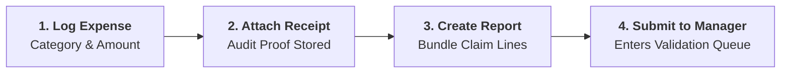
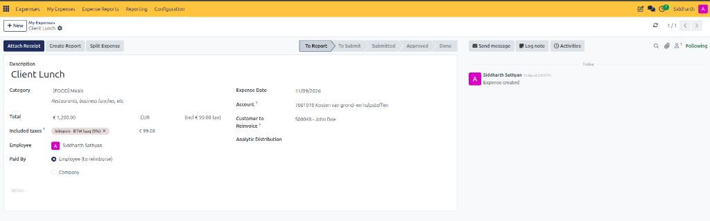
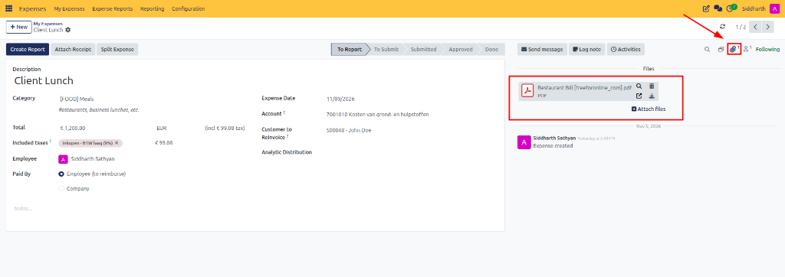
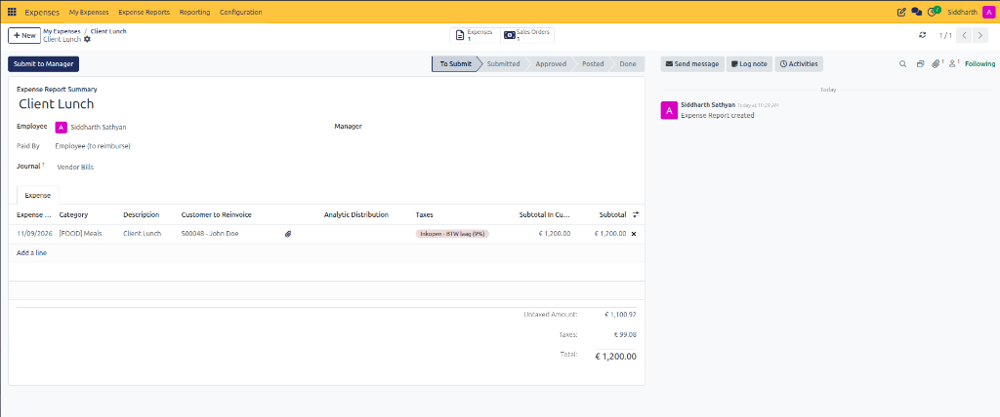

# Record and Submit Your First Expense

Welcome to CURQ Expenses. This tutorial provides employees with a quick, end-to-end walkthrough of logging an out-of-pocket business expenditure, attaching proof of purchase, bundling the transaction into an expense report, and submitting it to management for reimbursement.

> **Prerequisites**
> * An active CURQ user account with **Expenses / User (Own Records)** rights.
> * An employee profile linked to your user account under **Employees**.
> * At least one active **Expense Category** configured by your organization *(e.g., `[FOOD] Meals`)*.

---

## 1. Hands-On Scenario

In this walkthrough, you will record an out-of-pocket client hospitality dinner:
* **Description**: `Client Lunch`
* **Expense Category**: `[FOOD] Meals`
* **Total Paid**: `€ 1,200.00` *(inclusive of 9% VAT)*
* **Payment Party**: `Employee (to reimburse)`
* **Customer to Reinvoice**: `S00048 - John Doe`

---

## 2. Log Your Expense Record

1. Open the **Expenses** application from your main dashboard.
2. In the top navigation bar, click **My Expenses → My Expenses**.
3. In the upper-left action toolbar, click **New** to open a blank expense form.
4. Complete the primary transaction fields:
   * **Description**: Enter `Client Lunch`.
   * **Category**: Select `[FOOD] Meals`. CURQ automatically populates default expense accounts and the guideline note.
   * **Total**: Enter `1,200.00`. The tax breakdown (`€ 99.08`) is calculated automatically.
   * **Paid By**: Keep **Employee (to reimburse)** selected for personal out-of-pocket purchases.
   * **Customer to Reinvoice**: Select `S00048 - John Doe` to mark the cost as billable to the client.

5. Click the cloud icon or navigate to the next step to save your record.

> **Tip:** For complete field definitions of the expense form, see [**Individual Expense Form Fields Data Dictionary**](../settings-and-fields/02-expense-record-and-report-field-definitions.md#2-individual-expense-form-fields-data-dictionary).

---

## 3. Attach Proof of Purchase

Corporate audit compliance requires legible receipts for all claimed expenditures:

1. In the upper action bar of the expense form, click the dark blue **Attach Receipt** button.
2. In the file selection window, select your scanned bill *(e.g., `Restaurant Bill [freeforonline_com].pdf`)* and click **Open**.
3. CURQ uploads and binds the document directly to the record:
   * The file appears in the **Files** sidebar with inline preview and download controls.
   * The paperclip counter in the top-right stat bar increments to `1`.

> **Note:** For automated intake methods such as receipt OCR scanning, drag-and-drop ingestion, and email alias forwarding, see [**Log Expenses and Attach Receipts**](../task-guides/02-log-expenses-and-attach-receipts.md#4-alternative-intake-channels-ocr-upload-drag--drop-and-inbound-email).

---

## 4. Bundle and Submit for Approval

Individual expense entries must be packaged into a formal expense report before managers can review and authorize reimbursement:

1. In the upper action bar of the verified expense record, click the dark blue **Create Report** button.
2. CURQ consolidates the line into an **Expense Report** summary sheet:
   * **Expense Report Summary**: Pre-populated as `Client Lunch`.
   * **Financial Breakdown**: Reflects untaxed expenditure (`€ 1,100.92`), taxes (`€ 99.08`), and the total reimbursement claim (`€ 1,200.00`).
   * **Status Ribbon**: Sets the initial stage to **To Submit**.

3. In the upper-left action bar, click **Submit to Manager**:
   * The status advances to **Submitted**, locking the claim lines against accidental edits.
   * Your department supervisor receives an automated approval activity notification.

---

## Next Steps

Now that your report is submitted, proceed to [**Approve, Post, and Reimburse Expenses**](./02-approve-post-and-reimburse-expenses.md) to explore how managers validate submissions, how finance posts journal vouchers to the general ledger, and how reimbursement disbursements are executed.

---

## Related Documentation

* [Approve, Post, and Reimburse Expenses](./02-approve-post-and-reimburse-expenses.md)
* [Log Expenses and Attach Receipts](../task-guides/02-log-expenses-and-attach-receipts.md)
* [Submit and Track Expense Reports](../task-guides/03-submit-and-track-expense-reports.md)
* [Create and Manage Expense Categories](../task-guides/01-create-and-manage-expense-categories.md)
* [Expense Record and Report Field Definitions](../settings-and-fields/02-expense-record-and-report-field-definitions.md)
