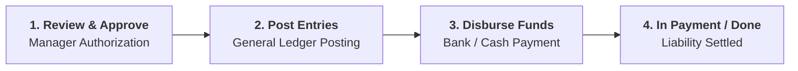
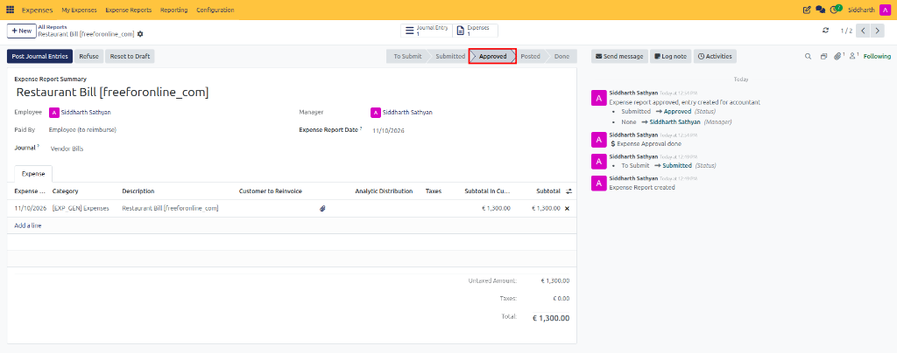
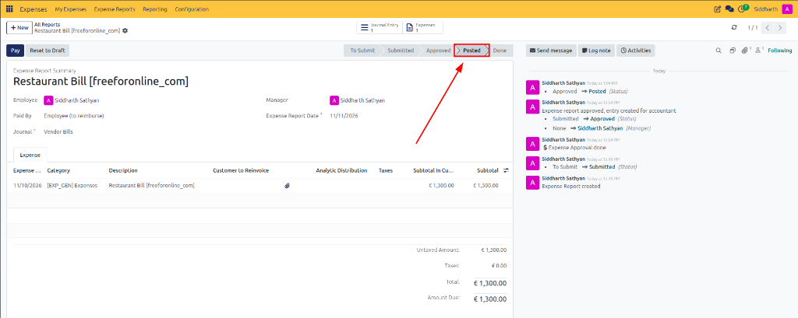
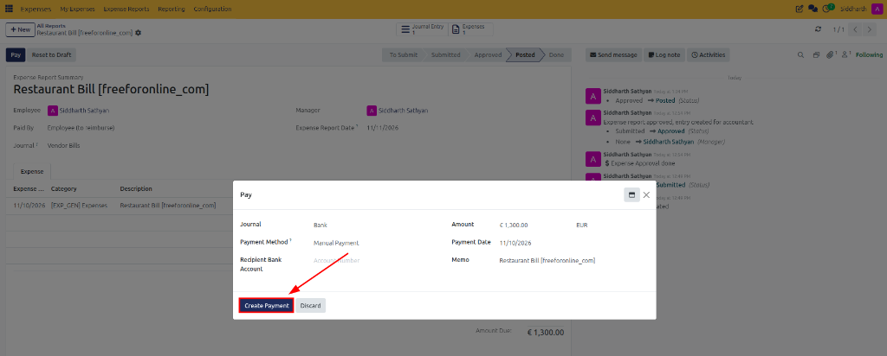
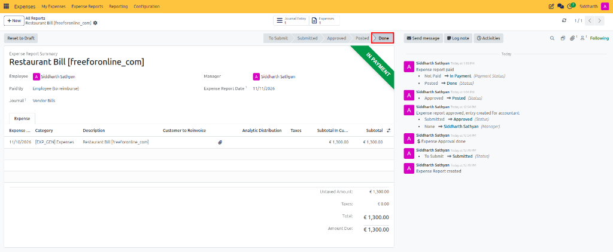

# Approve, Post, and Reimburse Expenses

Welcome to the administrative lifecycle of CURQ Expenses. This tutorial guides department managers and finance personnel through reviewing submitted employee claims, approving expenditures, committing double-entry journal vouchers to the general ledger, and issuing direct employee reimbursements.

> **Prerequisites**
> * Managerial permissions: At least **Team Approver** rights in CURQ Expenses.
> * Accounting permissions: **Accounting / Accountant** (or **Adviser**) for general ledger posting and payment registration.
> * One or more expense reports in **Submitted** status.

---

## 1. Hands-On Exercise: Approve, Post, and Reimburse

### 1.1 Review the Administrative Scenario

In this administrative walkthrough, you will process an approved employee expense claim through final settlement:
* **Expense Report Summary**: `Restaurant Bill [freeforonline_com]`
* **Claimant Employee**: `Siddharth Sathyan`
* **Net Reimbursement Liability**: `€ 1,300.00`
* **Accounting Destination Journal**: `Vendor Bills`
* **Settlement Method**: Direct bank transfer via corporate bank account

---

### 1.2 Review and Approve the Claim

Department managers inspect pending submissions to verify business necessity and policy compliance:

1. In the top navigation bar, navigate to **Expenses → Expense Reports**.
2. Filter the queue by **Submitted** status and open the target report *(e.g., `Restaurant Bill [freeforonline_com]`)*.
3. **Audit Checkpoints**:
   * Inspect attached receipt files in the **Files** sidebar to ensure amounts and vendor details match the logged lines.
   * Verify that expense categories, applicable taxes, and analytic project tags are properly assigned.
4. In the upper action bar, click the dark blue **Approve** button:
   * CURQ logs the approval event in the chatter audit trail.
   * The **Manager** field is stamped with your user profile.
   * The status advances to **Approved**, unlocking the claim for accounting journal posting:

> **Note:** If an expenditure violates corporate policy or lacks documentation, managers can click **Refuse** to mandate corrections. For complete guidance on refusal logging and claim resubmission, see [**Review, Approve, and Refuse Expenses**](../task-guides/04-review-approve-and-refuse-expenses.md).

---

### 1.3 Post Approved Expenses to the General Ledger

Financial users commit authorized expense liabilities into the accounting ledgers:

1. Open the approved expense report from **Expenses → Expense Reports**.
2. In the upper action bar, click **Post Journal Entries**:
   * CURQ generates and commits the corresponding journal entry voucher in the specified journal *(e.g., `Vendor Bills`)*.
   * The status ribbon advances from **Approved** to **Posted**.
   * A **Journal Entry** smart button appears in the upper stat bar, providing direct drill-down into double-entry accounting lines.
   * The dark blue **Pay** action button appears, reflecting the outstanding **Amount Due: € 1,300.00**:

> For complete definitions of accounting journals, accounting dates, and generated debit, tax, and credit lines, see [**Accounting Journal Posting Fields Data Dictionary**](../settings-and-fields/03-expense-reimbursement-and-posting-field-definitions.md#3-accounting-journal-posting-fields).

---

### 1.4 Disburse Employee Reimbursement

Once the liability is recognized in Accounts Payable, funds can be disbursed to the employee:

1. On the **Posted** expense report, click the dark blue **Pay** button in the upper action bar.
2. In the **Pay** pop-up modal, configure payment disbursement parameters:
   * **Journal**: Select your corporate Bank or Cash account *(e.g., `Bank`)*.
   * **Payment Method**: Select the applicable disbursement rail *(e.g., `Manual Payment`, `Batch Deposit (Bank)`, or `Checks (Bank)`)*.
   * **Recipient Bank Account**: Confirm the employee's personal bank account details.
   * **Amount**: Confirms the net disbursement figure *(e.g., `€ 1,300.00 EUR`)*.
   * **Payment Date**: Designate the effective transaction value date.

3. Click **Create Payment**:
   * CURQ books the payment transaction in the general ledger, clearing the employee payable balance.
   * The status ribbon advances to **Done**.
   * A prominent green **IN PAYMENT** banner appears in the upper-right corner of the report sheet, confirming that the claim is fully settled:

> For complete field definitions of the payment modal, see [**Direct Reimbursement Payment Modal Fields Data Dictionary**](../settings-and-fields/03-expense-reimbursement-and-posting-field-definitions.md#1-direct-reimbursement-payment-modal-fields). To process payments for multiple claims at once, see [**Reimburse Employee Expenses**](../task-guides/06-reimburse-employee-expenses.md#2-reimburse-multiple-expense-reports-in-bulk).

---

## 2. Exploring Further: Settlement Governance

### 2.1 Audit Trails and Approval Traceability
Every stage transition, attachment upload, manager approval, and refusal note is permanently logged in the Chatter audit feed with user stamps and ISO timestamps.

### 2.2 Rejection and Refusal Handling
Refusing an expense report sends the sheet back to the draft queue with a mandatory justification note, allowing employees to rectify and resubmit without losing entered receipt lines.

### 2.3 Batch Settlement and Grouped Payments
Finance teams can select multiple approved reports simultaneously from the management list view and execute a single consolidated bank payment per employee using the **Group Payments** feature.

---

## Related Documentation

* [Record and Submit Your First Expense](./01-record-and-submit-your-first-expense.md)
* [Review, Approve, and Refuse Expenses](../task-guides/04-review-approve-and-refuse-expenses.md)
* [Post Expenses to Accounting Journals](../task-guides/05-post-expenses-to-accounting-journals.md)
* [Reimburse Employee Expenses](../task-guides/06-reimburse-employee-expenses.md)
* [Expense Reimbursement and Posting Field Definitions](../settings-and-fields/03-expense-reimbursement-and-posting-field-definitions.md)
