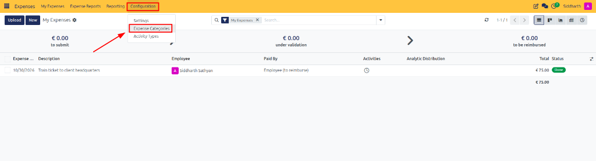
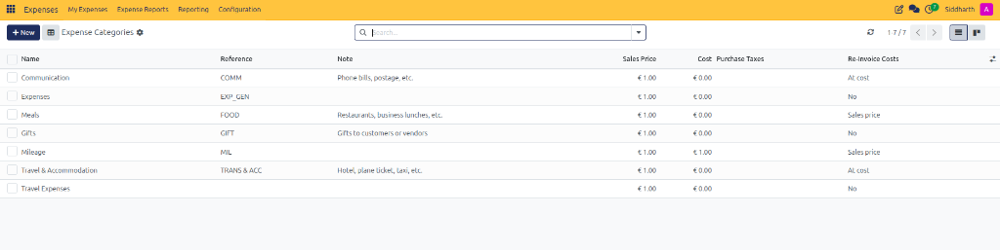
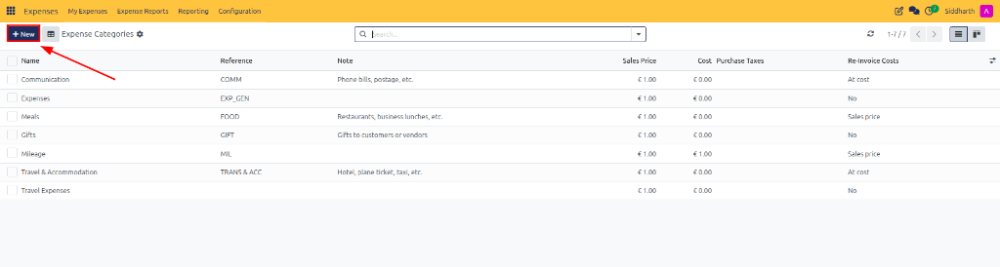
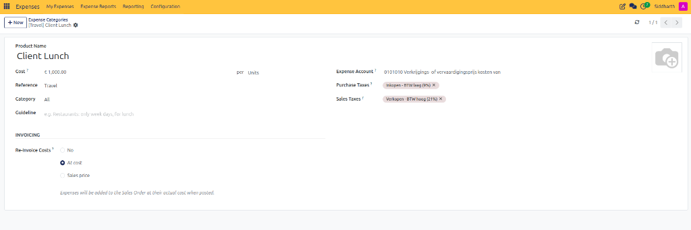
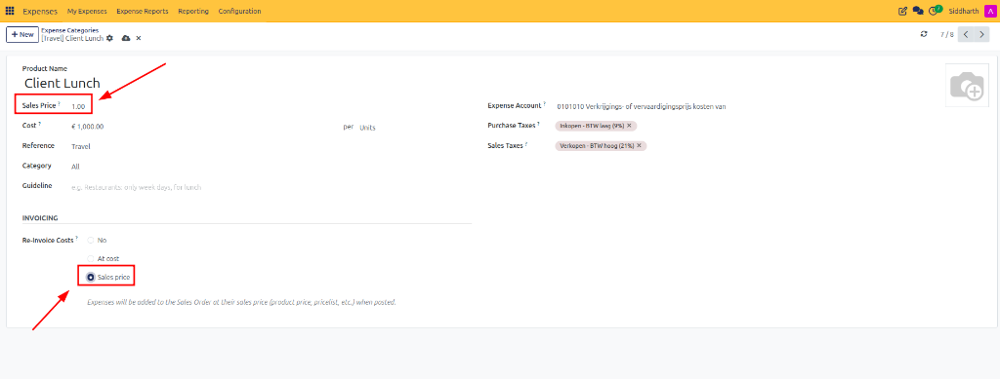

# Create and Manage Expense Categories

Expense categories establish the operational taxonomy, reimbursement costs, accounting ledgers, applicable taxes, employee guidelines, and reinvoicing policies for all expenditures in CURQ Expenses. Properly structured categories ensure corporate policy compliance, simplify receipt logging, and automate client reinvoicing.

> **Prerequisites**
> * Administrative access with **Expenses / Administrator (Manager)** permissions.
> * General Ledger chart of accounts configured in [**Accounting**](../../Accounting/core-concepts/01-understanding-double-entry-bookkeeping-and-journals.md).
> * Applicable purchase and sales taxes configured in **Accounting > Configuration > Taxes**.
>
> **Warning (Configuration Advisory):** Modifying expense categories requires administrative privileges. Because misconfiguration can lead to operational disruptions or workflow errors, configuration by a user administrator with the assistance of an authorized CURQ advisor or consultant is advised.

---

## 1. Create and Configure Expense Categories

### 1.1 Access the Expense Categories Register

1. Open the **Expenses** application.
2. In the top navigation bar, click **Configuration**.
3. In the dropdown menu, click **Expense Categories**:

4. CURQ displays the **Expense Categories** register catalog:

5. Review the default corporate expense categories pre-configured in CURQ:
   * **Communication**: Mobile telephone plans, internet data packages, postage, and courier fees (`COMM`, at cost).
   * **Expenses**: General corporate operating expenditures (`EXP_GEN`, no reinvoicing). This category serves as the fallback for expenses that do not belong to predefined categories.
   * **Meals**: Client dining, business lunches, and travel subsistence (`FOOD`, sales price).
   * **Gifts**: Client and vendor relationship tokens, hospitality items, and partner appreciation gifts (`GIFT`, no reinvoicing).
   * **Mileage**: Vehicle distance compensation allowances (`MIL`, € 1.00 standard rate, sales price).
   * **Travel & Accommodation**: Lodging, hotel reservations, flight tickets, rail transport, and taxi fares (`TRANS & ACC`, at cost).
   * **Travel Expenses**: Ancillary travel costs, airport parking, and luggage fees.

Existing categories can be modified, or new categories can be created to meet organizational requirements.

> For more details about the fields and columns on the expense categories register, see [**Expense Categories Register Data Dictionary**](../settings-and-fields/01-expense-category-and-configuration-field-definitions.md#1-expense-categories-register-data-dictionary).

---

### 1.2 Open the Category Creation Form

1. In the upper-left action bar of the Expense Categories register, click the dark blue **+ New** button:

2. CURQ opens the blank expense category creation form:

---

### 1.3 Configure Operational Parameters and Guidelines

Configure category identification and employee spending boundaries:
1. **Product Name (Mandatory)**: Enter a short, descriptive name for the expenditure type *(e.g., `Client Lunch`)*.
2. **Cost**: Specify the fixed reimbursement amount. Leave as `0.00` if employees are reimbursed based on the actual expense amount.
3. **Reference**: Enter a short reference code *(e.g., `FOOD`, `TRAVEL`, or `COMM`)* used for automated email intake routing.
4. **Category**: Select the appropriate product category in the catalog hierarchy *(e.g., `All`)*.
5. **Company**: Specify the operating company entity to which the category belongs. Leave blank if it applies across all multi-company entities.
6. **Guideline**: Provide instructions or policy rules about the expenses allowed under this category *(e.g., `e.g. Restaurants: only week days, for lunch`)*.

---

### 1.4 Map General Ledger Accounts and Taxes

Configure accounting and taxation mappings to ensure compliant journal posting:
1. **Expense Account (Mandatory)**: Select the general ledger operating expense account debited upon posting *(e.g., `0101010 Verkrijgings- of vervaardigingsprijs kosten van`)*.
2. **Purchase Taxes**: Specify the default purchase taxes applicable to the expense *(e.g., `Inkopen - BTW laag (9%)`)*.
3. **Sales Taxes**: Specify the default sales taxes applied when reinvoicing to customers *(e.g., `Verkopen - BTW hoog (21%)`)*.
4. Changes are automatically saved by CURQ upon leaving the form.

> For detailed field descriptions across category setup, accounting mappings, and client billing, see [**General Information & Identification Fields**](../settings-and-fields/01-expense-category-and-configuration-field-definitions.md#21-general-information--identification-fields), [**Financial and Tax Mapping Fields**](../settings-and-fields/01-expense-category-and-configuration-field-definitions.md#22-financial-and-tax-mapping-fields), and [**Reinvoicing & Commercial Recovery Fields**](../settings-and-fields/01-expense-category-and-configuration-field-definitions.md#23-reinvoicing--commercial-recovery-fields).

---

## 2. Configure Reimbursement Rates and Billing Policies

### 2.1 Configure Reimbursement Rates and Cost Models

The **Cost** field dictates how CURQ computes employee reimbursement values:

* **Meals (Actual Expense, Cost = 0.00)**: Set Cost to `0.00` when employees are reimbursed for the actual amount spent *(e.g., restaurant receipts, flights, or hotel bills)*. The employee inputs the precise invoice total.
* **Mileage (Fixed Unit Rate, Cost = 1.00)**: Set Cost to `1.00` when employees receive a fixed reimbursement allowance of `1.00` per mile or kilometer. When logging the expense, the employee enters the distance in **Quantity**, and CURQ computes the total:
  $$\text{Reimbursement Total} = \text{Logged Quantity} \times \text{Unit Cost Rate}$$
* **Per Diem (Fixed Daily Allowance, Cost = 125.00)**: Set Cost to `125.00` when employees receive a flat daily subsistence stipend of `125.00` per day of business travel.

---

### 2.2 Re-Invoice Project Expenses to Client Sales Orders

If the Sales module is installed, the invoicing section allows expenses to be charged back to customers through sales orders:

1. Open the expense category and locate the **INVOICING** section.
2. Select the desired **Re-Invoice Costs** billing policy:
   * **No**: The expenditure remains an internal company overhead expense.
   * **At cost**: When employee expenses are posted, CURQ generates billable expense lines on the linked Sales Order matching the cost configured on the category.
   * **Sales price**: CURQ bills the client using a standardized commercial catalog rate while reimbursing the employee at their incurred cost.
3. When **Sales price** is selected, CURQ dynamically reveals the commercial pricing controls:

4. **Configure Commercial Billing Parameters**:
   * **Sales Price**: Enter the fixed unit price charged to the client *(e.g., `1.00`)*. This field appears dynamically below **Product Name** once **Sales price** is activated.
   * **Sales Taxes**: Verify the output sales tax rate *(e.g., `Verkopen - BTW hoog (21%)`)* applied to client invoices.
   * **Dynamic Confirmation**: CURQ displays confirmation text below the selector:
     > *"Expenses will be added to the Sales Order at their sales price (product price, pricelist, etc.) when posted."*
5. Changes are automatically saved by CURQ upon leaving the form.

---

> **Tip (Advised Settings):** Map every expense category to its dedicated general ledger operating account and standard Dutch RGS purchase tax code.

---

## Related Documentation

* [Understanding Expense Reinvoicing and Analytic Costing](../core-concepts/02-understanding-expense-reinvoicing-and-analytic-costing.md)
* [Record and Submit Your First Expense](../getting-started/01-record-and-submit-your-first-expense.md)
* [Reinvoice Project Expenses to Customers](./07-reinvoice-project-expenses-to-customers.md)
* [Expense Category and Configuration Field Definitions](../settings-and-fields/01-expense-category-and-configuration-field-definitions.md)
* [Log Expenses and Attach Receipts](./02-log-expenses-and-attach-receipts.md)
