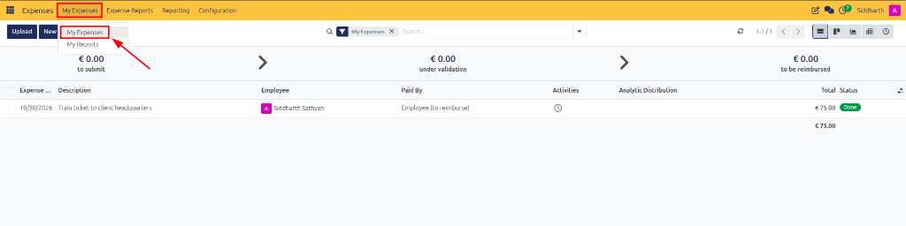
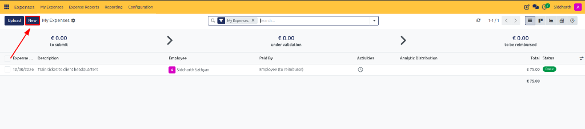
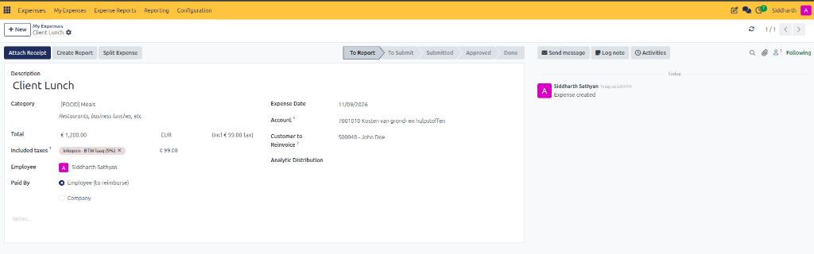
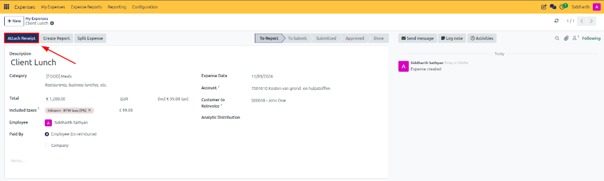
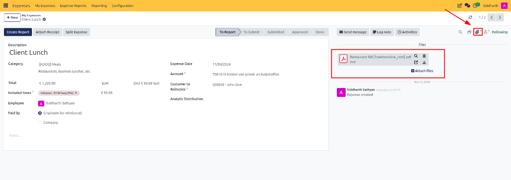
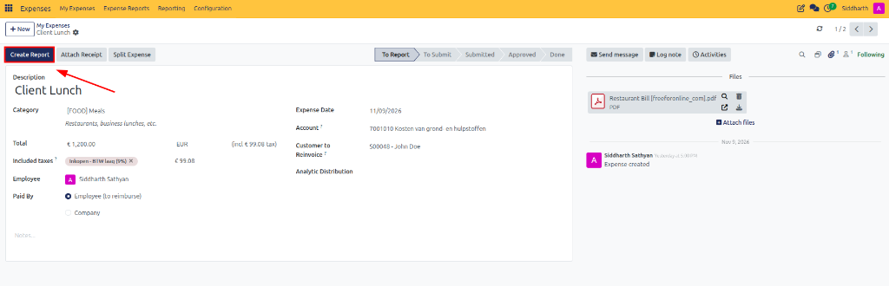
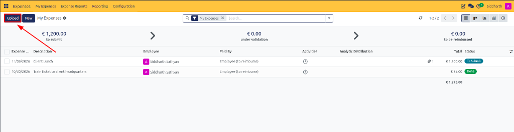
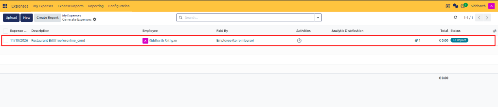
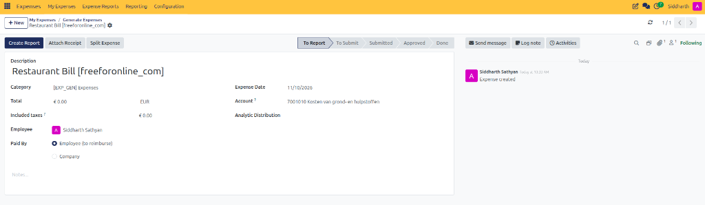

# Log Expenses and Attach Receipts

Employees must record their expenditures in CURQ before they can be included in expense reports and processed for reimbursement. CURQ Expenses supports four flexible intake channels: manual web entry, receipt file uploads, drag-and-drop receipt scanning, and inbound email forwarding.

> **Prerequisites**
> * Active CURQ user account with **Expenses / User (Own Records)** rights.
> * Document scanning or camera device for capturing receipt images *(PDF, PNG, JPEG)*.
> * For email ingestion: An authenticated work email address registered on your employee profile.

---

## 1. Create and Record Individual Expenses Manually

### 1.1 Access the My Expenses Register

1. Open the **Expenses** application.
2. In the top navigation bar, click **My Expenses**.
3. In the dropdown menu, select **My Expenses**:

4. CURQ opens the **My Expenses** personal workspace.
5. **Evaluate the Personal Register Layout**:
   * **Pipeline Status Banners**: Header metric cards summarize personal expense claims across approval stages:
     * **to submit**: Sum of draft or recorded expenses not yet bundled into an expense report.
     * **under validation**: Total value of claims submitted and awaiting manager review.
     * **to be reimbursed**: Value of approved expenses awaiting accounts payable or payroll disbursement.
   * **Action Controls**:
     * **Upload**: Initiates multi-receipt upload with optical character recognition (OCR).
     * **New**: Opens a blank form for manual transactional data entry.
   * **Itemized Expense Register Columns**: Review logged expenditures, payment types, and operational statuses *(e.g., `10/30/2026 Train ticket to client headquarters`, `€ 75.00`, green `Done` status)*.

> For more details about the columns, summary banners, and status cards on the register, see [**My Expenses Register and Pipeline Data Dictionary**](../settings-and-fields/02-expense-record-and-report-field-definitions.md#1-my-expenses-register-and-pipeline-data-dictionary).

---

### 1.2 Create and Configure the Expense Form

1. In the upper-left action bar of the My Expenses register, click the dark blue **New** button:

2. CURQ opens the individual expense record form:

3. **Configure Transaction Details**:
   * **Description (Mandatory)**: Enter a short description of the expense *(e.g., `Client Lunch` or `Hotel Accommodation`)*.
   * **Category (Mandatory)**: Select the appropriate expense category *(e.g., `[FOOD] Meals`)*. CURQ automatically displays the associated category guideline note *(e.g., `Restaurants, business lunches, etc.`)*.
   * **Total (Mandatory)**: Enter the total amount paid for the expense *(e.g., `€ 1,200.00`)*.
   * **Quantity**: Specify the number of units when the expense has a fixed unit price *(e.g., distance units or per diem days)*.
     > **Note:** If the selected expense category has a fixed cost, the unit price is automatically populated. The total amount is calculated based on the quantity entered.
   * **Included taxes**: Displays the taxes configured for the selected expense category *(e.g., `Inkopen - BTW laag (9%)`, `€ 99.08`)*.
   * **Employee (Mandatory)**: Select the employee associated with the expense *(defaults to the active user profile, e.g., `Siddharth Sathyan`)*.
   * **Paid By**: Specify whether the expense was paid by the employee or the company:
     * **Employee (to reimburse)**: For personal out-of-pocket payments requiring corporate reimbursement.
     * **Company**: For purchases settled using a corporate payment method.
4. **Configure Accounting and Billing Linkages**:
   * **Expense Date (Mandatory)**: Select the date on which the expense was incurred *(e.g., `11/09/2026`)*.
   * **Account**: Select the general ledger operating expense account where the expense should be recorded *(e.g., `7001010 Kosten van grond- en hulpstoffen`)*.
   * **Customer to Reinvoice**: Select the customer sales order if the expense needs to be charged back to a client *(e.g., `S00048 - John Doe`)*.
   * **Analytic Distribution**: Allocate the expense to relevant projects or cost centers.
   * **Company**: Select the operating company associated with the expense.
   * **Notes...**: Add internal itemization notes, justification comments, or client attendee lists.
5. Review the right-hand chatter audit feed, which logs the initial creation timestamp: `Siddharth Sathyan Expense created`.

> For more details about transaction fields, action buttons, and audit trail attributes, see [**Individual Expense Form Fields Data Dictionary**](../settings-and-fields/02-expense-record-and-report-field-definitions.md#2-individual-expense-form-fields-data-dictionary).

---

### 1.3 Attach Supporting Receipts and Documentation

Receipts can be attached to individual expense records for verification, audit compliance, and managerial review:

1. Locate the top action bar on the saved expense form:

2. Click the dark blue **Attach Receipt** button.
3. In the file selection dialog, browse and select your digital receipt file *(PNG, JPEG, PDF)* from your computer.
4. Click **Open** to commit the upload:
   * The receipt file is securely stored and attached directly to the expense record.
   * The paperclip counter in the upper-right corner updates to indicate the count of attached documents *(e.g., `1` attachment)*.
   * The right-hand sidebar displays the uploaded document preview under **Files** *(e.g., `Restaurant Bill [freeforonline_com].pdf`)*, complete with inline preview and download controls.

5. If an expenditure requires supplementary documentation *(such as an itemized meal bill plus a payment terminal receipt)*, click **+ Attach files** in the Files widget or click **Attach Receipt** in the top action bar to append additional files.
6. If charges need to be partitioned across different categories or cost centers, click **Split Expense** in the top action bar.
7. Once individual expenses and supporting receipts are verified, click the dark blue **Create Report** button in the upper-left action bar to consolidate the claim into an official expense report sheet:

> **Tip:** For the complete procedure on reviewing bundled report lines, audit checks, and managerial submission, see [**Submit and Track Expense Reports**](./03-submit-and-track-expense-reports.md).

---

## 2. Alternative Automated Intake Channels

In addition to manual web entry, CURQ provides automated intake workflows to eliminate manual typing:

### 2.1 Upload and Digitize Receipts via OCR

1. Open the **Expenses** application and navigate to **My Expenses > My Expenses**.
2. In the upper-left action toolbar, click the dark blue **Upload** button:

3. In the file picker dialog, select one or more receipt files *(PNG, JPEG, PDF)* and click **Open**.
4. CURQ scans the receipt and creates a new draft expense record using the information extracted from the document:
   * Automatically extracts merchant data, transaction dates, currency, and total values.
   * Displays the generated record in the **Generate Expenses** view *(e.g., `11/10/2026 Restaurant Bill [freeforonline_com]`, attachment count `1`, initial draft status `To Report`)*.

5. Click into the newly generated expense row to open the detailed record form:

6. **Review and Complete Draft Values**:
   * **Description**: Pre-filled with the uploaded file name *(e.g., `Restaurant Bill [freeforonline_com]`)*. You can refine this to reflect the specific business event *(e.g., `Client Hospitality Dinner`)*.
   * **Category**: Defaults to general expenses *(e.g., `[EXP_GEN] Expenses`)*; update to the specific category *(e.g., `[FOOD] Meals`)* to apply correct policy guidelines and reinvoicing defaults.
   * **Total & Taxes**: Review extracted gross amounts and input VAT deduction. If OCR captured `€ 0.00` due to scan resolution, enter the exact receipt amount from the attached bill.
   * **Customer to Reinvoice**: Link to an active client Sales Order if the expense is project-billable.
   * **Create Report**: Once verified, click **Create Report** to package the claim into an expense sheet for submission.

> For more details about the register columns and intake status badges, see [**My Expenses Register and Pipeline Data Dictionary**](../settings-and-fields/02-expense-record-and-report-field-definitions.md#1-my-expenses-register-and-pipeline-data-dictionary). To review form field definitions and validation rules, see [**Individual Expense Form Fields Data Dictionary**](../settings-and-fields/02-expense-record-and-report-field-definitions.md#2-individual-expense-form-fields-data-dictionary).

### 2.2 Ingest Receipts via Drag and Drop

Receipts can also be uploaded by dragging and dropping files onto the Expenses dashboard:

1. Ensure expense digitization is enabled in Settings.
2. Open the **Expenses** application.
3. Drag the receipt file from your local file browser onto the dashboard workspace.
4. CURQ scans the receipt and displays the generated record on the **Generate Expenses** dashboard.
5. Open the record and review or update the extracted information before submitting.

### 2.3 Submit Expenses Through Email Aliases

Expenses can be created by sending receipts to a configured email alias:

1. Navigate to **Expenses → Configuration → Settings**.
2. Enable **Incoming Emails**.
3. Configure the email alias *(e.g., `expenses@yourcompany.com`)*.
4. Click **Save**.
5. Employees send an email to the configured alias with the receipt attached:
   * The email subject must contain the expense category reference followed by the expense amount.
   * CURQ matches the sender's authenticated email, creates the expense record, and attaches the receipt file.
   * **Note:** Only authenticated employee email addresses are accepted. The employee's work email address must be configured in the Work Email field of their profile in the Employees module.

> For incoming email alias and OCR configuration parameters, see [**Receipt Processing and Digitization (OCR)**](../settings-and-fields/01-expense-category-and-configuration-field-definitions.md#31-receipt-processing-and-digitization-ocr).

---

## Related Documentation

* [Record and Submit Your First Expense](../getting-started/01-record-and-submit-your-first-expense.md)
* [Submit and Track Expense Reports](./03-submit-and-track-expense-reports.md)
* [Review, Approve, and Refuse Expenses](./04-review-approve-and-refuse-expenses.md)
* [Create and Manage Expense Categories](./01-create-and-manage-expense-categories.md)
* [Expense Record and Report Field Definitions](../settings-and-fields/02-expense-record-and-report-field-definitions.md)
* [Expense Category and Configuration Field Definitions](../settings-and-fields/01-expense-category-and-configuration-field-definitions.md)
