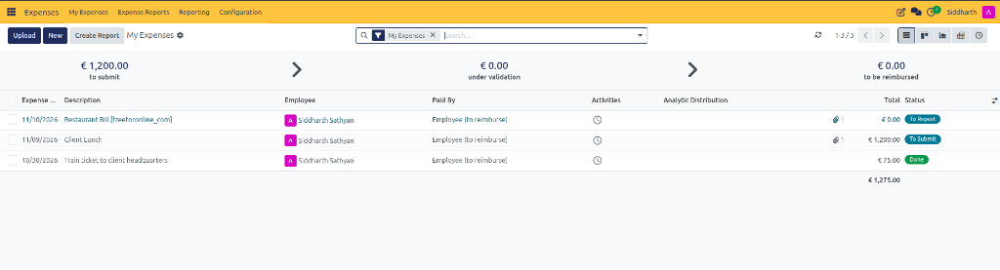
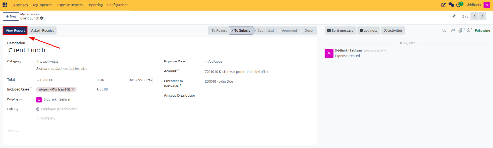
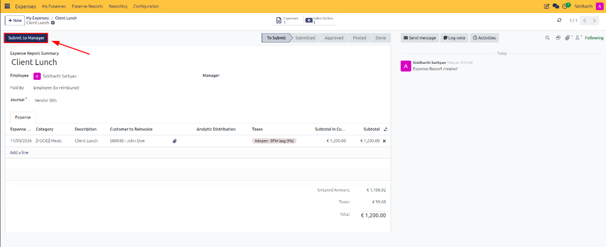
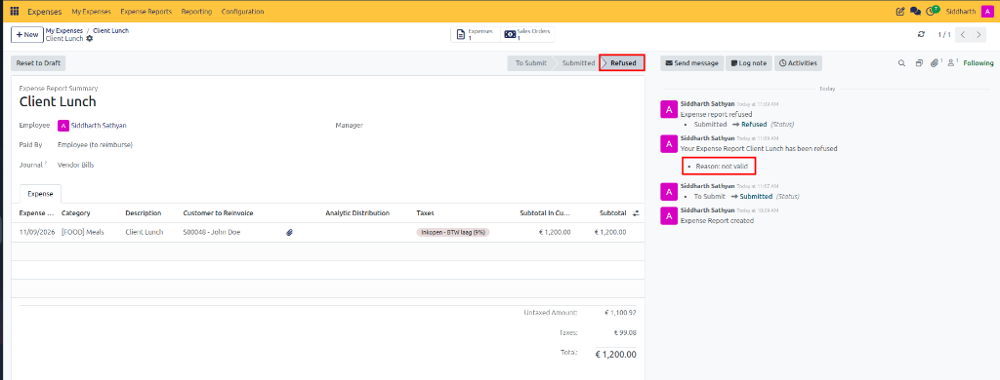
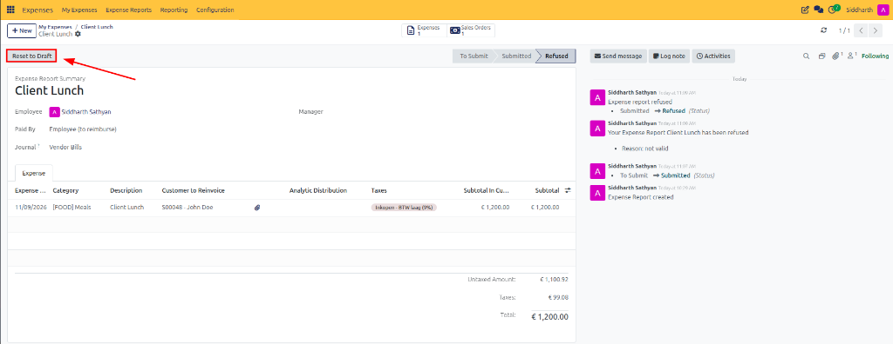

# Submit and Track Expense Reports

Individual draft expenses must be packaged into consolidated expense reports and formally submitted to enter the management verification workflow. This guide details how to bundle draft lines, track status progression, audit reviewer feedback, and handle refused claims in CURQ Expenses.

> **Prerequisites**
> * Active CURQ user account with **Expenses / User (Own Records)** rights.
> * One or more recorded expense entries *(in `To Report` or `To Submit` status)*.

---

## 1. Bundle and Submit Expense Reports

### 1.1 Monitor Expenses on the Personal Register

1. Open the **Expenses** application.
2. In the top navigation bar, click **My Expenses > My Expenses**.
3. CURQ displays your personal expense register and pipeline status cards:

4. **Evaluate Register Metrics and Transaction Statuses**:
   * **Pipeline Status Banners**:
     * **to submit**: Sum of logged expenses waiting to be bundled or submitted *(e.g., `€ 1,200.00 to submit`)*.
     * **under validation**: Value of claims currently submitted and awaiting manager authorization *(e.g., `€ 0.00`)*.
     * **to be reimbursed**: Value of approved expenses awaiting payment or payroll disbursement *(e.g., `€ 0.00`)*.
   * **Itemized Expense Lines**: Review logged expenditures and their current lifecycle stage:
     * `11/10/2026 Restaurant Bill [freeforonline_com]` — `€ 0.00`, Status **To Report** *(newly uploaded draft receipt)*.
     * `11/09/2026 Client Lunch` — `€ 1,200.00`, Status **To Submit** *(bundled into an unsubmitted report sheet)*.
     * `10/30/2026 Train ticket to client headquarters` — `€ 75.00`, Status **Done** *(fully approved and processed)*.
   * **Aggregated Register Total**: Shows total expenditures recorded across all lines *(e.g., `€ 1,275.00`)*.

> For complete descriptions of the register columns, filter options, and pipeline status banners, see [**My Expenses Register and Pipeline Data Dictionary**](../settings-and-fields/02-expense-record-and-report-field-definitions.md#1-my-expenses-register-and-pipeline-data-dictionary).

---

### 1.2 Access Bundled Reports via Individual Expense Lines

When an expense is packaged into an expense report, its status transitions to **To Submit**:

1. In the **My Expenses** register, click on an expense row currently in **To Submit** status *(e.g., `Client Lunch`)*.
2. CURQ opens the individual expense form:

3. Observe the upper action toolbar:
   * The status pipeline displays **To Submit** as the active stage.
   * CURQ replaces the standard creation controls with the dark blue **View Report** button.
4. Click **View Report** to navigate directly to the consolidated Expense Report sheet.

> For field specifications and action button behavior on the individual expense form, see [**Individual Expense Form Fields Data Dictionary**](../settings-and-fields/02-expense-record-and-report-field-definitions.md#2-individual-expense-form-fields-data-dictionary).

---

### 1.3 Submit the Consolidated Expense Report to Management

The Expense Report sheet aggregates individual lines into an official claim for managerial review:

1. On the Expense Report sheet *(e.g., `Client Lunch`)*, review the header parameters and itemized table:

2. **Verify Report Configuration**:
   * **Expense Report Summary**: Descriptive title of the claim *(e.g., `Client Lunch`)*.
   * **Employee**: Staff member submitting the claim *(e.g., `Siddharth Sathyan`)*.
   * **Paid By**: Funding classification *(e.g., `Employee (to reimburse)`)*.
   * **Journal**: Pre-configured destination accounting journal *(e.g., `Vendor Bills`)*.
   * **Smart Buttons**: Quick links displaying linked records *(e.g., `Expenses: 1` and `Sales Orders: 1`)*.
   * **Expense Lines**: Itemized breakdown showing date, category, description, customer reinvoice link, attached receipts, taxes, and subtotal *(e.g., `€ 1,200.00`)*.
   * **Financial Summary**: Untaxed amount *(e.g., `€ 1,100.92`)*, applicable taxes *(e.g., `€ 99.08`)*, and total claim *(e.g., `€ 1,200.00`)*.
3. Click the dark blue **Submit to Manager** button.
4. The report status advances to **Submitted**, locking the lines and dispatching an approval activity to the designated supervisor.

> For details on report header fields, journal assignment rules, and report sheet statuses, see [**Expense Report (Sheet) Fields Data Dictionary**](../settings-and-fields/02-expense-record-and-report-field-definitions.md#3-expense-report-sheet-fields-data-dictionary).

---

## 2. Track Approval Status and Resolve Refused Reports

### 2.1 Track Stage Progression and Lifecycle Statuses

Expense reports move through distinct administrative stages during the review and reimbursement lifecycle:

| Status | Description |
| :--- | :--- |
| **To Submit** | The expense report has been created but has not yet been submitted for approval. |
| **Submitted** | The report has been submitted and is awaiting managerial review. |
| **Approved** | The manager has approved the expense report. |
| **Posted** | The expenses have been committed to an accounting journal. |
| **Done** | The expense reimbursement process has been completed. |
| **Refused** | The manager has refused the expense report. |

CURQ maintains an immutable audit trail in the chatter feed detailing every managerial action and status transition.

---

### 2.2 Audit Reviewer Refusal Notes and Feedback

If an approver rejects a submission, the pipeline stage automatically updates to **Refused**:

1. In the **Expense Reports** view, open the refused report sheet:

2. **Inspect the Refusal Audit Details**:
   * **Status Ribbon**: The status bar in the upper header reflects **Refused**.
   * **Chatter Timeline**: The right-hand panel logs the exact timeline:
     * `Submitted -> Refused (Status)`
     * `Your Expense Report Client Lunch has been refused`
     * **Reason**: Approvers must enter a mandatory explanation upon refusal *(e.g., `• Reason: not valid`)*.
3. Review the reason provided to understand required corrections *(such as policy limits exceeded, improper category assignment, or illegible receipt documents)*.

---

### 2.3 Rectify and Reset Refused Expense Reports

Refused expense reports can be unlocked, modified, and resubmitted without recreating transaction lines:

1. On the refused Expense Report form, locate the action toolbar in the upper-left corner:

2. Click the dark blue **Reset to Draft** button.
3. **Execute Required Corrections**:
   * CURQ returns the report to editable status, unlocking both the report sheet and its underlying expense lines.
   * Click into any line item to amend amounts, change the expense category, or re-upload missing receipts.
   * Remove invalid lines by clicking the delete icon *(**X**)* at the end of the line item row.
4. Once all discrepancies are addressed, click **Submit to Manager** to re-submit the corrected claim for supervisor review.

> For detailed field descriptions, journal selection rules, and report sheet statuses, see [**Expense Report (Sheet) Fields Data Dictionary**](../settings-and-fields/02-expense-record-and-report-field-definitions.md#3-expense-report-sheet-fields-data-dictionary).

---

## Related Documentation

* [Record and Submit Your First Expense](../getting-started/01-record-and-submit-your-first-expense.md)
* [Log Expenses and Attach Receipts](./02-log-expenses-and-attach-receipts.md)
* [Review, Approve, and Refuse Expenses](./04-review-approve-and-refuse-expenses.md)
* [Create and Manage Expense Categories](./01-create-and-manage-expense-categories.md)
* [Expense Record and Report Field Definitions](../settings-and-fields/02-expense-record-and-report-field-definitions.md)
