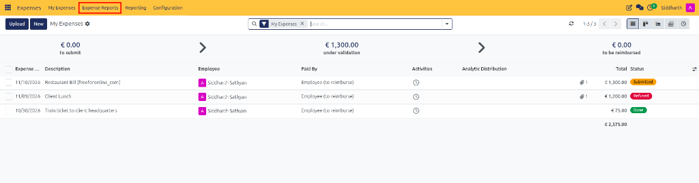
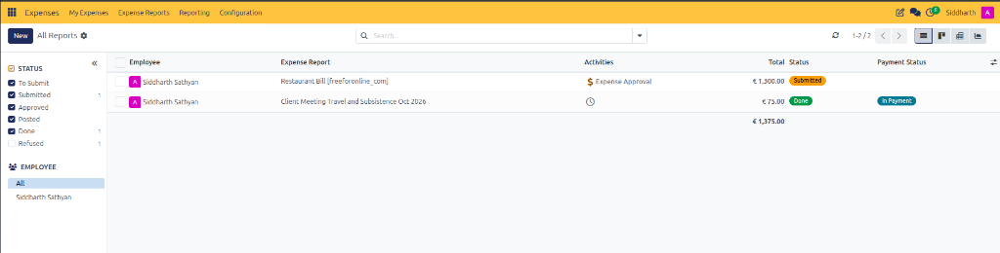
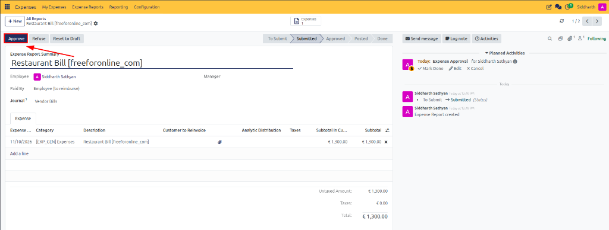
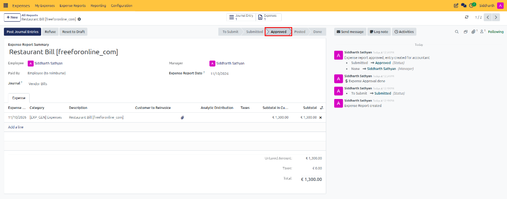

# Review, Approve, and Refuse Expenses

Expense reports must be reviewed and approved by authorized users before they can be posted to accounting journals. Department managers and team approvers verify that submitted claims are complete, adhere to corporate spending policies, and include valid proof of purchase.

> **Prerequisites**
> * User access rights: At least **Team Approver** rights in the Expenses module.
> * One or more expense reports in **Submitted** status awaiting authorization.

---

## 1. Review and Approve Expense Reports

### 1.1 Access the Expense Reports Management Workspace

Authorized managers can review pending claims through the managerial navigation menu:

1. Open the **Expenses** application.
2. In the top navigation bar, click **Expense Reports**:

3. CURQ opens the **All Reports** management dashboard:

4. **Filter and Triage Submitted Claims**:
   * **Left-Hand Status Filters**: Filter by pipeline stage. Only reports with the **Submitted** status can be approved *(e.g., `Submitted: 1`)*.
   * **Employee Filters**: Select individual team members or choose **All** to view team-wide submissions.
   * **Dashboard Columns**: Inspect claimant names, report summaries *(e.g., `Restaurant Bill [freeforonline_com]`)*, scheduled review activities *(e.g., `$ Expense Approval`)*, total amounts *(e.g., `€ 1,300.00`)*, and current lifecycle stages.
   * **My Team Filter**: In the search bar, managers can apply the **My Team** filter to isolate submissions from direct reports.

> For complete descriptions of the register columns, filter options, and pipeline status banners, see [**My Expenses Register and Pipeline Data Dictionary**](../settings-and-fields/02-expense-record-and-report-field-definitions.md#1-my-expenses-register-and-pipeline-data-dictionary).

---

### 1.2 Audit and Approve an Individual Report

1. On the **All Reports** dashboard, click to open the target submitted expense report *(e.g., `Restaurant Bill [freeforonline_com]`)*:

2. **Audit Claim Details**:
   * **Header Attributes**: Verify **Employee** *(e.g., `Siddharth Sathyan`)*, **Paid By** *(e.g., `Employee (to reimburse)`)*, and target destination **Journal** *(e.g., `Vendor Bills`)*.
   * **Expense Lines Notebook**: Inspect itemized purchase dates, categories, descriptions, and subtotals *(e.g., `€ 1,300.00`)*. Click the paperclip attachment icon to verify supporting receipts.
   * **Financial Summary**: Confirm Untaxed Amount, applicable taxes, and the final total claim.
   * **Planned Activities**: Observe the scheduled approval task in the chatter *(e.g., `Today: Expense Approval for Siddharth Sathyan`)*.
3. In the upper-left action bar, click the dark blue **Approve** button.
4. **Confirm Approval Status Transition**:

* **Status Progression**: The status chevron ribbon advances to **Approved**.
* **Manager Assignment**: The **Manager** field automatically populates with the approving user's profile *(e.g., `Siddharth Sathyan`)* alongside the **Expense Report Date**.
* **Accounting Routing**: CURQ reveals the dark blue **Post Journal Entries** action button and updates stat buttons *(displaying `Journal Entry: 1` and `Expenses: 1`)*.
* **Chatter Audit Confirmation**: The audit feed records the approval event:
  * `Expense report approved, entry created for accountant`
  * `Submitted -> Approved (Status)`
  * `None -> Siddharth Sathyan (Manager)`
  * `$ Expense Approval done`

> For details on report header fields, expense lines, and lifecycle statuses, see [**Expense Report (Sheet) Fields Data Dictionary**](../settings-and-fields/02-expense-record-and-report-field-definitions.md#3-expense-report-sheet-fields-data-dictionary).

---

### 1.3 Approve Multiple Expense Reports in Batch

Managers supervising large teams can approve multiple expense reports in a single operation:

1. Navigate to **Expenses → Expense Reports**.
2. Filter the reports using the **Submitted** status filter.
3. Select the checkboxes next to the expense reports to be approved.
4. In the upper toolbar, click the dark blue **Approve Report** button.
5. All selected eligible reports advance to **Approved** status simultaneously and route to accounting for journal posting.

---

## 2. Refuse Claims and Handle Discrepancies

### 2.1 Refuse an Ineligible Expense Report

Managers can refuse an expense report when submitted information is incomplete, incorrect, or violates corporate spending policies:

1. Open the individual expense report.
2. Review the submitted details and identify discrepancies *(such as missing VAT receipts, unauthorized personal dining, or unapproved travel upgrades)*.
3. In the upper action bar, click **Refuse**.
4. In the pop-up modal dialog, enter the mandatory reason explaining why the claim was refused.
5. Click **Refuse** in the pop-up window:
   * The report status updates to **Refused**.
   * CURQ logs the refusal and justification explanation directly in the chatter.
   * An automated notification is delivered to the employee detailing the reason.

> For complete refusal modal field specifications, see [**Expense Refusal Modal Data Dictionary**](../settings-and-fields/02-expense-record-and-report-field-definitions.md#4-expense-refusal-modal-data-dictionary).

---

### 2.2 Communicate via Chatter and Reset Refused Claims

1. **Collaborate via Chatter**: If additional documentation or clarification is needed before making an approval decision, managers can communicate with employees through the chatter using **Send message** or **Log note**.
2. **Reset to Draft**: A refused report can be returned to editable status using **Reset to Draft**:
   * The employee or manager clicks **Reset to Draft** to unlock the report sheet and lines.
   * The employee makes required corrections, amends amounts, or uploads missing receipts.
   * The employee resubmits the report for managerial review by clicking **Submit to Manager**.

---

## Related Documentation

* [Submit and Track Expense Reports](./03-submit-and-track-expense-reports.md)
* [Post Expenses to Accounting Journals](./05-post-expenses-to-accounting-journals.md)
* [Reimburse Employee Expenses](./06-reimburse-employee-expenses.md)
* [Approve, Post, and Reimburse Expenses](../getting-started/02-approve-post-and-reimburse-expenses.md)
* [Expense Record and Report Field Definitions](../settings-and-fields/02-expense-record-and-report-field-definitions.md)
