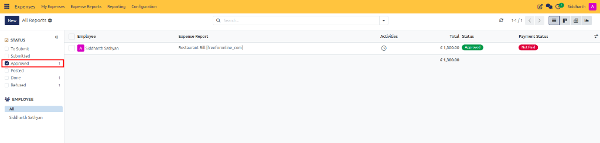
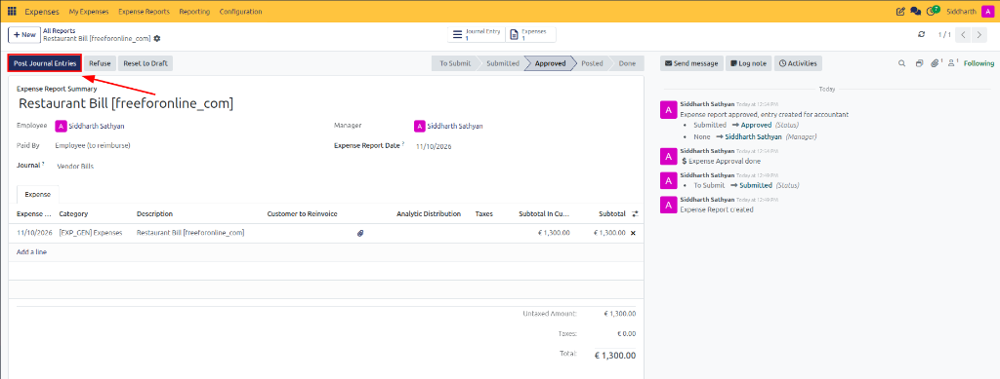
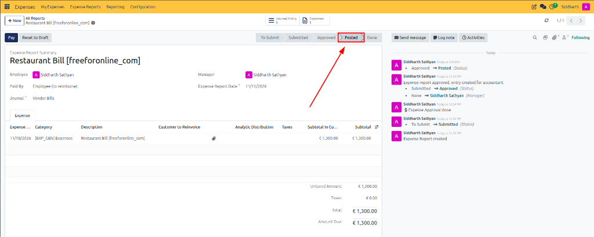

# Post Expenses to Accounting Journals

After an expense report has been approved by management, the finance team must post the expenses to the appropriate general ledger accounting journal. Posting commits the expenditure to financial ledgers, debits operational expense accounts, and recognizes the liability owed to the employee or corporate credit provider.

> **Prerequisites**
> * User access rights: **Accounting / Accountant** (or **Adviser**) and **Expenses / Manager**.
> * One or more expense reports in **Approved** status.

---

## 1. Post Approved Expenses to Financial Journals

### 1.1 Filter and Locate Approved Expense Reports

Accounting personnel identify validated claims ready for ledger posting through the management queue:

1. In the top navigation bar, navigate to **Expenses → Expense Reports**.
2. In the left-hand sidebar under **STATUS**, select the **Approved** checkbox:

3. CURQ filters the **All Reports** register to display approved claims awaiting general ledger commitment:
   * **Employee**: Identifies the claimant *(e.g., `Siddharth Sathyan`)*.
   * **Expense Report**: Title of the claim *(e.g., `Restaurant Bill [freeforonline_com]`)*.
   * **Total**: Gross approved claim figure *(e.g., `€ 1,300.00`)*.
   * **Status & Payment Badges**: Reflects green **Approved** operational status alongside red **Not Paid** settlement status.

---

### 1.2 Post an Individual Expense Report to the General Ledger

1. From the filtered list, click to open the target approved expense report:

2. **Audit Report Header and Accounting Parameters**:
   * **Employee**: Confirms claimant profile *(e.g., `Siddharth Sathyan`)*.
   * **Paid By**: Confirms payment classification *(e.g., `Employee (to reimburse)`)*.
   * **Journal**: Target accounting journal where vouchers will be committed *(e.g., `Vendor Bills`)*.
   * **Manager**: Confirms the supervisor who authorized the claim *(e.g., `Siddharth Sathyan`)*.
   * **Expense Report Date**: Records the effective accounting recognition date *(e.g., `11/10/2026`)*.
   * **Line Items & Taxes**: Review line items, categories, cost allocations, and VAT amounts.
3. In the upper-left action bar, click the dark blue **Post Journal Entries** button.
4. **Confirm Ledger Posting & Stage Transition**:

* **Status Progression**: The pipeline chevron ribbon advances to **Posted**.
* **Payment Readiness**: CURQ reveals the dark blue **Pay** button in the action bar and displays the outstanding **Amount Due: € 1,300.00**.
* **Stat Navigation**: The **Journal Entry** smart button is active; click it to inspect the balanced debit/credit lines in the **Accounting** module.
* **Chatter Audit Confirmation**: The audit feed records the status change:
  * `Siddharth Sathyan Approved -> Posted (Status)`

> For complete definitions of journal posting fields, accounting dates, and smart button linkages, see [**Accounting Journal Posting Fields Data Dictionary**](../settings-and-fields/03-expense-reimbursement-and-posting-field-definitions.md#3-accounting-journal-posting-fields).

---

### 1.3 Post Multiple Expense Reports in Batch

Finance teams managing high transaction volumes can post approved reports simultaneously:

1. Navigate to **Expenses → Expense Reports**.
2. Filter the reports using the **Approved** status filter.
3. Select the checkboxes next to the expense reports to be posted.
4. In the upper toolbar, click the dark blue **Post Entries** button:
   * CURQ processes the batch, generating separate accounting vouchers for each report in its designated journal.
   * All selected reports advance to **Posted** status.

> **Important:** Only approved reports can be posted. Reports that are already posted or have not yet been approved by a manager cannot be processed through this batch action.

---

## 2. Audit and Validate Accounting Entries

### 2.1 Audit the Generated Journal Entry

To verify the financial integrity of the posted transaction:

1. Open the posted expense report.
2. In the upper stat button panel, click **Journal Entry**:
   * CURQ opens the corresponding accounting document in the **Accounting** module.

---

### 2.2 Verify Debit, Tax, and Credit Balancing

Inspect the journal items generated by the system:
1. **Debit Line(s)**: Confirms the operational expense account *(e.g., `7001010 Kosten van grond- en hulpstoffen`)* and analytic tags.
2. **Tax Line(s)**: Reflects deductible input VAT/GST.
3. **Credit Line**: Reflects the liability payable to the employee profile *(for out-of-pocket expenses)* or the corporate bank journal *(for company-paid purchases)*.

---

## Related Documentation

* [Review, Approve, and Refuse Expenses](./04-review-approve-and-refuse-expenses.md)
* [Reimburse Employee Expenses](./06-reimburse-employee-expenses.md)
* [Approve, Post, and Reimburse Expenses](../getting-started/02-approve-post-and-reimburse-expenses.md)
* [Understanding the Expense Lifecycle and Accounting Flow](../core-concepts/01-understanding-the-expense-lifecycle-and-accounting-flow.md)
* [Expense Reimbursement and Posting Field Definitions](../settings-and-fields/03-expense-reimbursement-and-posting-field-definitions.md)
