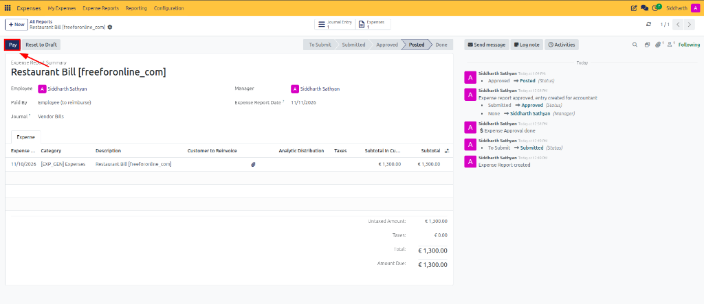
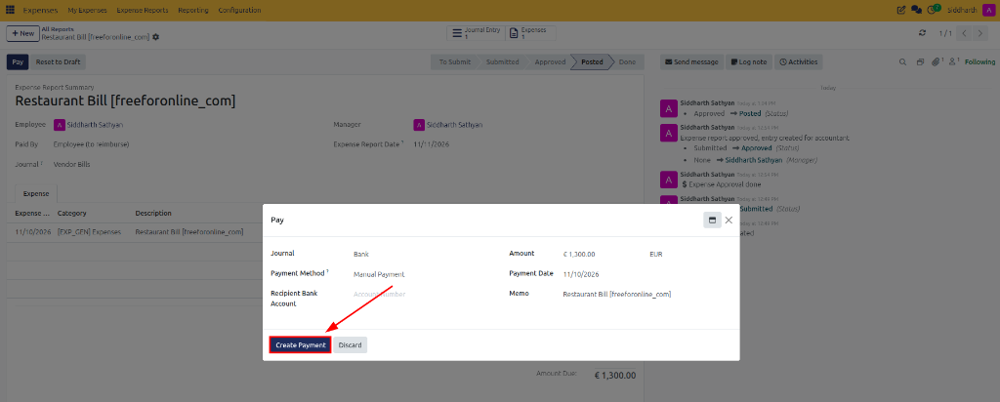
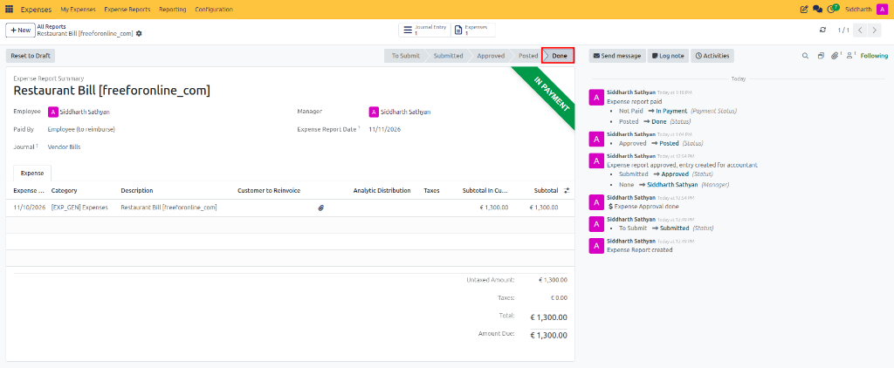

# Reimburse Employee Expenses

After an expense report has been approved and committed to the general ledger, organizations must disburse reimbursement funds to settle the employee payable liability. CURQ Expenses supports direct financial disbursement via bank transfer, cash, or check, processed individually or in bulk.

> **Prerequisites**
> * User access rights: **Accounting / Accountant** (or **Adviser**).
> * The expense report must reside in **Posted** status.
> * For electronic bank disbursements: An active employee bank account configured in the employee's contact record.

---

## 1. Reimburse an Individual Expense Report

To process a direct bank or cash disbursement for a single employee claim:

1. In the top navigation bar, navigate to **Expenses → Expense Reports**.
2. Open the target expense report with the **Posted** status *(e.g., `Restaurant Bill [freeforonline_com]`)*:

3. Review the outstanding balance under **Amount Due** *(e.g., `€ 1,300.00`)* and verify the claimant payment classification *(e.g., `Paid By: Employee (to reimburse)`)*.
4. In the upper action bar, click the dark blue **Pay** button.
5. In the **Pay** pop-up modal, configure payment parameters:

   * **Journal**: Select the corporate Bank or Cash journal *(e.g., `Bank`)*.
   * **Payment Method**: Select the applicable payment rail *(e.g., `Manual Payment`, `Manual Payment (Cash)`, `Batch Deposit (Bank)`, or `Checks (Bank)`)*.
   * **Recipient Bank Account**: Select the employee's verified personal bank account *(e.g., `Account Number`)* when using a Bank journal.
   * **Amount**: Displays the exact reimbursement amount *(e.g., `€ 1,300.00 EUR`)*.
   * **Payment Date**: Specify the effective disbursement execution date *(e.g., `11/10/2026`)*.
   * **Memo**: Pre-populated with the expense report summary *(e.g., `Restaurant Bill [freeforonline_com]`)*.
6. Review the payment details and click the dark blue **Create Payment** button.
7. **Verify Payment Registration and Lifecycle Completion**:

* **Status Progression**: The status chevron ribbon advances to **Done**.
* **Payment Badge**: A prominent green **IN PAYMENT** ribbon appears in the upper-right corner of the expense sheet.
* **Audit Confirmation**: The chatter timeline logs the complete disbursement history:
  * `Siddharth Sathyan Expense report paid`
  * `• Not Paid -> In Payment (Payment Status)`
  * `• Posted -> Done (Status)`

> **Tip:** For complete field definitions of the payment modal, see [**Direct Reimbursement Payment Modal Fields Data Dictionary**](../settings-and-fields/03-expense-reimbursement-and-posting-field-definitions.md#1-direct-reimbursement-payment-modal-fields).

---

## 2. Reimburse Multiple Expense Reports in Bulk

Finance teams can process reimbursements across multiple employees and expense reports simultaneously:

1. Navigate to **Expenses → Expense Reports**.
2. Filter the reports using the **Posted** status filter.
3. Select the checkboxes next to the expense reports to be reimbursed.
4. In the upper toolbar, click the dark blue **Pay** button.
5. In the bulk payment modal, configure the parameters:
   * **Journal**: Select the corporate Bank or Cash journal.
   * **Payment Method**: Select the desired payment rail.
   * **Group Payments**: Enable this option to consolidate multiple expense reports belonging to the same employee into a single payment transaction.
   * **Amount**: Displays the aggregated total reimbursement sum.
   * **Payment Date**: Specify the effective payment date.
6. Click **Create Payments** to process all disbursements in batch.

---

## Related Documentation

* [Post Expenses to Accounting Journals](./05-post-expenses-to-accounting-journals.md)
* [Review, Approve, and Refuse Expenses](./04-review-approve-and-refuse-expenses.md)
* [Approve, Post, and Reimburse Expenses](../getting-started/02-approve-post-and-reimburse-expenses.md)
* [Understanding the Expense Lifecycle and Accounting Flow](../core-concepts/01-understanding-the-expense-lifecycle-and-accounting-flow.md)
* [Expense Reimbursement and Posting Field Definitions](../settings-and-fields/03-expense-reimbursement-and-posting-field-definitions.md)
