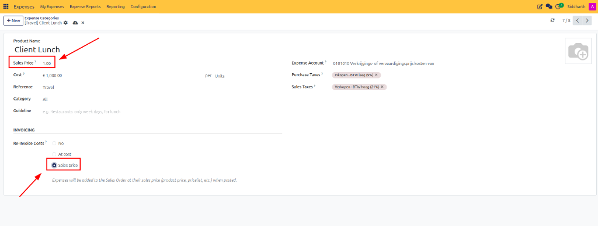
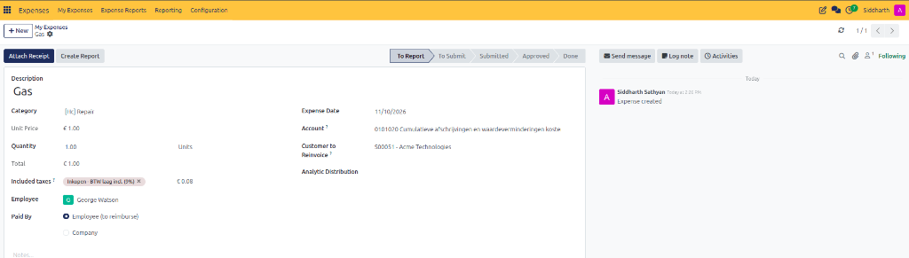
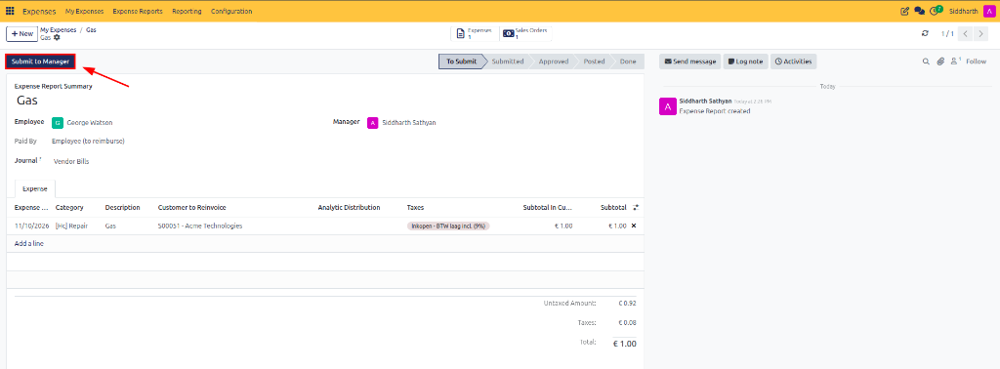
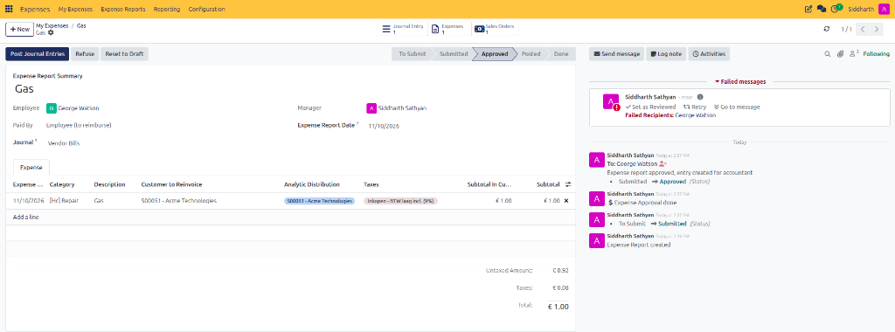

# Reinvoice Project Expenses to Customers

The Expenses module allows organizations to charge eligible employee expenditures back to customers. This capability is essential when staff incur travel, dining, lodging, or operational costs while delivering customer projects or on-site client services.

> **Prerequisites**
> * CURQ **Sales** and **Accounting** applications installed and active.
> * An active, confirmed customer **Sales Order** *(e.g., `S00051 - Acme Technologies`)*.
> * User access rights: **Expenses / User** and **Sales / User**.

---

## 1. Configure and Log Client Billable Expenses

### 1.1 Configure Expense Categories for Reinvoicing

Before an expense can be charged to a client, its underlying category must have reinvoicing activated:

1. Navigate to **Expenses → Configuration → Expense Categories**.
2. Open the desired expense category *(e.g., `Repair`, `Meals`, or `Travel & Accommodation`)*.
3. Locate the **INVOICING** section.
4. Set the **Re-Invoice Costs** policy:
   * **No**: The expenditure remains an internal operating cost and cannot be reinvoiced.
   * **At cost**: Expenses are reinvoiced to the customer at the exact purchase cost recorded on the expense.
   * **Sales price**: Expenses are reinvoiced at a pre-configured commercial catalog price. When selected, input the unit rate in the **Sales Price** field *(e.g., `1.00`)*.

5. Configure applicable **Purchase Taxes** and **Sales Taxes** for proper tax accounting on both vendor purchases and customer invoices.
6. Click the cloud icon or navigate away to save the category.

> For complete field definitions of reinvoicing policies, pricing formulas, and tax mappings, see [**Financial and Tax Mapping Fields**](../settings-and-fields/01-expense-category-and-configuration-field-definitions.md#22-financial-and-tax-mapping-fields) and [**Reinvoicing & Commercial Recovery Fields**](../settings-and-fields/01-expense-category-and-configuration-field-definitions.md#23-reinvoicing--commercial-recovery-fields).

---

### 1.2 Create an Expense Linked to a Customer Sales Order

1. Open **Expenses → My Expenses → My Expenses** and click **New**.
2. In the **Category** field, select the configured expense category *(e.g., `[Hc] Repair`)*.
3. Enter the **Description** *(e.g., `Gas`)*, **Unit Price** *(e.g., `€ 1.00`)*, and **Quantity** *(e.g., `1.00 Units`)*.
4. Specify the **Employee** *(e.g., `George Watson`)* and payment party *(e.g., `Paid By: Employee (to reimburse)`)*.
5. In the **Customer to Reinvoice** field, select the confirmed customer **Sales Order** *(e.g., `S00051 - Acme Technologies`)*:

6. If required, assign an **Analytic Distribution** to allocate the expense to specific project tags or department cost centers.
7. Click **Attach Receipt** in the upper toolbar to attach supporting supplier invoices or payment slips.
8. Click **Create Report** in the upper action bar to group the line into a formal expense report.

> For field specifications and action button behavior on the individual expense form, see [**Individual Expense Form Fields Data Dictionary**](../settings-and-fields/02-expense-record-and-report-field-definitions.md#2-individual-expense-form-fields-data-dictionary).

---

### 1.3 Submit and Approve the Expense Report

1. When creating a report from an individual expense, CURQ generates an **Expense Report** summary *(e.g., `Gas`)* in the **To Submit** stage.
2. Review the linked line items under the **Expense** tab:
   * **Expense Date**: Date incurred *(e.g., `11/10/2026`)*.
   * **Category**: Configured category *(e.g., `[Hc] Repair`)*.
   * **Description**: Detailed note *(e.g., `Gas`)*.
   * **Customer to Reinvoice**: Linked sales order *(e.g., `S00051 - Acme Technologies`)*.
   * **Subtotal**: Purchase subtotal before and after taxes *(e.g., Untaxed Amount `€ 0.92`, Taxes `€ 0.08`, Total `€ 1.00`)*.
3. Note the upper stat bar: CURQ displays **Expenses 1** and **Sales Orders 1** smart buttons, confirming direct traceability to the customer sales order.
4. In the upper action bar, click **Submit to Manager**:

5. The assigned manager *(e.g., `Siddharth Sathyan`)* reviews the report, verifies customer contractual authorization, and clicks **Approve**.
6. Once approved, the report transitions to the **Approved** status:

7. **Verify Approved Report State**:
   * The status bar advances to **Approved**.
   * The **Analytic Distribution** column automatically inherits the project tag *(e.g., `S00051 - Acme Technologies`)*.
   * The action bar unlocks the **Post Journal Entries** button for the finance team.

> For details on report header fields, journal assignment rules, and report sheet statuses, see [**Expense Report (Sheet) Fields Data Dictionary**](../settings-and-fields/02-expense-record-and-report-field-definitions.md#3-expense-report-sheet-fields-data-dictionary).

---

## 2. Post Expenses and Invoice the Customer

### 2.1 Post Expenses and Update Sales Order Lines

1. Open the approved expense report.
2. In the upper action bar, click **Post Journal Entries**:
   * CURQ generates and commits the corresponding vendor bill or journal entry in the specified journal *(e.g., `Vendor Bills`)*.
   * The system automatically updates the customer sales order *(e.g., `S00051 - Acme Technologies`)* with a new billable expense line under the **Order Lines** tab.
3. The expense items become immediately available on the customer sales order for final invoicing.

---

### 2.2 Create and Validate Customer Invoices

1. In the posted expense report, click the **Sales Orders** smart button *(or navigate directly to **Sales → Orders → Orders** and open `S00051 - Acme Technologies`)*.
2. Under the **Order Lines** tab, verify the injected expense line *(e.g., `[Hc] Repair - Gas`)* and confirmed delivered quantity.
3. In the upper action bar, click **Create Invoice**.
4. Select the desired invoice type:
   * **Regular Invoice**
   * **Down Payment (Percentage)**
   * **Down Payment (Fixed Amount)**
5. Click **Create Draft Invoice**.
6. Review draft descriptions, unit prices, and applicable customer sales taxes.
7. Click **Confirm** to post the invoice to Accounts Receivable.
8. Click **Send** to review the email message and deliver the official PDF invoice to the client.

---

### 2.3 Verify and Reconcile Customer Payments

Once the client receives the invoice, payment can be completed through corporate settlement channels:

1. For online customer payments, enable the **Invoice Online Payment** feature in **Accounting** and verify active payment provider methods.
2. After the customer remits payment:
   * Open the customer invoice.
   * Verify the **In Payment** status badge.
   * Click the **Payments** smart button in the upper stat bar.
   * Open the payment record and click **Validate** to confirm receipt of funds.
3. The invoice status permanently updates to **Paid**.

---

## Related Documentation

* [Understanding Expense Reinvoicing and Analytic Costing](../core-concepts/02-understanding-expense-reinvoicing-and-analytic-costing.md)
* [Create and Manage Expense Categories](./01-create-and-manage-expense-categories.md)
* [Post Expenses to Accounting Journals](./05-post-expenses-to-accounting-journals.md)
* [Log Expenses and Attach Receipts](./02-log-expenses-and-attach-receipts.md)
* [Expense Category and Configuration Field Definitions](../settings-and-fields/01-expense-category-and-configuration-field-definitions.md)
