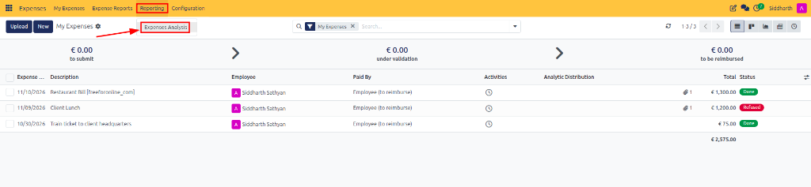
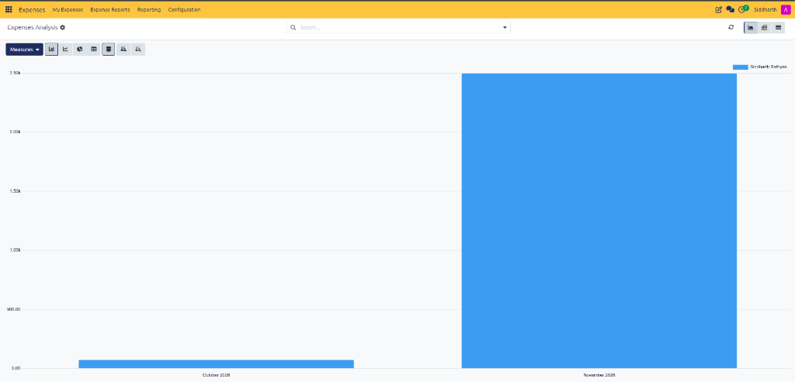
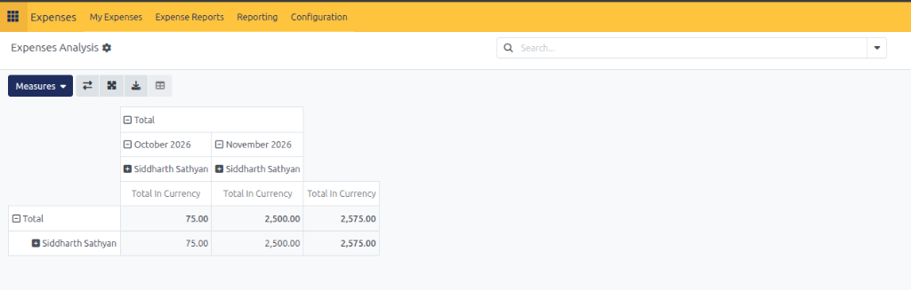
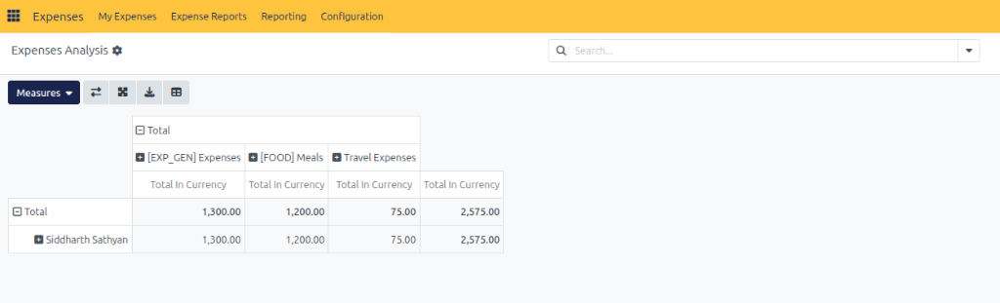

# Analyze Expense Reports and Spending

The Expenses Analysis report helps organizations monitor employee spending, maintain budget discipline, and identify organizational cost trends. It delivers deep analytical insights into aggregate expenditures, category distributions, monthly variances, and top employee spenders.

> **Prerequisites**
> * User access rights: **Expenses / Administrator (Manager)**.
> * Historical expense records in **Approved**, **Posted**, or **Done** status.

---

## 1. View Expense Analysis

To access the aggregate analytical dashboard:

1. Open the **Expenses** application.
2. In the top navigation bar, navigate to **Reporting → Expenses Analysis**:

3. The **Expenses Analysis** view opens. By default, CURQ displays corporate expenditure data for the current fiscal period in an interactive stacked bar chart grouped by month:

4. **Chart Toolbar and Display Controls**:
   * **Measures**: Click the **Measures** dropdown to choose the calculated analytical dimension *(defaulting to `Total In Currency`)*.
   * **Chart Types**: Switch between **Bar Chart**, **Line Chart**, and **Pie Chart** displays.
   * **Stacked Bar Chart**: Toggle stacked bar representation to view proportional employee or category contributions per period.
   * **Sort Order**: Use the ascending and descending sort icons to rank period expenditure.
   * **Legend and Axis**: Review the horizontal timeline *(e.g., `October 2026` at `€ 75.00` and `November 2026` at `€ 2,500.00`)* and claimant legend *(e.g., `Siddharth Sathyan`)*.
5. **View Selectors**: Use the view toggle buttons in the upper-right corner to switch between:
   * **Graph View** *(Bar Chart, Line Chart, Pie Chart)*
   * **Pivot View** *(Multi-dimensional spreadsheet matrix)*
   * **List View** *(Itemized transaction log)*

---

## 2. Analyse Expenses by Employee

Evaluating expenditures across staff members highlights top claimants and verifies travel policy compliance:

1. In the upper-right view switcher, click the **Pivot View** icon *(second icon)*.
2. The default pivot matrix displays employees along the row axis with monthly expenditure columns:

3. **Inspect Employee Spend Matrix**:
   * The matrix breaks down monthly columns *(e.g., `October 2026`, `November 2026`)* alongside the cumulative corporate **Total**.
   * Click the plus (`+`) toggle next to an employee name *(e.g., `Siddharth Sathyan`)* to drill down into period subtotals:
     * **October 2026**: `€ 75.00`
     * **November 2026**: `€ 2,500.00`
     * **Total In Currency**: `€ 2,575.00`
4. **Sort and Rank Claimants**:
   * Click the **Total In Currency** column header to sort expenses in ascending or descending order.
   * Instantly identify employees with the highest reimbursement totals and cross-reference claimed amounts against project deliverables.
5. **Matrix Controls**:
   * Click **Flip Axis** to swap rows and columns.
   * Click **Expand All** to reveal all nested sub-dimensions across all claimants simultaneously.

---

## 3. Analyse Expenses by Category

Understanding how expenditures distribute across expense categories assists finance leaders in negotiating vendor corporate rates and enforcing category caps:

1. In the **Pivot View**, click the dimension selectors or column groupings to group expenditure by **Category**.
2. The matrix dynamically reorganizes columns to display expenditures grouped across configured expense categories:

3. **Evaluate Category Allocations**:
   * Review corporate spending across individual category columns:
     * **[EXP_GEN] Expenses**: `€ 1,300.00`
     * **[FOOD] Meals**: `€ 1,200.00`
     * **Travel Expenses**: `€ 75.00`
     * **Total In Currency**: `€ 2,575.00`
   * The row axis displays claimant allocations across each category *(e.g., `Siddharth Sathyan`)*.
4. **Identify Cost Drivers and Enforce Caps**:
   * Click the **Total In Currency** column header to sort categories from highest to lowest expenditure.
   * Pinpoint category cost drivers *(such as general expenses and client meals)* to adjust expense limits or negotiate preferred commercial rates.

---

## 4. Filter and Export Analytical Reports

1. **Apply Dynamic Filters**: In the search bar at the top, filter by operational status *(e.g., `To Post`, `Approved`, `Done`)*, filter by date ranges, or group by department and analytic distribution accounts.
2. **Export to Excel**: In the upper toolbar of the Pivot View, click the **Download (Excel)** icon *(third icon in the pivot controls toolbar)* to export an `.xlsx` spreadsheet complete with sub-totals and formulas for board and executive reporting.
3. **Save Favorite Filters**: Click the search bar dropdown, expand **Favorites**, and select **Save current search** to bookmark recurring analytical configurations for fast quarterly or monthly audits.

> **Tip:** For details on register metrics, pipeline statuses, and currency attributes, see [**My Expenses Register and Pipeline Data Dictionary**](../settings-and-fields/02-expense-record-and-report-field-definitions.md#1-my-expenses-register-and-pipeline-data-dictionary).

---

## Related Documentation

* [Post Expenses to Accounting Journals](./05-post-expenses-to-accounting-journals.md)
* [Review, Approve, and Refuse Expenses](./04-review-approve-and-refuse-expenses.md)
* [Submit and Track Expense Reports](./03-submit-and-track-expense-reports.md)
* [Understanding the Expense Lifecycle and Accounting Flow](../core-concepts/01-understanding-the-expense-lifecycle-and-accounting-flow.md)
* [Expense Record and Report Field Definitions](../settings-and-fields/02-expense-record-and-report-field-definitions.md)
