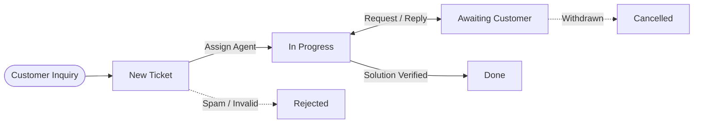

# Understanding Ticket Lifecycle and Routing

This document explains the underlying state progression, team dispatch mechanisms, priority ranking, and audit tracking governing CURQ Helpdesk.

---

## 1. The Ticket Lifecycle State Machine

Support tickets progress through a multi-stage workflow from intake to resolution:

### 1.1 Lifecycle Stages

1. **New**: The initial triage state. CURQ displays an active stage duration timer badge *(e.g., `New 18h`)* measuring elapsed time since intake to ensure response SLAs are met.
2. **In Progress**: The assigned agent is actively investigating, testing, or collaborating with engineering on linked development tasks.
3. **Awaiting**: The ticket is paused awaiting customer feedback, logs, or external third-party vendor remediation.
4. **Done**: The inquiry or software issue has been diagnosed, resolved, and verified. Triggers customer satisfaction rating surveys when configured.
5. **Cancelled**: The issue was withdrawn by the customer or rendered obsolete prior to remediation.
6. **Rejected**: The ticket was classified as out-of-scope, spam, duplicate, or invalid.

---

## 2. Priority Levels and Queue Triage

CURQ uses a 4-tier visual priority classification:

| Priority Level | Visual Icon | Operational Target |
| :--- | :--- | :--- |
| **Normal** | 0 Stars | Routine inquiries, general how-to questions, and minor documentation requests. |
| **Low** | 1 Star | Non-blocking issues with simple workarounds. |
| **Medium** | 2 Stars | Impaired functionality impacting individual users without global outage. |
| **Urgent** | 3 Stars | Critical business stoppage, security vulnerabilities, or complete system unavailability. |

---

## 3. Multi-Channel Ingestion & Partner Integration

CURQ Helpdesk is deeply integrated with the core ERP data model:
* **Contact & Partner Profiles**: Tickets directly link to debtor profiles in CURQ Contacts and Accounting, allowing support agents to see customer contract standing and previous tickets.
* **Project & Task Delegation**: Technical tickets can spawn or attach directly to agile development tasks in CURQ Projects, eliminating silos between support desk staff and engineering teams.
* **Audit Trail**: Every customer interaction, internal log note, and stage change is permanently tracked in the ticket chatter for regulatory and quality assurance auditing.

---

## Related Documentation

* [Log and Resolve Your First Helpdesk Ticket](../getting-started/01-log-and-resolve-your-first-helpdesk-ticket.md)
* [Create and Manage Helpdesk Tickets](../task-guides/01-create-and-manage-helpdesk-tickets.md)
* [Navigate and Use the Helpdesk Dashboard](../task-guides/02-navigate-and-use-the-helpdesk-dashboard.md)
* [Helpdesk Ticket and Register Field Definitions](../settings-and-fields/01-helpdesk-ticket-field-definitions.md)
