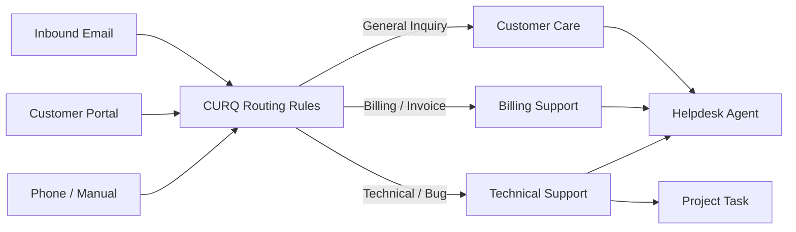
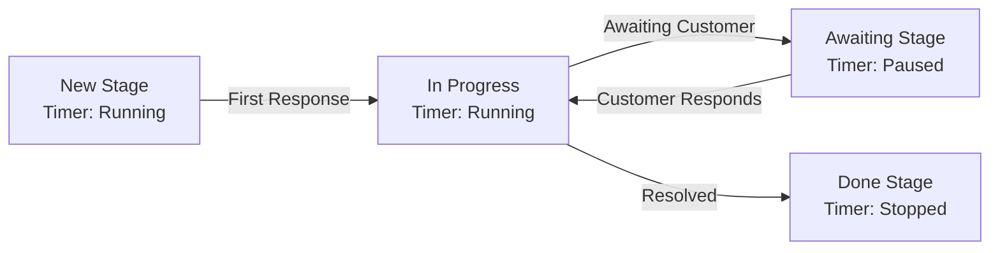
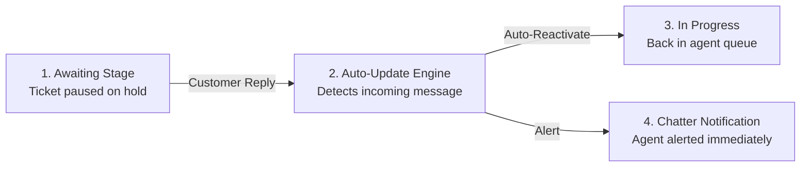

# Understanding Support Teams, SLA Policies, and Escalation Architecture

In high-volume enterprise support operations, handling inquiries on an ad-hoc basis creates SLA breaches, duplicate troubleshooting, and orphaned customer requests. CURQ Helpdesk provides an architectural framework structured around functional team topologies, automated stage reactivations, Service Level Agreement (SLA) timers, and cross-module project integration.

This document explains the conceptual foundations governing multi-channel team routing, SLA tracking mechanics, and automated lifecycle escalation.

---

## 1. Support Team Topologies and Ingestion Architecture

Rather than maintaining a flat, unstructured pool of support tickets, CURQ organizes operational capacity into functional **Helpdesk Teams** *(e.g., Customer Care, Technical Support, Development Team, Billing)*.

Each team functions as an autonomous queue with dedicated inbound communication aliases, member rosters, and operational parameters:

### 1.1 Inbound Channel Segregation
* **Email Ingestion**: Each team can configure a unique email alias *(e.g., `dev` or `support`)*. Inbound emails sent to that alias bypass manual intake and are directly converted into tickets assigned to that department.
* **Portal Visibility**: Support desks can selectively expose specific teams to client web portals, allowing customers to self-classify inquiries upon submission.

### 1.2 Tiered Team Routing
* **Tier 1 (Triage & Intake)**: Validates customer identity, reproduces errors, and filters out duplicate or out-of-scope inquiries.
* **Tier 2 (Specialized / Engineering)**: Handles complex root-cause remediation, infrastructure failures, or software code fixes tied directly to project tasks.

---

## 2. Service Level Agreements (SLAs) and Stage Duration Tracking

Service Level Agreements define contractual commitments regarding response velocity and resolution time. CURQ enforces SLAs dynamically through real-time stage duration timers:

### 2.1 Active vs Paused SLA Clocks
* **Intake Time**: Measures elapsed time from customer submission until an agent transitions the ticket out of `New`. Displays active duration on the stage badge *(e.g., `New 18h`)*.
* **Remediation Time**: Tracks active diagnostic and engineering effort while the ticket resides in `In Progress`.
* **Waiting Time**: When an agent requires additional diagnostic logs from the customer, moving the ticket to `Awaiting` pauses internal resolution SLA clocks, ensuring team performance metrics reflect only controllable working hours.

---

## 3. Automated Event Reactivation Logic

A frequent point of failure in customer support operations is the "dormant ticket trap": an agent places a ticket on hold awaiting customer logs, the customer replies weeks later, but the ticket remains buried in an inactive queue.

CURQ eliminates this failure mode through the **Auto Update Ticket Stage** engine:

1. **Source Stages**: Designated holding stages *(e.g., `Awaiting`)* where tickets wait for counterparty action.
2. **Event Trigger**: An inbound message or customer email reply linked to the ticket sequence *(e.g., `HT00065`)*.
3. **Destination Stage**: The operational target stage *(e.g., `In Progress`)* to which CURQ instantly moves the record, re-enabling active queue alerts for internal specialists.

---

## 4. Customer Satisfaction (CSAT) Rating Architecture

Quality assurance and customer satisfaction tracking are embedded directly into stage progression:

* **Trigger Rules**: When **Customer Rating** is configured to `Rating when changing stage`, advancing a ticket to terminal resolution *(e.g., `Done`)* automatically fires an automated customer survey email.
* **Survey Feedback Aggregation**: Customers select satisfaction scores *(Happy, Neutral, Unhappy)* directly within the email body. CURQ records the feedback on the ticket card and aggregates corporate CSAT ratings inside **Reporting > Customer Rating**.
* **Administrative Exclusions**: Tickets classified with `No rating` suppress automated dispatches, preventing survey fatigue on internal test records or administrative tasks.

---

## 5. Cross-Module Enterprise Integration

CURQ Helpdesk does not operate as an isolated silo. It shares the core database schema across the enterprise:

| Integrated Application | Architectural Relationship | Operational Value |
| :--- | :--- | :--- |
| **Contacts & Accounting** | Direct foreign-key linkage to counterparty debtor records. | Specialists immediately view client contract terms, credit status, and invoicing history during support triage. |
| **Projects & Tasks** | Direct attachment of project tasks to support tickets. | Engineering bugs are delegated to development sprint boards without losing customer-facing chatter and ticket status visibility. |
| **Users & Security** | Unified role-based access control. | Team leaders, internal specialists, and customer portal users operate under centralized authentication and audit logging. |

---

## Related Documentation

* [Understanding Ticket Lifecycle and Routing](./01-understanding-ticket-lifecycle-and-routing.md)
* [Configure a Support Team and Automate Ticket Intake](../getting-started/02-configure-a-support-team-and-automate-ticket-intake.md)
* [Configure Helpdesk Teams and Routing](../task-guides/03-configure-helpdesk-teams-and-routing.md)
* [Analyze Helpdesk Performance and Reports](../task-guides/04-analyze-helpdesk-performance-and-reports.md)
* [Helpdesk Team Field Definitions](../settings-and-fields/02-helpdesk-team-field-definitions.md)
