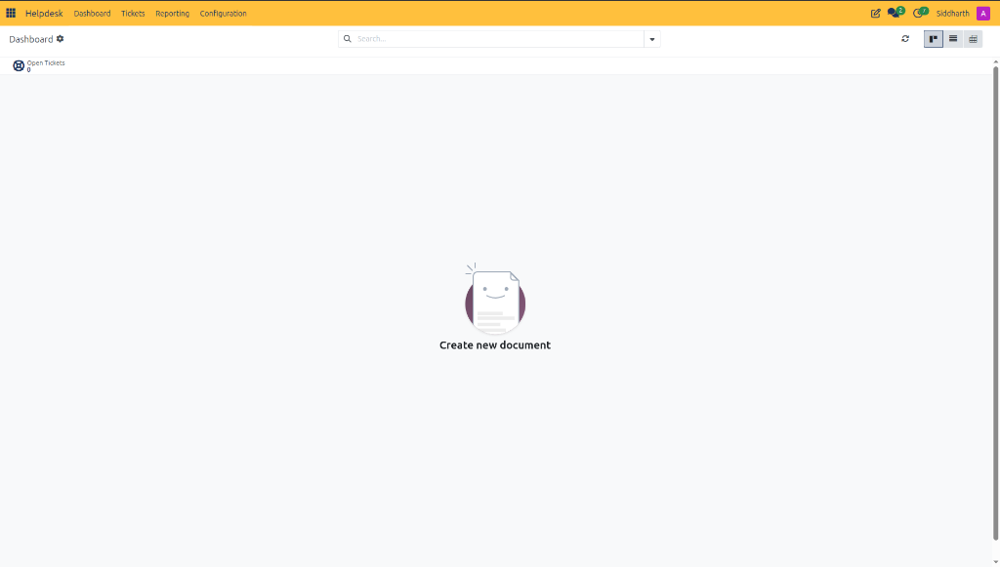
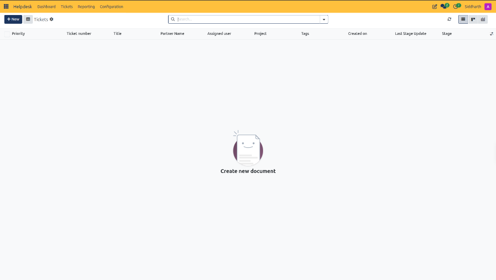
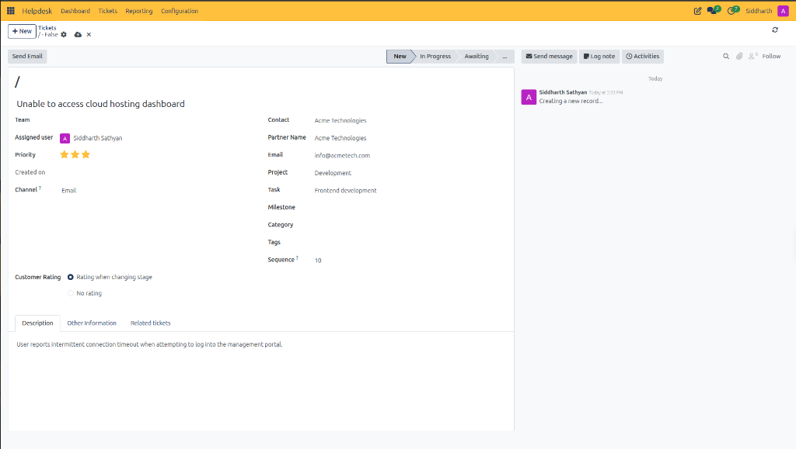
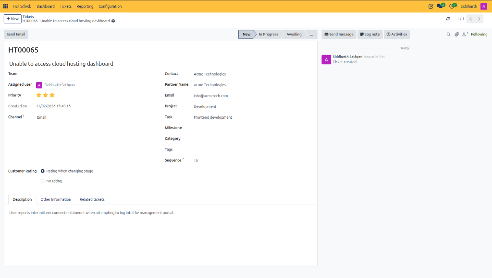
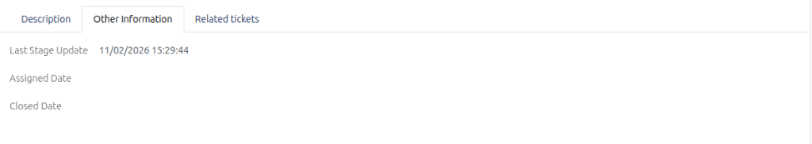
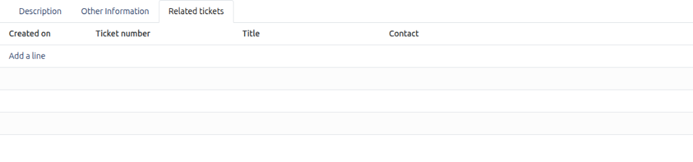
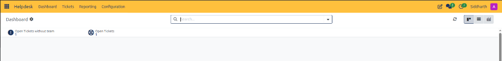
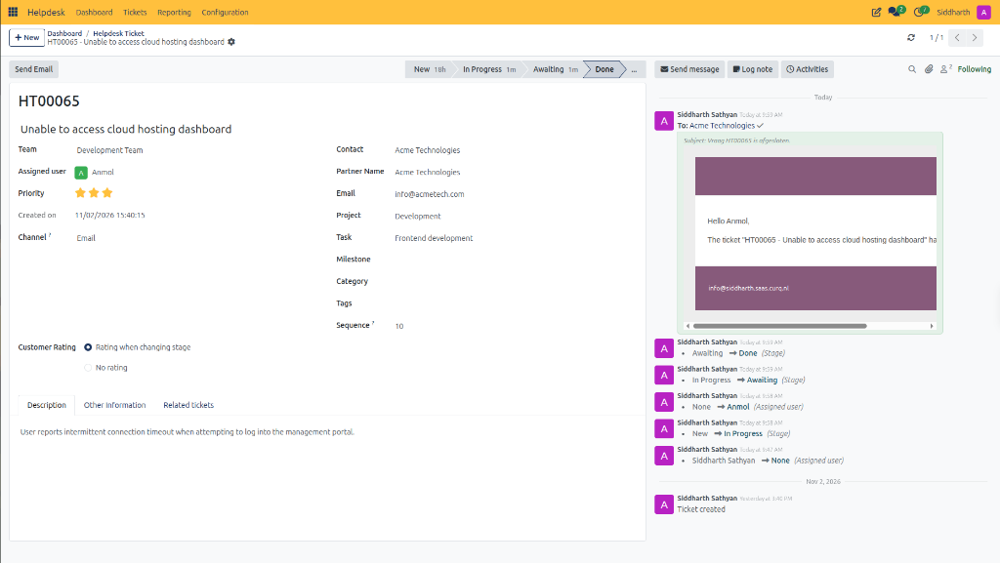

# Log and Resolve Your First Helpdesk Ticket

This tutorial guides you through the end-to-end support lifecycle in CURQ Helpdesk, from ticket intake and customer linkage to investigation, project task delegation, and resolution tracking.

> **Prerequisites**
> * Access to the **Helpdesk** application in CURQ.
> * At least one customer partner record *(e.g., `Acme Technologies`)* configured in [**Contacts**](../../Contacts/getting-started/01-create-your-first-contact.md).
> * An internal support agent or engineer configured as an active user profile.

---

## 1. End-to-End Helpdesk Ticket Lifecycle

### 1.1 Access the Helpdesk Application

1. In the main CURQ application switcher, select **Helpdesk**.
2. CURQ opens the **Helpdesk Dashboard**:

3. The dashboard displays overall team workload metrics, including the **Open Tickets** counter and fast view switchers *(Kanban, List, and Pivot)*.

---

### 1.2 Open the Ticket Register

1. In the top navigation bar, click **Tickets**.
2. CURQ displays the centralized ticket register:

3. Click **+ New** in the top-left action bar (or click **Create new document** in the central workspace).

---

### 1.3 Enter Ticket Details

CURQ presents a new ticket creation form:

1. In the **Title** field, enter a concise summary of the issue:
   * Example: `Unable to access cloud hosting dashboard`
2. Specify customer and routing parameters:
   * **Contact**: Select the person reporting the issue *(e.g., `Acme Technologies`)*.
   * **Partner Name**: CURQ auto-fills the parent corporate account.
   * **Email**: Confirms the customer notification address *(e.g., `info@acmetech.com`)*.
   * **Priority**: Click the star icons to set the urgency level *(e.g., 2 stars for Medium priority)*.
   * **Assigned user**: Select the support agent responsible for remediation.
   * **Channel**: Select how the inquiry arrived *(e.g., `Email`)*.
3. Link project work (optional):
   * **Project**: Select `Development` if the issue requires engineering remediation.
   * **Task**: Select `Frontend development` to coordinate with sprint backlogs.
4. Set Customer Rating policy:
   * Select **Rating when changing stage** to collect automated customer feedback upon ticket resolution.
5. In the **Description** tab, document the full context:
   * Example: `User reports intermittent connection timeout when attempting to log into the management portal.`

> For a detailed explanation of all ticket header fields, project linkages, and customer rating policies, see [**Helpdesk Ticket and Register Field Definitions**](../settings-and-fields/01-helpdesk-ticket-field-definitions.md).

6. Click the Save icon:
   * CURQ commits the ticket, registers the creation event in the chatter, and assigns a permanent sequential ticket number with prefix **`HT`** *(e.g., `HT00065`)*:

   

---

### 1.4 Review Lifecycle Audit Markers

1. Select the **Other Information** tab:

2. Verify that CURQ automatically recorded the **Last Stage Update** timestamp *(e.g., `11/02/2026 15:29:44`)*.
3. As the ticket progresses, CURQ automatically populates the **Assigned Date** and **Closed Date** markers for SLA compliance tracking.

> For a detailed explanation of lifecycle audit timestamps and related ticket columns, see [**Tab Section Field Definitions**](../settings-and-fields/01-helpdesk-ticket-field-definitions.md#3-tab-section-field-definitions).

---

### 1.5 Check Related Inquiries

1. Select the **Related tickets** tab:

2. If this issue relates to recurring incidents or duplicate inquiries submitted by the same client, click **Add a line** to establish cross-ticket relationships.

---

### 1.6 Monitor Updated Dashboard Metrics

1. In the top navigation bar, click **Dashboard**.
2. Notice that the dashboard immediately reflects the logged ticket:

* **Open Tickets without team**: Displays `1`, alerting supervisors that ticket `HT00065` requires assignment to a functional support team.
* **Open Tickets**: Increments to `1`.

---

### 1.7 Resolve the Ticket and Trigger Customer Notification

1. In the top navigation bar, click **Tickets** and reopen ticket `HT00065`.
2. As investigation proceeds, advance the ticket through operational stages:
   * Click **In Progress** when active diagnosis and frontend development begin.
   * Click **Awaiting** if waiting on deployment verification.
   * Click **Done** once the solution is verified and operational access is restored.
3. Review the confirmed resolved ticket:

4. Observe the automated system actions triggered upon moving to **Done**:
   * **Stage Bar Timers**: The stage bar highlights **Done**, while preceding stages record elapsed operational time *(e.g., `New 18h`, `In Progress 1m`, `Awaiting 1m`)* for SLA reporting.
   * **Automated Customer Email**: Because **Customer Rating** was configured to `Rating when changing stage`, CURQ automatically dispatches an official resolution email to `info@acmetech.com` *(e.g., `To: Acme Technologies`)* containing customer feedback options.
   * **Chatter Audit Trail**: The right-hand audit stream records the full transition history *(e.g., `Awaiting -> Done`, `In Progress -> Awaiting`, `New -> In Progress`)* alongside internal user assignments.

> For a detailed explanation of stage progression timers and terminal resolution definitions, see [**Ticket Lifecycle Stages Data Dictionary**](../settings-and-fields/01-helpdesk-ticket-field-definitions.md#5-ticket-lifecycle-stages-data-dictionary).

---

## Related Documentation

* [Configure a Support Team and Automate Ticket Intake](./02-configure-a-support-team-and-automate-ticket-intake.md)
* [Create and Manage Helpdesk Tickets](../task-guides/01-create-and-manage-helpdesk-tickets.md)
* [Navigate and Use the Helpdesk Dashboard](../task-guides/02-navigate-and-use-the-helpdesk-dashboard.md)
* [Understanding Ticket Lifecycle and Routing](../core-concepts/01-understanding-ticket-lifecycle-and-routing.md)
* [Helpdesk Ticket and Register Field Definitions](../settings-and-fields/01-helpdesk-ticket-field-definitions.md)
