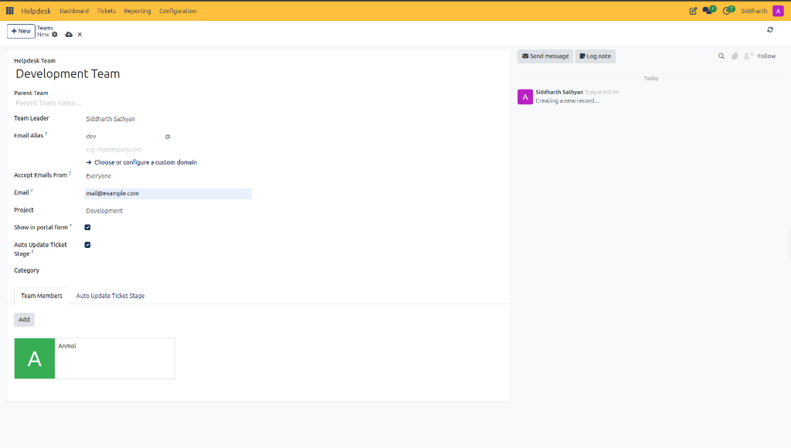
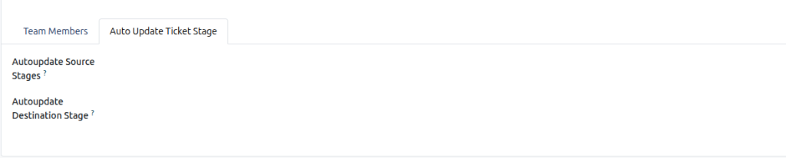
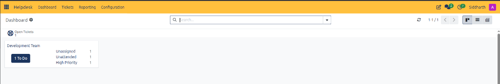

# Configure a Support Team and Automate Ticket Intake

Welcome to CURQ Helpdesk. While [Log and Resolve Your First Helpdesk Ticket](./01-log-and-resolve-your-first-helpdesk-ticket.md) walked through logging and solving an individual ticket, enterprise support desks require structured functional teams to automate inquiry routing, email ingestion, and customer communication.

In this tutorial, you will configure a dedicated functional support department *(e.g., `Development Team`)*, attach an inbound email alias, publish the team to your customer web portal, enroll team members, and configure automated ticket reactivation rules.

> **Prerequisites**
> * Helpdesk Manager or Administrator privileges in CURQ.
> * Internal staff profiles *(e.g., `John`)* configured as active users in CURQ.
> * An active project workspace *(e.g., `Development`)* in [**Projects**](../../Project/getting-started/01-create-and-manage-your-first-project.md) for cross-module task coordination.

---

## 1. Configure and Activate a Support Team

### 1.1 Access Helpdesk Team Configuration

1. In the top navigation bar, select **Configuration > Helpdesk Teams**.
2. Click **+ New** in the upper-left action bar.
3. CURQ presents the team configuration form.

---

### 1.2 Configure Team Identity, Inbound Alias, and Roster

Configure the operational parameters and communication routing on the main team form:

1. Specify department identifiers:
   * **Helpdesk Team**: Enter the functional department title *(e.g., `Development Team`)*.
   * **Team Leader**: Assign the supervisory lead responsible for team throughput and escalations.
2. Configure communication channels:
   * **Email Alias**: Specify the inbound mailbox prefix *(e.g., `dev`)*. Inbound emails sent to `dev@yourcompany.com` automatically generate new tickets assigned to this team.
   * **Show in portal form**: Check this box to expose the team as a selectable department on your public customer website portal.
3. Link project operations:
   * **Project**: Select the corresponding project workspace *(e.g., `Development`)*. New tickets linked to this team automatically inherit project task tracking.
4. Enroll specialists in the **Team Members** tab:
   * Click **Add a line**.
   * Select internal agents *(e.g., `Support Specialist` or `Lead Engineer`)* to grant queue access and dispatch eligibility.

> For a detailed explanation of team configuration fields, email alias parameters, and member roster controls, see [**Helpdesk Team Configuration Header Fields**](../settings-and-fields/02-helpdesk-team-field-definitions.md#1-helpdesk-team-configuration-header-fields) and [**Team Members Tab**](../settings-and-fields/02-helpdesk-team-field-definitions.md#21-team-members-tab).

---

### 1.3 Establish Automated Stage Reactivation Rules

Prevent dormant tickets from languishing when clients respond by configuring automated stage transitions:

1. On the team form, click the **Auto Update Ticket Stage** tab.
2. Configure the automated reactivation logic:
   * **Autoupdate Source Stages**: Select the waiting or paused stages *(e.g., `Awaiting`)*.
   * **Autoupdate Destination Stage**: Select the active operational stage *(e.g., `In Progress`)*.
3. How this functions in production: When a ticket sits in `Awaiting` waiting for customer input, any incoming email reply from the customer automatically moves the ticket back to `In Progress` and alerts the assigned specialist in real time.
4. Click the Save icon to commit the team configuration.

> For a detailed explanation of automated source and destination stage transitions, see [**Auto Update Ticket Stage Tab Field Definitions**](../settings-and-fields/02-helpdesk-team-field-definitions.md#22-auto-update-ticket-stage-tab).

---

### 1.4 Verify Team Activation on the Dashboard

1. In the top navigation bar, select **Helpdesk > Dashboard**.
2. Observe that CURQ dynamically creates a dedicated workload card for your new team:

3. Review the live team metrics:
   * **1 To Do**: Action button providing instant access to all open tickets requiring attention.
   * **Unassigned**: Highlights inquiries routed to the team that lack an individual assignee.
   * **Unattended**: Tracks tickets awaiting first response or internal follow-up.
   * **High Priority**: Identifies urgent inquiries requiring expedited SLA handling.

---

## Related Documentation

* [Log and Resolve Your First Helpdesk Ticket](./01-log-and-resolve-your-first-helpdesk-ticket.md)
* [Configure Helpdesk Teams and Routing](../task-guides/03-configure-helpdesk-teams-and-routing.md)
* [Navigate and Use the Helpdesk Dashboard](../task-guides/02-navigate-and-use-the-helpdesk-dashboard.md)
* [Understanding Support Teams, SLA Policies, and Escalation](../core-concepts/02-understanding-support-teams-sla-policies-and-escalation.md)
* [Helpdesk Team Field Definitions](../settings-and-fields/02-helpdesk-team-field-definitions.md)
